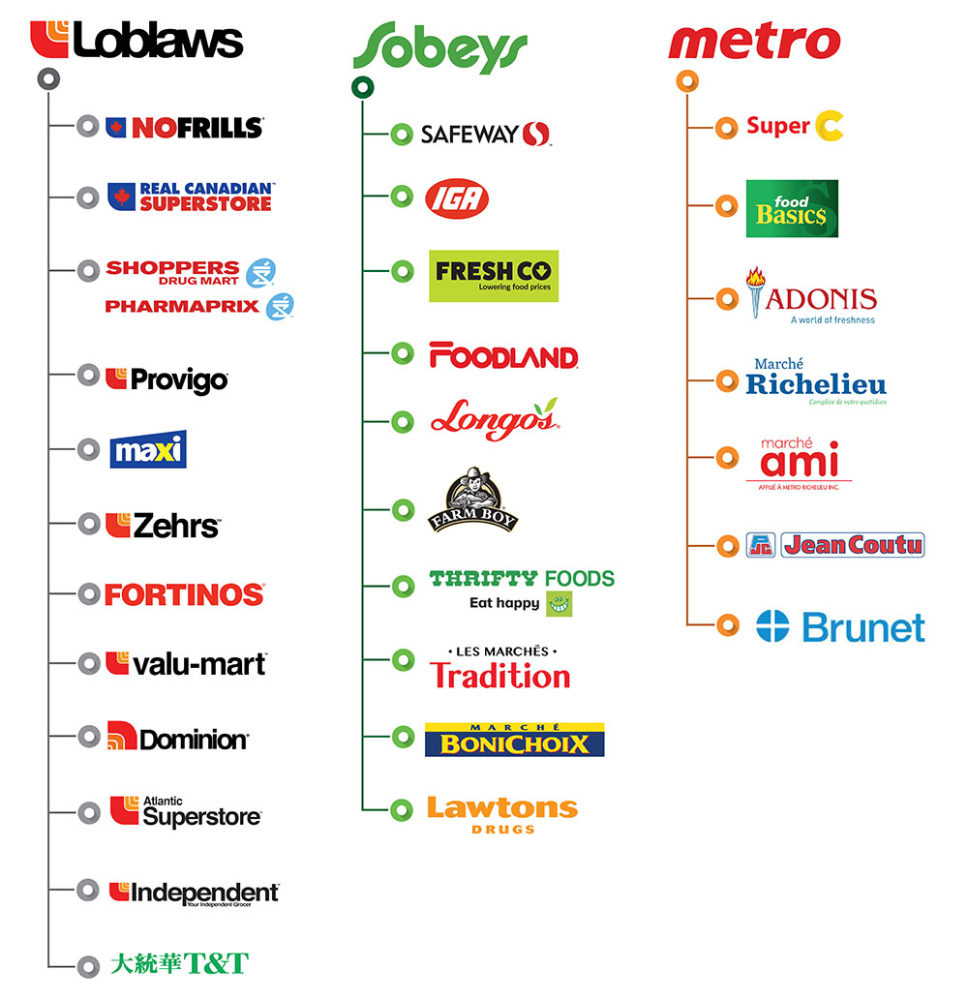

---
categories:
  - useful-tips/in-canada
date: 2026-07-22
description: Loblaw began in Toronto, Ontario, Canada, in 1919. Theodore Pringle Loblaw, known as T.P. Loblaw, and his business partner J. Milton Cork opened the first Loblaw Groceterias store in Toronto…
lang: en
last_updated: 2026-11-14
naver_date: 2026-07-22
naver_url: https://blog.naver.com/martin-lee/224353897543
tags:
  - Canada
  - grocery-stores
title: Canadian Grocery Stores — Loblaws, Sobeys, Metro, Pattison Food Group, Dollarama, Walmart, and Costco
translation_key: 2026-07-22-canadian-grocers
---

[https://competition-bureau.canada.ca/en/how-we-foster-competition/education-and-outreach/canada-needs-more-grocery-competition](https://competition-bureau.canada.ca/en/how-we-foster-competition/education-and-outreach/canada-needs-more-grocery-competition)

**Loblaws**

Loblaw began in Toronto, Ontario, Canada, in 1919. Theodore Pringle Loblaw, known as T.P. Loblaw, and his business partner J. Milton Cork opened the first **Loblaw Groceterias** store in Toronto. Unlike traditional grocery stores, where clerks fetched products for customers, they introduced a **self-service, cash-sales model** in which customers selected their own products and paid in cash. Lower operating expenses and the elimination of costs associated with selling on credit allowed them to offer lower prices, and customers responded enthusiastically.

Loblaw Groceterias grew rapidly, expanding beyond Ontario into New York State in 1924. By 1928, it had 69 stores and a headquarters and distribution warehouse considered state of the art at the time. When T.P. Loblaw died at age 60 in 1933, the chain had more than 150 stores. The familiar **Loblaws** name began appearing on store signs in 1939.

However, the Weston family, which controls Loblaw today, is not its original founding family. The Westons' business history goes back further, to 1882. Founder George Weston worked in Toronto as an apprentice baker and bread salesman before buying a bread delivery route from his employer and starting his own business. He subsequently grew Weston's Bread into Canada's largest baking business by the early twentieth century.

In 1924, his eldest son, Garfield Weston, became president of George Weston Limited. Garfield expanded his father's Toronto bakery into a food company operating across Canada and internationally. He began acquiring Loblaw shares in 1947, buying 100,000 shares, and George Weston Limited secured a controlling interest in Loblaw in the early 1950s. According to the official annual report, George Weston Limited acquired control of Loblaws Inc. in 1953, and the present-day **Loblaw Companies Limited** was established in 1956.

Loblaw later struggled with overexpansion and retail competition. A turning point came in the early 1970s when **W. Galen Weston**, the third generation of the Weston family, became involved in management. After becoming CEO in 1972, he closed unprofitable businesses and refreshed store designs and branding, returning Loblaw to growth. Through this process, Loblaw became a core asset of George Weston Limited and Canada's largest food retailer.

Private-label brands also played an important role in Loblaw's growth. In 1978, it launched **no name**, the low-price brand famous for its yellow packaging, and opened its first **No Frills** discount store that same year. In 1984, it introduced **President's Choice**, emphasizing quality and distinctive products. Today, the two brands serve different roles: no name focuses on low prices, while President's Choice emphasizes quality and new products.

Loblaw subsequently built a national network by acquiring regional retailers. It acquired Quebec's Provigo in 1998 and T&T Supermarket, Canada's largest Asian grocery chain, in 2009. Its 2014 acquisition of Shoppers Drug Mart transformed it from a supermarket company into a diversified retailer encompassing food, pharmacies, health, and beauty.

The Weston family still effectively controls Loblaw. As of early 2026, Galen G. Weston owns or controls **approximately 59.5% of George Weston Limited's shares** through companies he controls. George Weston Limited, in turn, holds approximately 52.6% of Loblaw Companies Limited.

**Galen G. Weston** currently chairs the board of Loblaw Companies Limited and serves as both chairman and CEO of its parent, George Weston Limited. Professional executive **Per Bank**, as president and CEO, is responsible for Loblaw's day-to-day operations.

Separate leaders manage its major business divisions.

Frank Gambioli: President of the conventional supermarket division

Melanie Singh: President of the discount division, including No Frills and Maxi

Tina Lee: CEO of T&T Supermarkets

Gregers Wedell-Wedellsborg: President of Shoppers Drug Mart

In other words, Loblaws and No Frills do not each have their own CEO. Under Loblaw's central leadership, division heads manage conventional supermarkets, discount stores, T&T, Shoppers Drug Mart, and other businesses.

Weston family

└ George Weston Limited — Food retail and real estate holding company

├ Loblaw Companies Limited — Food and pharmacy retailer

│　├ Loblaws — Conventional supermarkets

│　├ Loblaw City Market — Urban conventional supermarkets

│　├ Real Canadian Superstore — Large supermarkets and general discount stores

│　├ Real Atlantic Superstore — Large supermarkets in Atlantic Canada

│　├ Dominion — Supermarkets in Newfoundland and Labrador

│　├ No Frills — Discount supermarkets

│　├ Maxi — Discount supermarkets in Quebec

│　├ Provigo — Conventional supermarkets in Quebec

│　├ Fortinos — Full-service supermarkets in Ontario

│　├ Zehrs — Supermarkets in southwestern Ontario

│　├ Your Independent Grocer — Independently owned, community-oriented supermarkets

│　├ Valu-mart — Small supermarkets focused on smaller towns and local communities

│　├ T&T Supermarket — Asian grocery specialists

│　├ Wholesale Club / Club Entrepôt — Warehouse-format grocery wholesalers

│　├ Shoppers Drug Mart / Pharmaprix — Drugstores and pharmacies

│　├ Joe Fresh — Clothing and fashion brand

│　├ PC Express — Online ordering, pickup, and delivery platform

│　├ President's Choice — Premium private-label brand

│　├ no name — Low-price private-label brand

│　└ PC Optimum — Integrated points and loyalty program

│

└ Choice Properties REIT — Supermarket, industrial, and residential real estate investment company

**Sobeys**

Sobeys was founded by John William Sobey, generally known as J.W. Sobey. In 1907, he started a meat delivery business using a horse-drawn cart in Stellarton, Nova Scotia, Canada. He bought livestock from local farmers, transported it, and resold it. Beginning in 1924, his son, Frank H. Sobey, expanded the business from selling meat and a few vegetables into a full grocery store. In 1947, he opened the first modern Sobeys supermarket in Atlantic Canada, laying the foundation for today's chain.

Sobeys Inc. is currently a wholly owned food retail subsidiary of Empire Company Limited. Its major retail banners include Sobeys, Safeway, Thrifty Foods, Foodland, IGA, IGA Extra, FreshCo, Chalo! FreshCo, Lawtons Drugs, and Needs. It also operates the online grocery service Voilà. Empire's food retail division additionally includes Farm Boy, Longo's, and other businesses.

James M. Dickson currently chairs Empire Company Limited's board. Pierre St-Laurent serves as president and CEO of both Empire Company Limited and Sobeys Inc. He succeeded Michael Medline as CEO, effective immediately, on November 5, 2025.

Banners such as Sobeys, Safeway, Foodland, and IGA do not each have a separate CEO. They operate under Empire and Sobeys' integrated leadership. Julia Knox, as Chief Retail Officer and Chief Technology and Innovation Officer, oversees retail operations, the supply chain, and central kitchens. Each region and retail banner has its own operations and store management organization.

According to Empire's official disclosures, as of May 2, 2026, its major supermarket banners had 234 Sobeys stores, 132 Safeway stores, 140 IGA Extra stores, 189 IGA stores, 52 Farm Boy stores, 43 Longo's stores, 26 Thrifty Foods stores, and 209 Foodland stores. Quebec banners Bonichoix and Les Marchés Tradition had 45 and 81 locations, respectively. There were also four Kim Phat Asian grocery stores and two Pete's Frootique & Fine Foods specialty grocery stores.

The discount supermarket banners FreshCo and Chalo! FreshCo had a combined 160 locations. This total covers both banners: 108 in Ontario, six in Manitoba, five in Saskatchewan, 24 in Alberta, and 17 in British Columbia.

Beyond grocery stores, the Sobeys group operates various other retail formats. It had 74 Lawtons Drugs pharmacies, eight Rachelle-Béry health and organic specialty stores in Quebec, and 77 Needs convenience stores in Atlantic Canada. Quebec convenience store banners Boni-Soir and Voisin had 282 and 80 locations, respectively. The figures also included six Cash & Carry wholesale stores, 359 retail fuel locations, and 97 liquor stores.

Voilà is not a conventional physical supermarket banner but an e-commerce service handling online orders and delivery. It operates through central customer fulfilment centres, or CFCs, regional delivery hubs, and delivery and pickup networks based at existing stores.

Overall, Sobeys has grown from a small meat delivery business in Nova Scotia in 1907 into a national retailer that owns or operates more than 1,600 food retail stores through company ownership, franchises, and affiliates across all ten Canadian provinces.

**Current Scale**

As of January 3, 2026, Loblaw operates or manages a total of 2,504 stores in Canada. These include 566 corporate-owned stores, 562 franchise stores, and 1,376 Shoppers Drug Mart and Pharmaprix pharmacies operated by independent pharmacists.

Including pharmacy clinics and other healthcare facilities, Loblaw describes its total network as more than 2,800 stores, pharmacies, and clinics. Together, its direct employees and franchise and pharmacy personnel number approximately 220,000. About 90% of Canadians live within 10 km of a Loblaw-affiliated store.

Loblaw's food and pharmacy retail revenue in 2025 was approximately CAD 63.9 billion. Its food, pharmacy, and financial services businesses generate more than one billion customer transactions annually. PC Optimum also has more than 18 million active members.

**Empire Company Limited**

└ **Sobeys Inc.**

Sobeys — Conventional supermarkets

Safeway — Conventional supermarkets

Thrifty Foods — Conventional supermarkets

FreshCo — Discount supermarkets

Lawtons Drugs — Drugstores and pharmacies

Foodland — Community-oriented neighborhood supermarkets

IGA — Independently owned supermarkets tailored to local communities

Voila — Online ordering and delivery platform

Needs — Convenience store banner in Nova Scotia, New Brunswick, PEI, and Newfoundland

**Metro**

Unlike Sobeys, METRO did not grow around a single founder or founding family. Its history began in Quebec, Canada, in 1947, when independent grocery operators established a joint purchasing organization called Magasins Lasalle Stores. Small grocers struggled to compete on price with large retail chains, so owners joined forces to buy goods together and sell at prices comparable to the major chains. METRO began as an alliance of independent merchants rather than one individual's venture.

In 1956, the organization “groupe des épiciers Metro” and the Metro banner were created. In 1972, the company changed its name to Marchés d'Aliments Metro and began operating modern supermarket-format stores in earnest. METRO subsequently expanded through mergers with regional grocery distribution organizations. It listed on the Montreal Stock Exchange in 1986. That same year, it acquired pharmaceutical distributor McMahon Distributeur Pharmaceutique, entering pharmacy and pharmaceutical distribution alongside food retail.

A series of acquisitions played a major role in making METRO the large retailer it is today. In 1987, it strengthened its discount supermarket business by acquiring Super Carnaval stores. In 1992, it acquired the leases and business rights of 48 stores from Steinberg, then one of Quebec's leading supermarket companies. In 1999, it expanded beyond Quebec by acquiring Loeb and 41 supermarkets in Ontario.

One of its most important turning points was the CAD 1.7 billion acquisition of A&P Canada in 2005. This gave METRO a strong retail network in Ontario as well as Quebec, establishing it as a major supermarket company in Canada's two largest food markets. Many of today's Metro and Food Basics stores in Ontario emerged from these acquisitions and subsequent banner reorganizations.

Alongside conventional supermarkets and discount stores, METRO continued adding specialty food brands. It acquired a 55% interest in Adonis, a supermarket specializing in Mediterranean and Middle Eastern foods, in 2011, then purchased the remaining interest in 2017. It invested in Quebec bakery brand Première Moisson in 2014 and acquired the founding family's remaining interest in 2019.

The 2018 acquisition of pharmacy chain Jean Coutu Group significantly changed METRO's business structure. It transformed METRO from a supermarket company into a diversified retailer spanning food, pharmacies, and health and beauty products. Pharmacy banners including Jean Coutu and Brunet now form the core of METRO's pharmacy business.

METRO Inc.'s major food banners currently include Metro, Metro Plus, Super C, Food Basics, Marché Richelieu, Marché Ami, Adonis, and Première Moisson. Metro and Metro Plus are conventional supermarkets; Super C and Food Basics are discount supermarkets. Marché Richelieu and Marché Ami are closer to networks of neighborhood grocery stores centered on independent owners and local communities.

METRO currently operates or supplies approximately 1,000 food stores and 640 pharmacies. Annual revenue exceeds CAD 22 billion, and it employs more than 97,000 people, primarily in Quebec and Ontario. Its food stores include 316 Metro and Metro Plus locations, 119 Super C locations, 153 Food Basics locations, 53 Marché Richelieu locations, and 323 Marché Ami locations.

METRO has no controlling founding family comparable to the Sobey family. It is listed on the Toronto Stock Exchange and run by professional management and a board of directors. As of July 2026, Pierre Boivin is chairman, and Eric La Flèche is president and CEO. Eric La Flèche has led the company for more than 18 years, since 2008, and is scheduled to retire on September 27, 2026. Current Chief Operating Officer Marc Giroux is then expected to become president and CEO, while Eric La Flèche moves to the role of board chairman.

METRO's history is therefore not the story of one family growing a company across generations. It is the story of independent grocery operators joining forces to compete with large chains, then developing their alliance into a leading Canadian food and pharmacy retailer through mergers, a public listing, regional expansion, and major acquisitions. If Sobeys illustrates the growth of a family business, METRO illustrates how an alliance of independent merchants grew into a large corporation.

**METRO Inc.**

Metro / Metro Plus — Conventional supermarkets

Super C — Discount supermarkets focused on Quebec

Food Basics — Discount supermarkets focused on Ontario

Adonis — Mediterranean and Middle Eastern grocery specialists

Première Moisson — Bakery and café brand

Les 5 Saisons — Upscale grocery stores

Marché Richelieu — Community-oriented neighborhood supermarkets

Marché Ami — Small neighborhood grocers centered on independent owners

Servi Express — Convenience store banner

Dépanneurs GEM — Quebec convenience store banner

Jean Coutu — Drugstores and pharmacies

Brunet — Drugstores and pharmacies

Brunet Plus — Large-format Brunet pharmacies

Brunet Clinique — Small pharmacies focused on health consultations

**The Jim Pattison Group**

The Jim Pattison Group was founded by James Allen Pattison, usually known as Jim Pattison or Jimmy Pattison. Born in Saskatoon, Saskatchewan, in 1928, he moved to Vancouver with his family in 1935. While attending UBC, he washed cars at used-car dealerships and sold cars to students to cover his tuition and living costs. Having shown a talent for car sales, he left university shortly before finishing his degree to focus on the business.

In 1961, at age 32, Jim Pattison acquired a General Motors dealership selling Pontiac and Buick vehicles in Vancouver. He **borrowed CAD 40,000** from the Royal Bank of Canada, putting up his home and life insurance as collateral. This dealership was the starting point of today's Jim Pattison Group.

The business did not remain limited to cars. He entered media by acquiring Vancouver radio station CJOR in 1965, then acquired an outdoor advertising business in 1967. In 1968, he moved into food retail by buying grocery company Overwaitea. He continued expanding through acquisitions including seafood company Canfisco, Ripley's Believe It or Not!, Guinness World Records, packaging businesses, agricultural equipment and truck dealerships, real estate, and forestry-related businesses.

The Jim Pattison Group currently operates approximately 20 divisions across **eight major industries**: automotive and agricultural equipment; food, beverages, and pharmacies; media, advertising, and signage; entertainment; packaging; forestry and ports; distribution; and real estate. Major businesses include Jim Pattison Auto Group, Pattison Food Group, Pattison Media, Pattison Outdoor Advertising, Ripley Entertainment, Guinness World Records, Great Wolf Lodge, Genpak, and Jim Pattison Developments.

According to the group's official materials, annual revenue is approximately **CAD 20 billion**, with about **57,000 employees**. Headquartered in Vancouver, it operates internationally, particularly in Canada and the United States. Another defining characteristic is that it is a large privately held group owned by Jim Pattison, rather than a publicly listed company.

The group's grocery business traces its roots to **Overwaitea**, not a store Jim Pattison founded himself. Overwaitea began as a grocery store opened by R.C. Kidd in New Westminster, BC, in 1915. The Jim Pattison Group entered the grocery market by acquiring Overwaitea in 1968.

The **Save-On-Foods** banner launched in 1982 through conversions of some stores. In 1985, a large Save-On-Foods store with a pharmacy opened in Richmond. A proprietary points program introduced in 1993 evolved into today's **More Rewards**. In 2018, the company name Overwaitea Food Group was also changed to Save-On-Foods.

**Pattison Food Group** was formed in 2021 to manage the various grocery, pharmacy, and wholesale businesses under one structure. Thus, The Jim Pattison Group is the overall corporate group, while Pattison Food Group is the division responsible for food, pharmacies, and wholesale.

Save-On-Foods is Pattison Food Group's largest and best-known banner. PriceSmart Foods is less a conventional discount store than a supermarket specializing in Asian groceries while offering both Eastern and Western foods. Urban Fare and Meinhardt serve the relatively upscale grocery market. Buy-Low Foods targets low-price and local markets, while Choices Market and Nature's Fare focus on organic and health foods.

Pattison Food Group currently operates **11 retail banners and more than 300 food and pharmacy stores**, employing approximately 30,000 people. Beyond its own stores, wholesale businesses such as Associated Grocers, Van-Whole Produce, and Bulkley Valley Wholesale provide products and distribution services to approximately **1,900 supermarkets, convenience stores, and specialty food stores** across Canada.

As of 2026, Jim Pattison is 97 and remains officially listed as The Jim Pattison Group's **sole owner, chairman, and CEO**. **Ryan Barrington-Foote** serves as group president, supporting day-to-day management and growth across its divisions.

At Pattison Food Group, president **Jamie Nelson** is responsible for overall management and strategy across all food banners, including Save-On-Foods. **Paul Cope**, Senior Vice-President of Retail Operations, manages grocery operations including Buy-Low Foods, Nesters Market, and Quality Foods. Rather than each banner having its own CEO, Pattison Food Group's integrated leadership divides responsibility for the different banners.

Unlike the Sobey or Weston families, it is still difficult to describe The Jim Pattison Group as **a “Pattison family business” jointly controlled by several generations**. Jim Pattison still owns it personally and exclusively, and his children do not feature prominently among the publicly identified senior leaders. Because it is privately held, detailed plans for ownership succession and future leadership are not publicly disclosed either.

**The Jim Pattison Group**

**└ Pattison Food Group Ltd.**

Save-On-Foods — Conventional supermarkets focused on Western Canada; the group's flagship banner

PriceSmart Foods — Supermarkets with an expanded Asian grocery selection

Buy-Low Foods — Low-price supermarkets focused on small towns and local communities

Nesters Market — Neighborhood supermarkets in tourist destinations and urban areas

Quality Foods — Regional supermarkets focused on Vancouver Island

Urban Fare — Upscale urban grocery stores

Choices Market — Organic and natural food supermarkets

Nature's Fare Markets — Health and organic food specialists

Meinhardt Fine Foods — Specialty imported foods and prepared meals

Everything Wine — Specialty liquor stores

Pure Integrative Pharmacy — Pharmacy banner

More Rewards — Integrated points and loyalty program

Western Family — Private-label brand

Ranking by asset size: Loblaw / George Weston > Jim Pattison > Empire / Sobeys > Metro

**Dollarama**

**Walmart / Costco**

#Canada

#grocerystores
