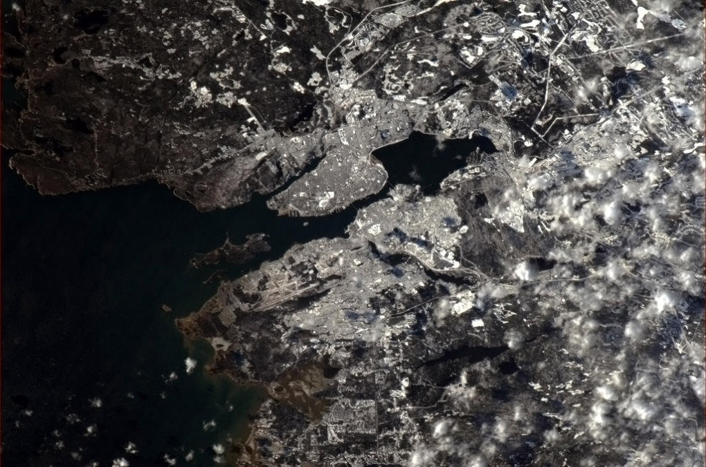
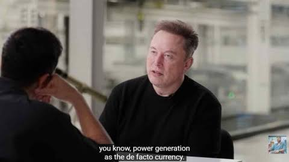

---
categories:
  - useful-tips/in-canada
date: 2026-09-24
description: Korea ranks first in quite a few things, whether from the top or the bottom.
lang: en
last_updated: 2026-11-14
naver_date: 2026-09-24
naver_url: https://blog.naver.com/martin-lee/224421525523
tags:
  - Life in Canada
title: Things Canada Ranks First In
translation_key: 2026-09-24-where-canada-ranks-first
---

<figure data-image-caption="true">
  
  <figcaption><a href="https://www.ogq.me/backgrounds/1463859">© CoolPubilcDomains, Source: OGQ</a></figcaption>
</figure>

Korea ranks first in quite a few things, whether from the top or the bottom.

University enrollment, birth rates, suicide rates, smartphone penetration, and so on.

This time, let us look at companies.

When you think of Korea, **memory semiconductors and OLED** naturally come to mind.

You have probably heard that the two giants, **Samsung and SK hynix**, keep the Korean economy going.

They are supported by shipbuilders such as **HD Hyundai Heavy Industries, Samsung Heavy Industries, and Hanwha Ocean**.

These are large companies whose names most people have heard.

Another company is **Korea Zinc**.

It operates the vast Onsan Smelter in the mountains, the world's largest single nonferrous metal smelter.

Among individual smelters, it ranks first globally in both zinc and lead production.

It produces more than one million tonnes of nonferrous metals annually.

---

<figure data-image-caption="true">
  
  <figcaption><a href="https://www.ogq.me/backgrounds/1459671">© CoolPubilcDomains, Source: OGQ</a></figcaption>
</figure>

Now, let us see what Canada ranks first in.

It has many lakes. According to government data, there are approximately 870,000 lakes larger than 0.1 km^2.

It has the world's largest operating nuclear power plant, **Bruce Nuclear Generating Station**, which supplies approximately 30% of Ontario's electricity. Canada's key industries are energy, mining, agriculture, and food.

The TSX lists many mining companies exploring for resources such as gold, copper, uranium, lithium, nickel, silver, and rare earths.

**Potash, or potassium chloride**, stands out in particular. Saskatchewan holds nearly half the world's potash reserves.

**Production: 32.8% of global production**

**Exports: 38.7% of global exports**

**Reserves: approximately 1.1 billion tonnes**

**Potash is one of the three essential nutrients—nitrogen, phosphorus, and potassium—used to improve crop yields and quality. More than 90% of U.S. fertilizer uses imported Canadian potash.**

Major companies include **Nutrien** and **The Mosaic Company**.

Next is **uranium**.

Canada ranks second to Kazakhstan in production and exports.

Its commercial refinery is Cameco's Blind River Refinery.

Major companies include Cameco and NexGen Energy.

True to its nickname as the land of maple leaves, Canada ranks first in maple syrup production.

It also ranks first in exports of canola oil, pulses, oats, and canary seed.

Canada is a large country geographically, but its strength also lies in supplying the world's basic resources, including energy, minerals, and food. As Elon Musk said, energy rather than money becomes most important in the great age of AI. Perhaps we can look forward to a day when Canada gets its chance to shine. At least until we go to Mars... For Canada, Alberta and Saskatchewan matter.
