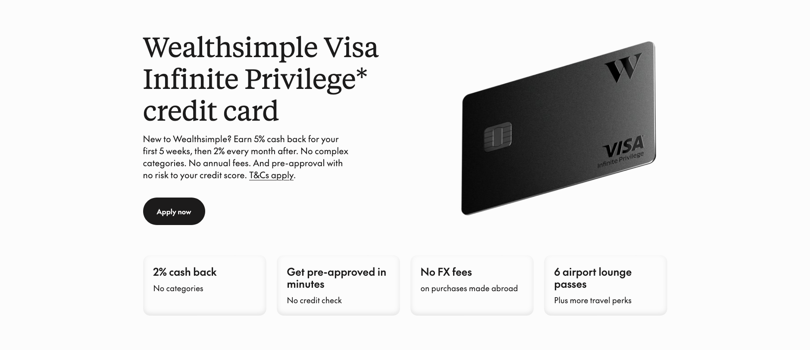
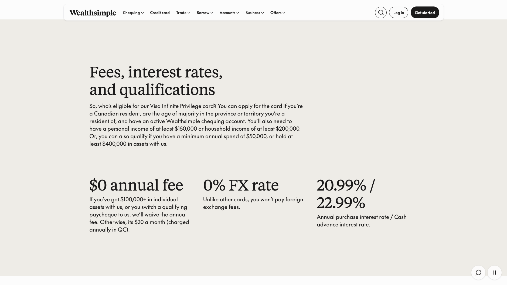

---
categories:
  - useful-tips/in-canada
date: 2026-11-10
description: Canadian credit card recommendations
lang: en
last_updated: 2026-11-11
tags:
  - canada
  - credit-card
  - bank
title: Canadian Credit Card Recommendations (2)
translation_key: credit-card-recommend-2
---

## Introduction

> **Affiliate disclosure:** This post includes the author's referral links. If a card application through one of these links is approved, the author may receive reward points. The reader's card costs do not depend on whether they use a link, and the possibility of compensation does not change the criteria used to evaluate the cards. Benefits and fees may change, so check the official terms before applying.

In my previous post, [Canadian Credit Card Recommendations](https://0xnefertt.github.io/ko/blog/category/useful-tips/in-canada/credit-card-recommend/), I recommended the American Express Cobalt, which I still use and enjoy. I recently got another card, so I am writing about it again.

As I mentioned before, I recommend getting a credit card with better terms rather than simply using one from a major bank such as RBC, CIBC, TD, Scotiabank, or BMO. My reasons are the long-term outlook and convenience. Working holiday participants and international students who have recently arrived in Canada often open bank accounts through promotions recommended by blogs and communities. These have advantages: meeting a few conditions can earn a small cash reward or a gift, and newcomers may have their account fees covered. But if you plan to keep an account for a long time, would it not be better to choose a bank with no account fees from the start? And how convenient would it be to open or close an account without visiting a branch?

## Wealthsimple Visa Infinite+

The credit card I want to recommend today is the [**Wealthsimple Visa Infinite+**](http://wealthsimple.com/invite/JVU4P0). To qualify, you must have a Wealthsimple account and meet at least one of the following conditions.

\- Personal annual income of at least $80,000  
\- Household annual income of at least $150,000  
\- Assets in savings and investments of at least $300,000  
\- Annual card spending of at least $25,000

These may be a little difficult for a newcomer who has just settled in. But if you are employed, have a formal room-rental agreement, and pay rent monthly, getting this card should not be too difficult. (If you have been paying rent by bank e-transfer, using a platform called [Chexy](https://app.chexy.co/join/REF-EQLYVM) makes it easy to exceed $25,000 in annual spending.)

One advantage is **2% cash back on every purchase**. The Amex Cobalt I introduced before has different earning rates by category, so you need to keep checking and use it strategically. This card can be used freely across all categories. (And there are not even stores that refuse it.)

**Another advantage is that there are no foreign exchange fees.** Additional benefits include shopping and travel-oriented purchase protection, mobile phone damage and loss insurance, and travel insurance. I have not really used these yet, but there are various benefits. **The fee is $20 per month.** However, it can be waived if you hold $100,000 in your Wealthsimple account or set up direct deposits of at least $4,000 per month. (= Wealthsimple Visa Infinite Privilege tier)

Finally, one big advantage is that it is a **metal card**.

---

## Maximizing the Benefits

[wealthsimple.com/invite/JVU4P0](http://wealthsimple.com/invite/JVU4P0)

If you sign up for Wealthsimple through the referral link and get an eligible credit card, you can receive a total of 5% cash back for 30 days: the regular 2% plus an extra 3%.

_This is a referral link, and signing up may also provide benefits to the author._

---

In conclusion, living in Canada, I currently consider the **Amex Cobalt and Wealthsimple Infinite+** the best credit cards. If I were to lay out a strategy:

- Amex Cobalt: Grocery shopping, dining out...

- Wealthsimple Infinite+: Everywhere that does not accept Amex Cobalt

## Official Source

- [https://www.wealthsimple.com/en-ca/wealthsimple-visa-infinite-privilege-card](https://www.wealthsimple.com/en-ca/wealthsimple-visa-infinite-privilege-card)
