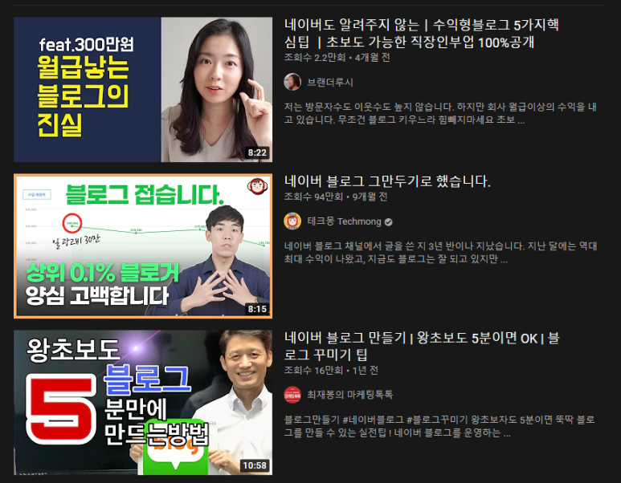

---
categories:
  - life-thoughts/opinions-is-my-own
date: 2021-03-23
description: ... 등등 아마도 이런 부류의 영상이나, 글들을 한번씩은 다들 봤을것임.
lang: ko
last_updated: 2026-11-14
naver_date: 2026-10-06
naver_url: https://blog.naver.com/martin-lee/224432479721
tags:
  - 첫글
  - 블로그
  - 개인적인생각
  - 고찰
  - 스마트블로그
  - blog
title: 21세기형 블로그에 대한 고찰
translation_key: 2021-03-23-blogging-in-the-21st-century
---

※ 본 글은 블로그 이전으로 인해 기존 글을 옮겨온 것입니다. (작성일: 2021년 3월 23일 20:46)

"1일 1포스팅"

"블로그로 월 100만원 벌기"

"블로그 조회수 늘리는 방법"

... 등등 아마도 이런 부류의 영상이나, 글들을 한번씩은 다들 봤을것임.

그리고 최근들어 블로그를 시작한 사람들도 많이 늘어났을것이고

" 블로그가 돈이 돼? 그거 유명한 사람들이 해서 그런거아니야??

난 시작하기에 재능도 없고 시작하기에 늦은것 같아... "

이런 생각을 갖고있으면 제발 한번쯤은 지금이라도 늦지 않았으니 일단 시도부터 해보길 바람

본인도 작년부터 생각만하고 미루다가 갑자기 생각나서 글쓰는중임

블로그는 돈이 될 수 있다.

정보화시대는 **정보 = 돈** 으로 직결되기 때문임

이 글의 핵심을 쉽게 말하자면 **'아는것이 힘이다'**

**'아는것 = 경험 = 지식 = 정보 = 돈'**

"나때는 말이야~" 하면서 꼰대 문화가 싫다고 혼자 꿋꿋이 버티다간 언젠가 도태됨..

불과 10년전만해도 스마트폰 못하는 어르신들이 있었지만,

몇년 뒤에는 전자기기가 없는 사람을 보고 의아해할만한 시대가 올것이다. 더 늦기전에 시작하자.

블로그, 유튜브 등등 본인만의 건물이 하나쯤은 있어야 할것이다.

어렸을 때 어른들이 괜히 공부해라 공부해라 잔소리 했던게 괜히 했던게 아니다.

그런 말을 듣고자란 아이들이 성인이 되서 변호사, 판사, 의사, 강사 같은거 해서 지금 다 부자됐다.

그렇다면 지금은?

인터넷만 할줄할면 공부 외에 요리를 할수있고, 컴퓨터를 배울수 있고, 노래도 배울수 있다.

학교에서 배우던 것 외에도 검색만 잘하면 왠만한 ㅈ문가 행세를 할수가 있다.

물론 방구석에서만이겠지만.

결론은 정보화시대에 정보가 너무나도 넘쳐 흐른다.

그렇다면 그것들 중 어떻게 받아들이고 해석해야하는지,

올바른 정보만을 걸러서 이해하고 내 것으로 만들수 있는 능력을 길러야한다.

자본주의에서도 피지배계층이었으나 남고싶지는 않다. 지배계층으로 올라설 수 있길 바라며...

그런것들을 기록하고 공유할 수 있는것이 21세기형 블로그이다.

#첫글 #블로그 #개인적인생각 #고찰 #스마트블로그 #blog
