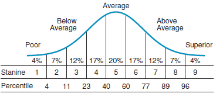
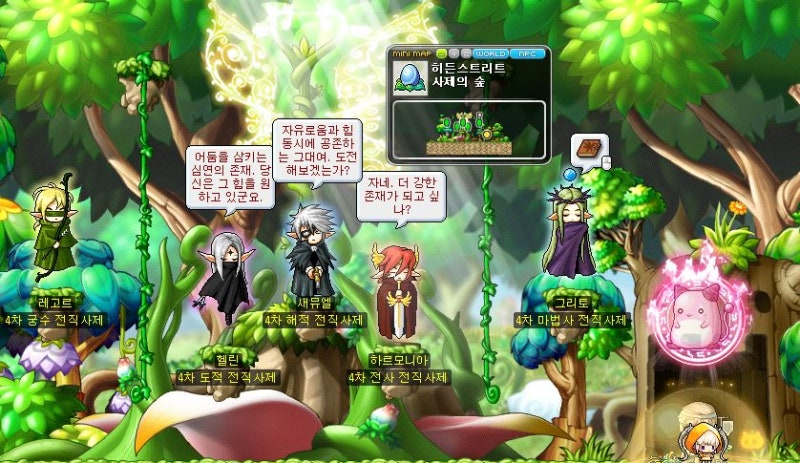
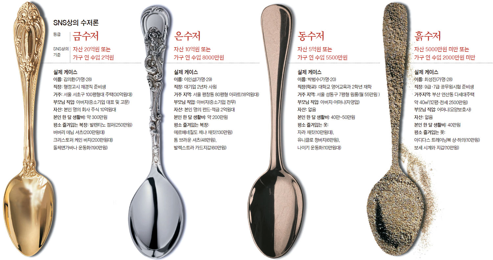

---
categories:
  - life-thoughts/opinions-is-my-own
date: 2021-06-05
description: 가장 먼저 "평범하다" 라는 뜻을 찾아보면 이렇게 나온다.
lang: ko
last_updated: 2026-11-14
naver_date: 2026-10-06
naver_url: https://blog.naver.com/martin-lee/224432480535
tags:
  - 인생
  - 한탄
  - 평범하게살기
title: 대한민국에서 평범하게 산다는 것이란?
translation_key: 2021-06-05-ordinary-life-in-korea
---

※ 본 글은 블로그 이전으로 인해 기존 글을 옮겨온 것입니다. (작성일: 2021년 6월 5일 19:30)

가장 먼저 "평범하다" 라는 뜻을 찾아보면 이렇게 나온다.

> 뛰어나거나 색다른 점이 없이 보통이다.
>
> 네이버 국어사전

영어로는 common 이고, 반의어로는 unique "특별하다" 이다.

대부분의 사람들은 평범하게 살기를 원한다.

_**대한민국에서 평범하게 살기란?**_

_**20대 전까지 공부를 해서 좋은 대학교 들어가고,**_

_**괜찮은 직장에 들어가서 첫 월급 받으면 부모님 선물도 드리고,**_

_**마음에 드는 배우자를 만나 결혼도 하고,**_

_**애도 낳고 행복하게 사는 것**_

이게 평범하게 살기의 기준이 될 수는 없지만

보통 대다수의 한국인이라면 이렇게 사는것이 기본이 되는 것 같다.

위에 적힌 예시대로 사는것이

누구한테 자랑할만한 것도 아니고 업적도 아닌 기본이다

메이플스토리 레벨 30찍고 2차 전직

60찍고 3차 전직

100찍고 4차 전직

이런 느낌으로...

살아가는데 조물주가 만들어놓은 현실세계에 기본 퀘스트랑 같다.

물론 일반인들 기준으로 적은거고

태어났을때부터 금수저 or 비브라늄 수저들은

애초에 캐릭터 생성부터가 다르기때문에 걱정도 안할거고

이 글을 어짜피 안볼것이다.

근데 지금 시점에서 평범하게 사는건 난이도가 너무 어려워졌다.

거꾸로 거슬러올라와보자.

대한민국에서 평범하게 살기란?

_**애 낳고 행복하게 사는 것 →**_ _**집 값 폭등으로 집 구하기 힘듬**_

_**마음에 드는 배우자를 만나 결혼 →**_ _**비혼주의자 많아짐, 남성 조건이 많아져서 연애 힘듬**_

_**괜찮은 직장 취직 →**_ _**일자리 감소 & 취업난**_

_**20대 전까지 공부를 해서 좋은 대학교 입학 →**_ _**사교육 없으면 힘든 입시 문제**_

서울이라면 처음부터 바로 컷이다.

차, 키, 외모, 성격, 직업 등등 따지는것들이 너무 많아졌기에

요즘 연애하기도 너무 힘들다.

번듯한 직장... 말 안해도 힘든거 다들 알테고...

결론적으로 말하자면

진짜 평범하게 살기도 ㄱㅐ힘든 세대가 왔다.

특히 남자라면 더욱 ㅈ빠지게 열심히 살아야한다...

그리고 평범하게 살기위해 노력하기보다

특별해지기 위해 노력하자

모두에게 평범해지는것보다

누군가에게 특별한 사람이 되는건 쉽다.

나도 모르게 특별한 사람들 속에서 평범하다고 느끼는 날이 올것이다

#인생 #한탄 #평범하게살기
