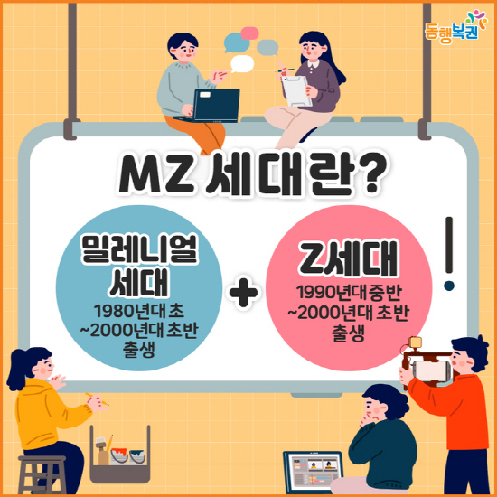
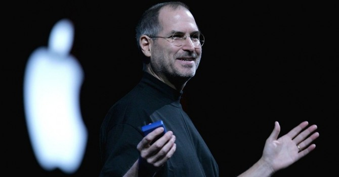
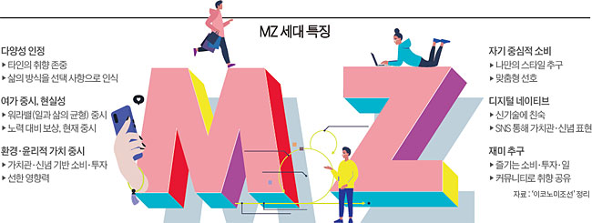

---
categories:
  - life-thoughts/opinions-is-my-own
date: 2021-06-05
description: 간단하게 이야기하자면 밀레니얼 + Z세대, 1980년 ~ 2010년 출생한 집단들을 일컫는 말이다.
lang: ko
last_updated: 2026-11-14
naver_date: 2026-10-06
naver_url: https://blog.naver.com/martin-lee/224432480025
tags:
  - mz세대
  - 밀레니엄세대
  - z세대
  - 세대차이
  - 블로그
  - 개인적인생각
  - 고찰
  - blog
title: MZ세대에 대한 개인적인 생각들
translation_key: 2021-06-05-thoughts-on-generation-mz
---

※ 본 글은 블로그 이전으로 인해 기존 글을 옮겨온 것입니다. (작성일: 2021년 6월 5일 18:30)

MZ세대란?

간단하게 이야기하자면 밀레니얼 + Z세대, 1980년 ~ 2010년 출생한 집단들을 일컫는 말이다.

(80년대 이전 세대들은 X세대, 베이비붐 세대가 있음)

나이로 보면 30대후반부터 10대까지라는 얘기다.

그렇게보면 사실 M세대랑 Z세대랑도 극심하게 세대 차이가 날법도 하다.

두 세대의 공통점은 전자기기, IT문화에 익숙하다 라는 점에서 세대차이가 별로 없다고 생각한다

그렇다면 **MZ세대와 기성세대 간에 차이가 발생하게 된 원인**이 전자기기의 발달로 찾아온것일까?

주관적인 생각이지만 그렇다고 생각한다.

같은 나이지만 주변 환경에 의해서도 받아들이는 생각도 다를거라 생각한다.

그리고 세대차이가 발생하는것에대해 부정적이지도 않다.

[원문 이미지](https://img7.yna.co.kr/etc/inner/KR/2017/05/16/AKR20170516076551033_02_i_P2.jpg)

예를 하나 들자면,

요즘 어린애들에게 책을 읽어주는 부모가 많을까? 유튜브로 아동용채널 틀어주는 부모가 많을까?

부모입장에서 얼마나 편해. 손가락 터치 몇번으로 애기 울음도 멈추고 돈도 안들고 시간도 줄고 말그대로 최고다.

옛날 자라온 아이들은 집에 하나씩은 위인전 세트 하나씩은 있었을거다. 그런걸 봤던 어린애들은 당연히 과학자, 대통령, 의사 같은 직업들이 멋있어 보였고 장래희망까지 가졌던 경우가 많았다.

지금은 유튜브로 세상을 배우기에 유튜브 크리에이터,BJ, 인플루언서 가 되고싶은 것이 아닐까 싶다.

<u>존재하지 않는 이미지입니다.</u>

물론 그 전에 진짜 전쟁을 겪었던 세대와 베이비붐 세대 간에서도 세대차이가 분명 있었을것이다.

진짜 먹고살기도 힘들었고, 산업화 시대, 금융위기를 겪으면서 공장에서 힘들게 땀흘려서만 돈을 벌수 있었던 세대들에게는 당연히 실내에서 일할수있었던 화이트칼라. 변호사, 의사 등등 사짜 직업 + 안정적인 수입과 적당한 업무인 공무원이 인기였다.

다시 MZ세대로 돌아와 정리해보자면,

**1\. 글 보다는 영상, 사진매체가 익숙하다**

**2\. 유행에 민감하며, 남들에게 인정받는것을 개인의 가치관보다 중요시 생각한다**

**3\. 자기 수준이 어느정도인지 모르는경우가 많다**

난 YOLO, FLEX 같은 단어 쓰는 요즘 젊은 세대들이 이해는 안되고 주변에 그런 사람들과 얘기 들어보면,

뭐 그들 나름대로의 생각과 사정이 있겠거니 하면서 듣는데 변명으로밖에 안보인다.

MZ세대가 듣기로는 최초로 부모보다 가난한 세대가 될수도 있다고 한다.

어찌되던간에 자연스러운 현상이지만

지금 세상은 이렇게 돌아가고있는것같다.

누군가는 이런 현상을 이해하고 미리 변화하고

준비를하는 사람들이 있을수도 있을것 같다

라는 생각에 글을 써봄.

#mz세대 #밀레니엄세대 #z세대 #세대차이 #블로그 #개인적인생각 #고찰 #blog
