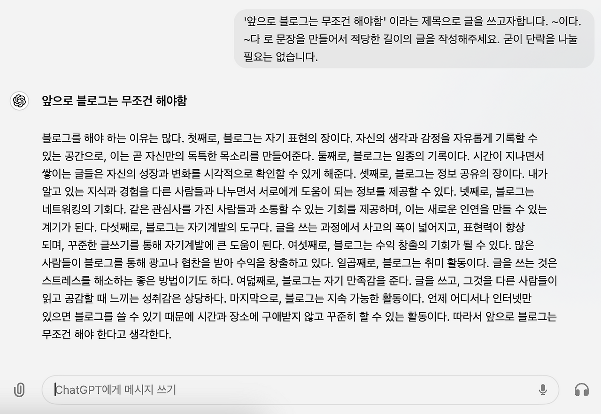
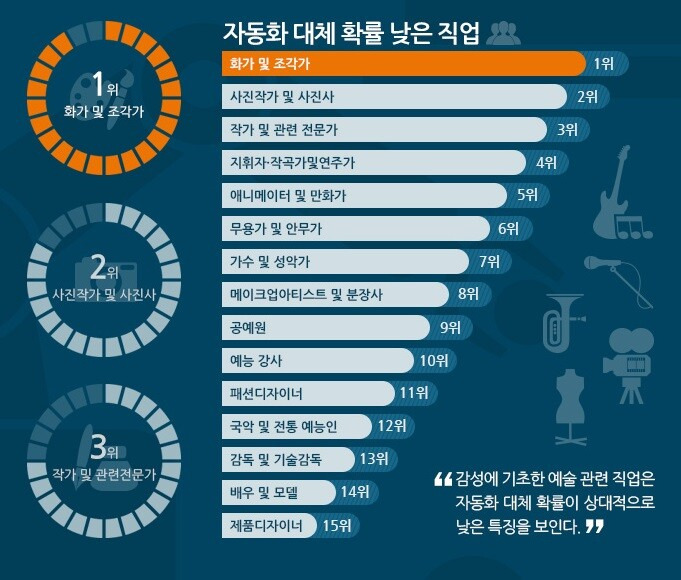

---
categories:
  - life-thoughts/opinions-is-my-own
date: 2024-05-28
description: 요즘 같은 시대에 블로그는 진짜 필수라고 생각한다.
lang: ko
last_updated: 2026-11-14
naver_date: 2026-09-26
naver_url: https://blog.naver.com/martin-lee/224422168433
tags:
  - 일상·생각
title: 본인이 흙수저라면 블로그는 무조건 해야함
translation_key: 2024-05-28-starting-a-blog
---

※ 본 글은 블로그 이전으로 인해 기존 글을 옮겨온 것입니다. (작성일: 2024년 5월 28일 22:16)

요즘 같은 시대에 블로그는 진짜 필수라고 생각한다.

요즘이 어떤 시대냐면,,

챗지피티한테 대충 글감 던져놓고 글 써달라고 하면 순식간에 글 뚝딱 만들어주고,

영어를 못해도 번역도 다 해주고, 심지어 코딩을 한번도 안해본 사람도 코딩할 수 있게해준다.

이렇게 챗지피티만 있으면 누구나 뭐든 시작할 수 있는 시대인데,

여기서 중요한 건 누구나 쓸 수 있는 '뻔한' 글을 작성하지 말아야 한다.

글을 쓰는데 있어서 어디선가 글을 참고해서 쓰는 거라면 본인 글이 뻔한 글이라는 건 쉽게 알 수 있다.

챗지피티는 인터넷에 있는 데이터들을 모은 자료들을 학습해서 대충 그럴싸한 글을 작성해 준다.

그렇기 때문에 앞으로 인터넷에 있는 글을 배껴 쓰거나 참고하거나 또는 내꺼인 척 하기는 해서는 안된다.

우연치 않게 겹치는 경우도 발생할 수 있지만,

사실 이 글에서 말하고 싶은 바는 '글을 작성할 때 도구가 아닌 자신의 뇌를 최대한 활용하라'다.

도구를 활용하는 것도 어느정도 능력이지만, 창작이란 인간만이 할 수 있고 앞으로도 그럴 것 같다.

AI 시대가 도래하면 대체하기 힘든 직업군 중 1~3위를 살펴보면 대부분 창작을 요하는 직업이다.

반대로 가장 먼저 대체될 직업군들은 단순 노동을 하는 직군들로 여기에는 변호사, 약사등 전문직도 포함되어 있다.

그래서 '블로그 글을 써서 기계한테 싸먹히지 말아라.' 라는 걸 말하고싶은 건 더욱 더 아니고,

앞으로는 **무언가를 창조해내는 능력**과 그로인해 **본인만의 색깔**이 들어있는 무언가를 찾아야한다.

한 문장으로 표현하면, 대체 불가능한 인간이 되어야 가 맞을 것 같다.

그리고 인터넷 세상에서 나를 어필하기 가장 쉬운 방법 중 하나가 블로그라고 생각한다.

필자 같은 경우 돌고 돌아서 다시 티스토리로 블로그를 시작하게 되긴 했는데 어디든 상관없다.

요즘 네이버 블로그도 에드포스트 달고 수익으로 월100 벌기 힘들고, 대부분 광고 수익이라고한다.

티스토리 같은 경우에는 구글 알고리즘탈 수 있도록 **사람들이 검색을 많이 하는 글을 '잘' 써야한다.**

이마저도 최근 구글 알고리즘이 바꼈다고 말이 많긴하지만...

이제 블로그를 접근할 때 예전이랑 다르게 '수익'보다는 '개인 브랜드(몸 값) 키우기'로 접근해야한다.

위에 사진은 2020년 당시에 금액이니까 지금은 저거보다 컷 높다고 생각하면 좋을 듯

열심히 살아서 가능한 건 흙수저 → 동수저 까지일거고 이마저도 진짜 죽어라 열심히 살아야 가능하다.

대한민국은 양극화가 더 심해져서 금수저나 은수저까지 가기 위해선 사업, 장사, 투자(부동산, 주식, 코인) 이 중에 하나는 잘 되야 가능하다.

이마저도 운이 따라줘야 가능한데,

전문성을 갖추거나 차별성이 있다면 그 운을 조금 더 앞 당길 수 있다.

그래서 가난하고 흙수저일 수록 본인만의 색을 보여줄 수 있는 블로그가 필요하다.

가장 중요한 건 꾸준히 양질의 글을 차곡차곡 쌓다보면 언젠가 빛을 바랄 수 있을 거라 믿어야 한다..

우리 모두 끝까지 가면 내가 다이겨 라는 마인드를 갖고 블로그를 시작해보자
