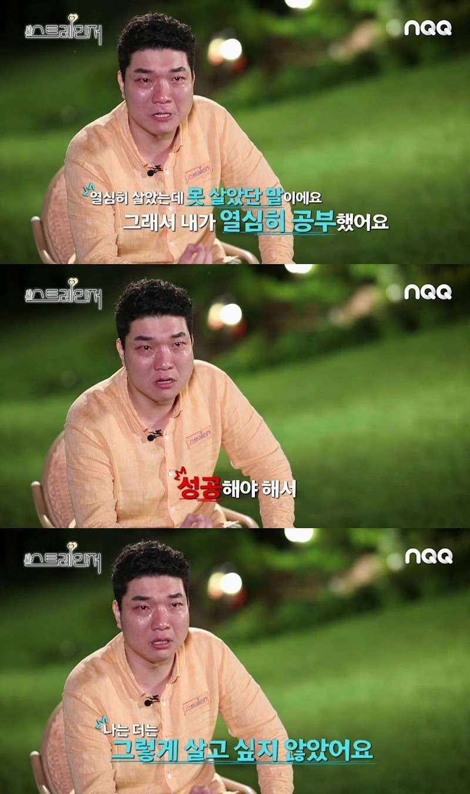

---
categories:
  - life-thoughts/opinions-is-my-own
date: 2024-05-30
description:
  사람이라면 누구에게나 24시간이라는 시간이 공평하게 주어진다. 진부한 말 일수도 있겠지만, 인생은 공평하지 않지만 시간은 공평하다. 그리고 흘러간 시간은 되돌릴 수 없다라는 말은 진리이다. 그렇기에 이러한 맥락으로 따져보자면,
  어제의 내가 오늘의 나를 만든다…
lang: ko
last_updated: 2026-11-14
naver_date: 2026-09-26
naver_url: https://blog.naver.com/martin-lee/224422166659
tags:
  - 일상·생각
title: 최고가 되겠다는 마음가짐으로 치열하게 살아야함
translation_key: 2024-05-30-aiming-for-the-best
---

※ 본 글은 블로그 이전으로 인해 기존 글을 옮겨온 것입니다. (작성일: 2024년 5월 30일 00:36)

사람이라면 누구에게나 24시간이라는 시간이 공평하게 주어진다. 진부한 말 일수도 있겠지만, 인생은 공평하지 않지만 시간은 공평하다. 그리고 흘러간 시간은 되돌릴 수 없다라는 말은 진리이다. 그렇기에 이러한 맥락으로 따져보자면, 어제의 내가 오늘의 나를 만든다. 지난 날들의 나의 행동과 생각들이 모여 지금의 내가 있고 지금 하고 있는 것들이 미래의 나를 형성하게 된다. 세상이 멈추지 않는 한 시간은 계속해서 흘러가기에 지금 이 순간이 가장 젊었을 때이자 소중한 순간임을 인지해야한다. 그렇기 때문에 매 순간을 소중히 생각하고 열심히 살아야 한다.

시간을 허투루 쓰지 않아야 한다는 건 많은 사람들이 이미 알고 있지만 나에게 있어서 시간은 공짜로 받은 선물이자 무한정으로 받을 수 있다라는 생각에 시간을 소중히 생각하지 않게 되는 경우가 허다하다. 특히, 핸드폰으로 하는 활동 중 SNS나 유튜브 시청이 시간을 허송세월 보내게되는 경우 중 하나인 것 같다.

시간을 효율적으로 사용하는 방법은 여러 가지다. 돈이 많다면 누군가의 시간을 돈으로 사기도 한다. 또한, 누군가 시간을 들여 습득한 지식들을 돈을 주고 사는 것도 그 사람이 공들였던 시간을 사는 행위의 일부이다. 시간을 잘 활용하는 방법 중 가장 가성비 좋은 방법은 그들만의 리그에 들어가는 것이다. 소위말해 주변 환경이 달라져야한다는 것이다. 어짜피 24시간 중 똑같이 8~10시간 쓰는 거 이왕이면 더 똑똑한 사람들하고 보내는 것이 훨씬 좋다 이거다. 그들만의 리그에 들어서서 많은 것을 경험하고 새로운 것들을 배울 수 있다. 그래서 기를 쓰고 좋은 대학을 나오려하고 사다리 계층에서 위로 올라가고자 하는 것이 아닐까 싶다.

언제나 최고가 되겠다는 마음가짐을 굳게 갖자.
