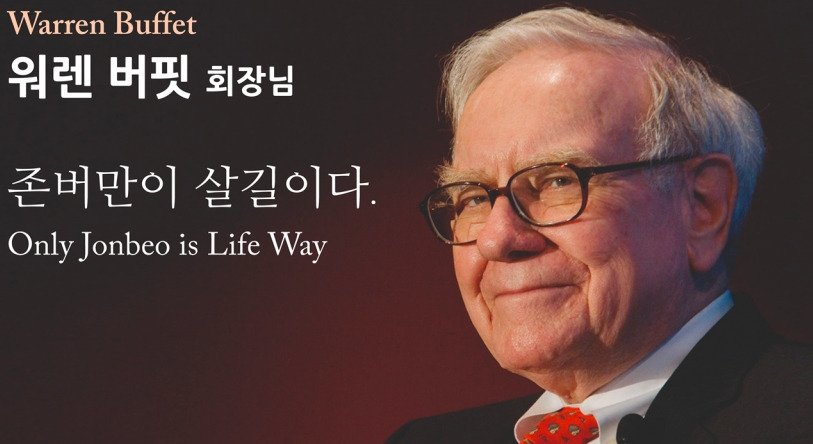

---
categories:
  - life-thoughts/opinions-is-my-own
date: 2024-05-31
description:
  인생은 무수히 많은 선택과 결정의 연속이다. 선택이 없는 삶은 재미가 없다. 인간이라면 선택에 기로에 섰을 때 최고의 선택을 하기를 원한다. 하지만, 선택 과정에서 내가 하는 선택이 최고의 결과를 가져올지는 예측하기 힘들다.
  그리고 하나를 선택하면 다른 하나…
lang: ko
last_updated: 2026-11-14
naver_date: 2026-09-26
naver_url: https://blog.naver.com/martin-lee/224422166224
tags:
  - 일상·생각
title: 버틴다고 해서 모든일이 저절로 해결되지 않는다.
translation_key: 2024-05-31-enduring-and-solving
---

※ 본 글은 블로그 이전으로 인해 기존 글을 옮겨온 것입니다. (작성일: 2024년 5월 31일 23:50)

인생은 무수히 많은 선택과 결정의 연속이다. 선택이 없는 삶은 재미가 없다. 인간이라면 선택에 기로에 섰을 때 최고의 선택을 하기를 원한다. 하지만, 선택 과정에서 내가 하는 선택이 최고의 결과를 가져올지는 예측하기 힘들다. 그리고 하나를 선택하면 다른 하나는 포기해야하기 때문에 분명 선택하지 못한 것에 대한 후회나 미련은 남아있기 마련이다.

선택을 해야하는 상황을 두려워하지말고 즐길줄 알아야한다. 그리고 후회는 항상 뒤늦게 찾아오기 때문에 후회라는 감정에 휘말려서 선택을 두려워해서는 안된다. 본인 스스로 최대한 후회라는 감정을 멀리하고 최대한 늦게 찾아올 수 있도록 노력해야한다. 후회라는 감정을 다스리는 방법을 배운다면 그것은 더 좋은 역할로써 지금의 상황을 극복할 수 있는 능력을 만들어낸다.

선택해야하는 순간을 방관하지마라. 당신이 무슨 선택을 하던 그 선택은 최고의 결정을 가져다 줄 것이다.
