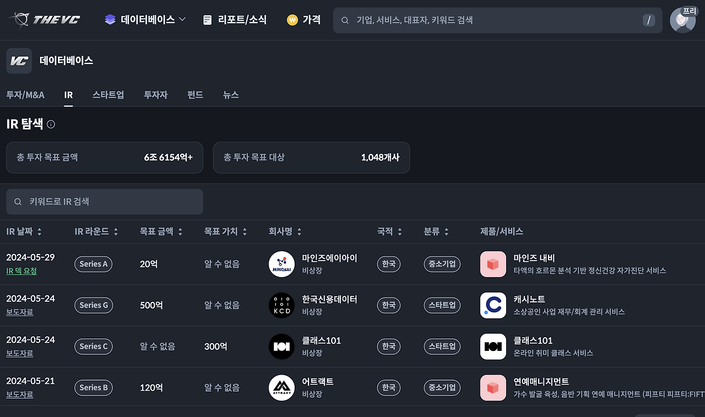

---
categories:
  - life-thoughts/opinions-is-my-own
date: 2024-06-01
description: 오늘 블로그 주제로 어떤 글을 써야할지 찾아보다가 우연히 VC 관련 글이 눈에 들어왔다.
lang: ko
last_updated: 2026-11-14
naver_date: 2026-09-26
naver_url: https://blog.naver.com/martin-lee/224422165830
tags:
  - 일상·생각
title: 돈은 어떻게 버는가
translation_key: 2024-06-01-how-money-is-made
---

※ 본 글은 블로그 이전으로 인해 기존 글을 옮겨온 것입니다. (작성일: 2024년 6월 1일 14:19)

오늘 블로그 주제로 어떤 글을 써야할지 찾아보다가 우연히 VC 관련 글이 눈에 들어왔다.

1\. VC는 벤처캐피탈, 투자 심사역 혹은 투자자를 의미한다. 즉, VC들은 초기 스타트업(혹은 기업)을 발굴하고 투자하여, 스타트업의 성장을 돕고 더 큰 수익을 얻어내는 것이 주 역할이다. 코인이랑 많이 비슷하다는 느낌을 받았다.

2\. 그렇다면, VC들은 투자를 할 때 어떤걸 주의깊게 보는걸까? 다양한 요소들이 있을 수 있겠지만 결국에는 회사가 돈을 벌어다 줄 수 있는지에 대한 능력일 것이다.

3\. 더 브이씨는 여러 VC 및 국내 스타트업 투자 동향을 파악할 수 있다는 홈페이지이다. 리스트 중 몇개는 들어본 적 있는 회사인데, 돈을 잘 벌고있어서 투자를 안받아도 되는줄 알았는데 아닌가보다.

4\. 돈을 어떻게 벌고 있는가에 대해서 공부하다보면 사는데 있어서 어느정도 도움이 될 수 있을거라는 믿음이 생겼다. 물론, 지금 당장 창업을 하고 싶단 생각과 계획은 없겠지만 사는데 있어서 투자는 계속해서 할 것 같으니깐 말이다.

5\. 이러한 관점에서 계속해서 나의 생각을 적어나가는 블로그를 만들어갈 것이고 이를 통해서 나는 어떤 포지션에 위치할 수 있는가? 에 대해서 답을 찾아나갈 예정이다.

6\. 어떤 포지션에 있던 돈은 사람을 움직일 수 있는 힘을 가지고 있다. 그렇기 때문에 돈의 흐름에 대해서 알아두어야한다.

7\. 가장 가까이 있는 회사 혹은 지금 이용하고 있는 서비스가 어떻게 돈을 벌고 있는지에 대해서 생각해보자.
