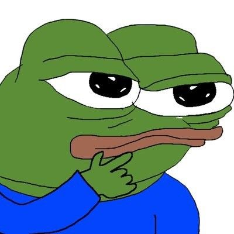

---
categories:
  - life-thoughts/opinions-is-my-own
date: 2024-06-06
description:
  '''인생은 선택과 결정의 연속이다'' 라는 말이 있다. 그리고 누구나 살다보면 한번쯤은 선택 과정에서 "할까? 말까?" 고민해본 경험이 있을 것이다. 오늘은 이 고민에 대해서 명쾌하고 빠른 결정을 내릴 수 있도록 어떤 방법이
  있을까에 대해 나의 생각을 글로 기록…'
lang: ko
last_updated: 2026-11-14
naver_date: 2026-09-26
naver_url: https://blog.naver.com/martin-lee/224422163904
tags:
  - 일상·생각
title: 할까 말까 고민될 때
translation_key: 2024-06-06-when-in-doubt
---

※ 본 글은 블로그 이전으로 인해 기존 글을 옮겨온 것입니다. (작성일: 2024년 6월 6일 23:52)

'인생은 선택과 결정의 연속이다' 라는 말이 있다. 그리고 누구나 살다보면 한번쯤은 선택 과정에서 "**할까? 말까?"** 고민해본 경험이 있을 것이다. 오늘은 이 고민에 대해서 명쾌하고 빠른 결정을 내릴 수 있도록 어떤 방법이 있을까에 대해 나의 생각을 글로 기록하기 위해 작성하였다.

1\. 할까? 말까? 할 때는 무조건 해라.

2\. 해도 될까? 라는 생각이 들면 하지 말자.

3\. 안해도 될까? 라는 생각이 들면 해야한다.

4\. 안해보고 후회할 바에 해보고 후회하는 것이 더 좋다.

5\. 예시로, 오늘 너무 더운데 헬스장 갈까? 말까? 라는 생각이 들었음에도 불구하고 헬스장을 갔다오면 기분이 좋고 뿌듯함을 느낄 수 있다. 또 다른 예시로, 시험기간에 오늘 하루 너무 놀고싶은데 시험 공부 안해도 될까? 하면 항상 아 그때 공부할껄... 하면서 후회했었던 적이 있을 것이다.

6\. '인생은 선택과 결정의 연속이다' 라는 말의 의미를 자세히 살펴보면 그 선택 과정에는 나의 생각과 행동들이 포함되어있다. 그리고 생각과 행동으로 인해 또 다른 생각들이 나를 만든다. 이런 나를 만드는 과정을 많이 겪을수록 사람이 성장하기 때문에, 결과가 어떻든 간에 생각이 들면 그것을 실천하는 것이 옳다.

7\. 이 블로그 글의 유입이 어떻게 되었을지 모르겠지만, 다들 각자 생각하는 게 있다면 그걸 무조건 실천해보는 걸 권장한다.
