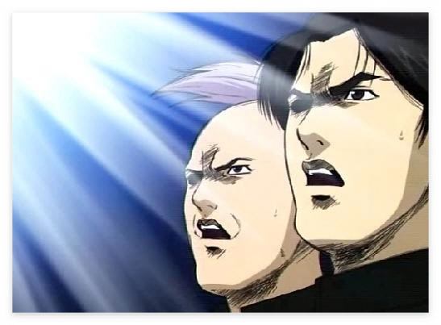

---
categories:
  - life-thoughts/opinions-is-my-own
date: 2024-06-10
description:
  오늘 중요한 걸 깨달았다. 아마 모든 영역에서 적용할 수 있는 법칙 아닌 법칙 같은 건데, 성공하고 싶다면 본인걸 해야 한다. 성공하기 위해서 챗 지피티건 강의팔이든 인플루언서가 되기 위해 노출을 심하게 하던 중요하지 않다.
  그것들은 단지 수단을 뿐이다. 나…
lang: ko
last_updated: 2026-11-14
naver_date: 2026-09-26
naver_url: https://blog.naver.com/martin-lee/224422163399
tags:
  - 일상·생각
title: 깨달음
translation_key: 2024-06-10-realization
---

※ 본 글은 블로그 이전으로 인해 기존 글을 옮겨온 것입니다. (작성일: 2024년 6월 10일 23:31)

오늘 중요한 걸 깨달았다. 아마 모든 영역에서 적용할 수 있는 법칙 아닌 법칙 같은 건데, **성공하고 싶다면 본인걸 해야 한다.** 성공하기 위해서 챗 지피티건 강의팔이든 인플루언서가 되기 위해 노출을 심하게 하던 중요하지 않다. 그것들은 단지 수단을 뿐이다. 나는 오늘부로 내 것으로 만들기 위해서는 수단과 방법을 가리지 않고 내 것이라는 마음가짐으로 살기로 굳게 다짐했다.

왜 이런 다짐을 했을까? 오늘 가볍게 스쳐지나간 글 중에 '[설빙 매각 1300억](https://higher-career.com/%EC%84%A4%EB%B9%99-%EB%A7%A4%EA%B0%81-%EA%B1%B4%EC%9C%BC%EB%A1%9C-%EC%95%8C%EC%95%84%EB%B3%B4%EB%8A%94-%EC%82%AC%EB%AA%A8%ED%8E%80%EB%93%9C-%ED%88%AC%EC%9E%90-%EC%BC%80%EC%9D%B4%EC%8A%A4/)' 이라는 글을 봤다. 아무렇지 않게 그냥 프랜차이즈 요식업이겠구나 싶었는데 아니었던 것이다. 그래서 몇 개 더 검색해 보다가 '스타일 난다 [6000억 매각](https://it.donga.com/27612/)' 등 우리한테 익숙한 브랜드 이름이 수십억, 수백억 도 아닌 수천억에 매각된다는 것에 놀랐고 흥미로웠다. 그래서 이들은 어떻게 이런 것들을 달성할 수 있었는지 고민해 보다가 생각이 들었다. 그리고 나는 그렇게 될 수 있을까?라는 생각도 잠깐 들었는데 직장인으로서는 절대 꿈도 못 꾼다라는 결론을 내렸다.

나는 조심스럽게 그들의 성공 법칙을 통해서 깨달음을 주변에서 얻었다. 스타트업을 예를 들어 설명하자면, 회사에서 가장 열심히 일하는 사람은 아마 대표일 것이다. 왜일까? 자기 사업이기 때문이다. 직원 모두가 대표와 같은 마음을 갖고 일을 하면 그 스타트업은 성공할 수 있을 것이다. 내가 좋아하는 말 중에 그런 말이 있다. 끼리끼리 만나게 되어있다. 내가 그 위치에 올라가 있는다고 한들 비슷한 대우를 받을 수 있겠지만 조금 더 면밀하게 살펴본다면, 같은 노력을 하는 사람들끼리 만나게 되어있는 것이다. 내가 그 사람들과 동등한 위치에 서 있다고 해서 자만해서는 절대 안 된다. 그리고 그들과 어울리지 못한다면 내가 어떤 노력이 부족했는지를 되돌아보는 시간이 필요하다. 아무리 운이 좋다한들 오랜 시간 지내다 보면 밑천이 드러나기 마련이다. 결국 이 영역은 항상 말하는 메타 인지 능력의 중요함이다. 그리고 오늘 깨달은건 주인의식의 중요성이다.

아마 모든 사람이라면 뺏기는 걸 싫어할 것이다. 모든 것을 내 것이라 생각하자. 내가 지금 갖고 있는 걸 알고서 그것을 지키기 위해 계속해서 강화하는 훈련이 필요하다. 그런 관점에서 사람들이 가장 소홀히 생각하는 게 있다면 바로 시간일 것이다. 내가 누군가의 시간을 뺏고 있는 게 아닌가?라고 생각해 보고, 일을 할 때도 내가 그 사람의 시간을 덜어줄 수 있는 일을 찾아 하면 그게 바로 일 잘하는 사원이 될 것이다. 내 주변에 있는 모든 것에 대해 감사하게 생각하자.
