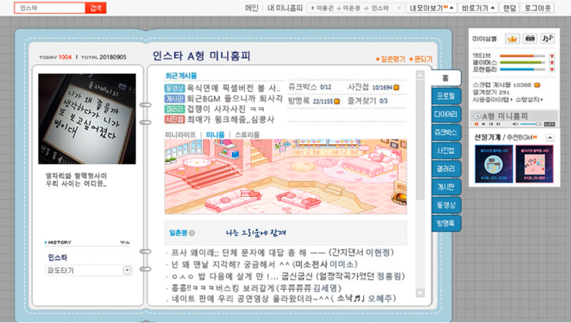

---
categories:
  - life-thoughts/opinions-is-my-own
date: 2024-06-17
description:
  위 사진이 익숙한 사람도 있을 것이고, 뭔지 모르는 사람들도 있을 것이다. 아마 90년대생들이라면 다 알 법한데, 이는 바로 싸이월드 사진이다. 지금의 인스타그램, 페이스북, 트위터, 쓰레드 등이 등장하기 전에 존재했던 국내형
  SNS 플랫폼이었다. 2015년…
lang: ko
last_updated: 2026-11-14
naver_date: 2026-09-26
naver_url: https://blog.naver.com/martin-lee/224422162931
tags:
  - 일상·생각
title: 나를 아는 것
translation_key: 2024-06-17-knowing-myself
---

※ 본 글은 블로그 이전으로 인해 기존 글을 옮겨온 것입니다. (작성일: 2024년 6월 17일 20:02)

싸이월드

위 사진이 익숙한 사람도 있을 것이고, 뭔지 모르는 사람들도 있을 것이다. 아마 90년대생들이라면 다 알 법한데, 이는 바로 싸이월드 사진이다. 지금의 인스타그램, 페이스북, 트위터, 쓰레드 등이 등장하기 전에 존재했던 국내형 SNS 플랫폼이었다. 2015년에 서비스가 종료되었지만, 당시 10대들에게 많은 인기를 끌었다. 사람들은 자신의 셀카를 개인의 미니홈피 사진첩에 업로드하고, 친한 친구들과 일촌을 맺는 놀이를 즐겼다. 배경음악(BGM), 베프, 절교, 얼짱시대, 100문 100답 등 많은 추억이 남아있다.

100문 100답은 나를 소개하는 글로, 많은 사람들이 기본으로 작성해두었는데, 막상 작성하다 보면 시간이 오래 걸리고 약간 귀찮기도 했다. 하지만 모두 작성하고 나면 뿌듯했고, 나만의 자아가 생겨나는 기분이 들었다. 성인이 된 지금은 내가 뭘 좋아하고 싫어하는지 딱 떠오르지 않는다는 생각이 들 때가 있다. 이력서를 작성할 때 취미와 특기에 적었던 것들이 정말 내가 좋아하고 잘하는 것인지 의구심이 들 때도 있다. 그래서 나는 날 잘 알고 있는가? 라는 생각이 들었다.

티스토리를 운영하면서 글을 작성하는 행위가 나를 아는 데 도움이 된다고 생각한다. 오늘 버스를 타고 오면서 나는 인터넷에서 다수가 싫어하는 행동들을 따라 싫어한 것 같다는 생각이 들었다. 막상 경험해보지도 않았고, 그냥 남들이 싫다는 말에 휘둘려 살아온 기분이 들었다. 그러다 내가 싫어하는 것이 무엇인지 생각하던 중, 한 사람이 나를 툭 치고 지나갔다. 그 순간 왜 사람이 꽉 찬 대중교통에서 가방을 앞으로 매지 않는 것인지 심기가 불편해졌다.

누군가 나에게 싫어하는 행동들이 무엇인지 물어본다면 당당하게 말할 수 있고, 직접 겪은 상황까지 덧붙여 설명할 수 있게 되었다. 최근 나를 잘 알기 위해 많은 노력을 하고 있다. 바깥 생활보다 인터넷 세상에서 더 많은 말을 하고 더 오랜 시간을 보내는 요즘, 경험이 부족해 말의 논리가 떨어진다고 느낀다. 가끔 내가 무슨 말을 하고 싶은 걸까? 라는 생각도 든다. 감정 없이 습득한 것은 오래가지 못한다. 무엇을 하더라도 현재 내가 느끼고 있는 감정들을 잘 기억하고 이를 행동으로 실천해야 한다. 이것이 나를 아는 방법 중 하나이다.

나를 알아가는 과정을 성공으로 삼는다면 정말 행복한 사람이 될 수 있을 것 같다.
