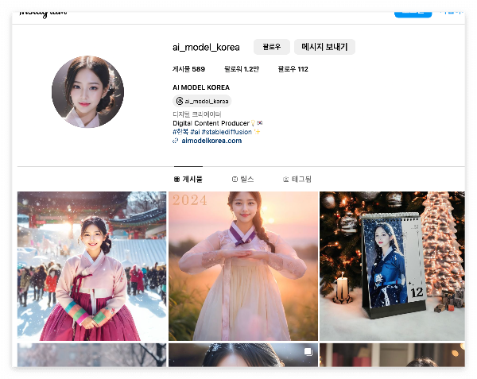
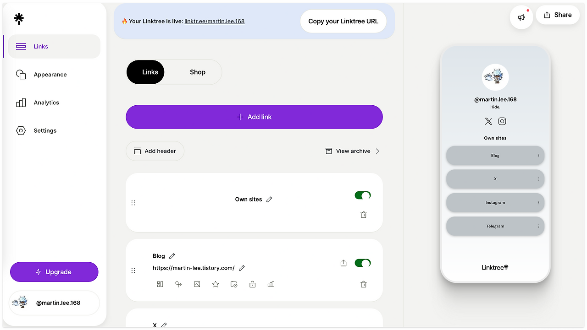

---
categories:
  - life-thoughts/opinions-is-my-own
date: 2024-06-27
description:
  다들 알다시피 AI 기술이 너무나도 빠르게 발달되고 있다. 특정 분야를 제외하고는 이미 사람보다 더 나은 결과물을 만들어내고 있는게 현상황이다. 그리고 누군가는 AI를 활용해서 수익을 거두고 있기도 하고, 누군가는 일자리를
  잃어가고 있다. 이러한 시기에서 살…
lang: ko
last_updated: 2026-11-14
naver_date: 2026-09-26
naver_url: https://blog.naver.com/martin-lee/224422161716
tags:
  - 일상·생각
title: 퍼스널 브랜딩이 중요한 시기에 반드시 필요한 것
translation_key: 2024-06-27-personal-branding
---

※ 본 글은 블로그 이전으로 인해 기존 글을 옮겨온 것입니다. (작성일: 2024년 6월 27일 12:25)

다들 알다시피 AI 기술이 너무나도 빠르게 발달되고 있다. 특정 분야를 제외하고는 이미 사람보다 더 나은 결과물을 만들어내고 있는게 현상황이다. 그리고 누군가는 AI를 활용해서 수익을 거두고 있기도 하고, 누군가는 일자리를 잃어가고 있다. 이러한 시기에서 살아남기 위해 가장 중요한건 개인의 가치를 올리는 **퍼스널 브랜딩**이 필요하다.

그리고 퍼스널 브랜딩을 하기위해서 가장 적합한 방법 중 하나로 블로그가 속해있다. AI 기술이 발달하면서 유일한 장점은 **인터넷 세계에서 내가 되고싶은 것이 될 수 있다** 라는 점인 것 같다. 글을 쓰면서 작가도 될 수 있고, 음악을 배우지 못해도 작곡을 할 수 있고, 이제는 얼굴을 공개하지 않고도 모델이 되기도 한다. 어떻게보면 무섭지만 누구에게나 인터넷만 주어진다면 공평한 기회를 준것과도 다름없다. **즉, 현실에서의 나와 분리된 인터넷 세상에서의 또 다른 자아를 만들어 낼 수 있게되었다.** 예전에는 검색이 중요한 시대였다면 이제는 생각을 어떻게 활용할지에 대한 시대가 온 것이다.

다양한 플랫폼을 활용하여 본인을 알리는 것이 가장 좋다. 블로그를 포함한 유튜브, 트위터, 인스타그램 또는 본인만의 페이지 등 여러 사이트들을 통해 최대한 노출시켜야한다. 그렇다면, 이렇게 많은 사이트들을 어떻게 보여주면 좋을까? 바로 [**링크트리(Linktree)**](https://linktr.ee/)를 이용하면 된다.

가입하고 누구나 쉽게 "**무료로**" 만들 수 있다는게 최대 장점이다. 15분도 안걸리고 뚝딱 만들어 낼 수 있을 것이다. 그리고 본인이 운영하고 있는 프로필 소개란에다가 만들어낸 링크 트리 주소를 추가해주면 끝이다.
