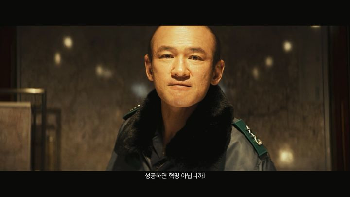
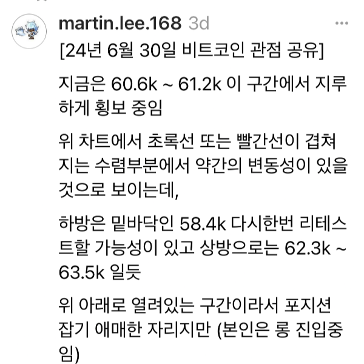
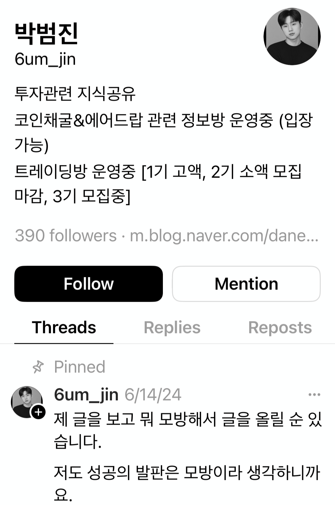
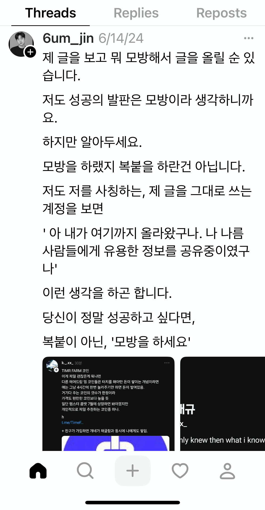
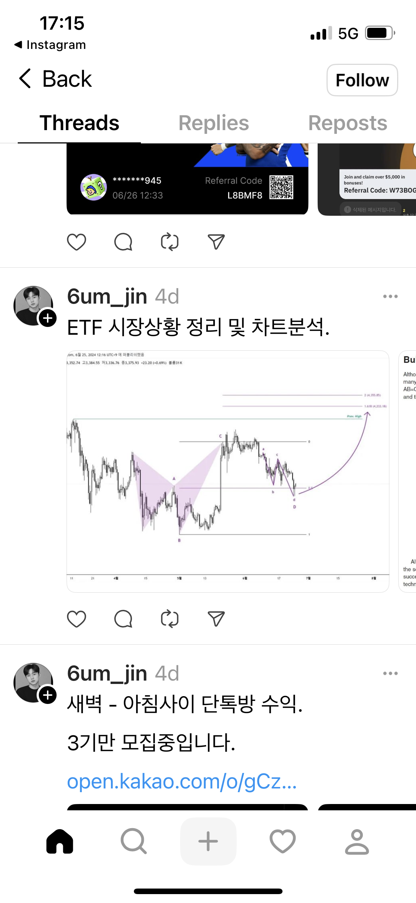
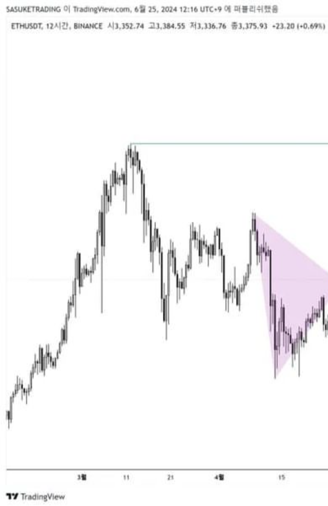
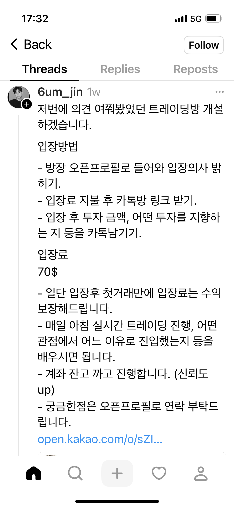

---
categories:
  - life-thoughts/opinions-is-my-own
date: 2024-07-03
description: 각박한 대한민국에서 살아남기 위해서는 언제 어디서 일어날지 모르는 사기를 조심해야 한다.
lang: ko
last_updated: 2026-11-14
naver_date: 2026-09-26
naver_url: https://blog.naver.com/martin-lee/224422160826
tags:
  - 일상·생각
title: "[공지] 언제 어디서나 사기꾼을 조심하세요"
translation_key: 2024-07-03-beware-of-scammers
---

※ 본 글은 블로그 이전으로 인해 기존 글을 옮겨온 것입니다. (작성일: 2024년 7월 3일 17:49)

각박한 대한민국에서 살아남기 위해서는 언제 어디서 일어날지 모르는 사기를 조심해야 한다.

[https://www.newsis.com/view/NISX20240701\_0002794401](https://www.newsis.com/view/NISX20240701_0002794401)

[서울 영등포서 130억원대 전세사기…임대인 2명 구속송치](https://www.newsis.com/view/NISX20240701_0002794401)

매일매일 곳곳에서 다양한 사건사고들이 발생하고 있지만

요즘 화제가 되고있는 사건은 바로 전세사기가 아닐까 싶다.

대부분의 피해자들이 사회초년생들이라 더 안타까운것 같다.

임대인(집 빌려주는 사람)은 사기가 아니라 사고, 재난이다 라고 주장하는 경우도 있어 좀 어이가 없었다.

전세사기는 좀 특수한 경우라고 생각하고,

애초에 사기꾼들은 계획하고 접근을 하기 때문에 경계해도 당할 수 있다. 대표적인 예로, 보이스피싱이다.

그래서 사기를 조심하기 위해서는 두 가지를 기억해두면 좋다.

**1\. 초면에 잘해주는 사람을 경계할 것**

관련해서 사기꾼과 사업가는 종이 한 장 차이라는 말을 예전에 들은 적이 있다.

**2\. 본인이 한 말을 끝까지 지키면 사업가, 결국 본인이 한 말을 못 지키면 사기꾼.**

최근, 블로그 유입을 위해서 쓰레드라는 SNS를 가입하고 블로그 글들을 요약해서 올리기 시작했다.

근데, 트위터나 텔레그램에서 이전부터 못봤었던 분들이 많이 보였고,

세상에 역시 고수들은 많구나 라는 느낌을 받았던 찰나

뭔가 사기꾼 같은 계정을 발견했다.

안그래도 이 업계는 사기꾼들이 많다라는 인식이 많은데,

이런 계정들때문에 더욱 더 그런 인식들이 부각될 것 같아서 블로그에 박제해두려고 글 쓴다.

이전부터 쓰레드에 수익인증 자랑글 올리면서 본인 오픈 카톡방으로 입장료 받고 끌어들였음

6/14 - 사칭범을 저격하며, '복붙이 아닌 모방을 하세요' 시전

6/25 - ETF 시장상황 정리 및 차트 분석 글 올렸는데, 이게 SASUKE라는 트레이더 분꺼 차트 훔쳐와서 올린거였음

6/30 - 발각되니까 차단하고 부끄러웠는지 올렸던 글 삭제함.

이 사람은 본인이 했던 말을 지킬줄 모르는 사람이다.

고로, 사기꾼이다.

설령 지금 사기꾼이 아닐지언정 전형적인 사기꾼이 되어가고 있는 중이다.

오해였다면 오해를 풀어야하고 잘못했으면 죄송합니다.

한번 하면 되는건데 사기꾼들은 괜히 자존심만 쎄서 그게 어렵나보다.

1. 수익 인증같은거 하는거 다 조작 할 수 있으니깐 그런거에 현혹되서 너무 믿지말 것

2. 뒤에서 추종하는 사람들 인증내역들이 많다한들 그조차도 다 조작할 수 있으니깐 믿지말 것

3. 순식간에 부의 추월차선에 오를수 있는 마법같은 기법은 절대 없음.
