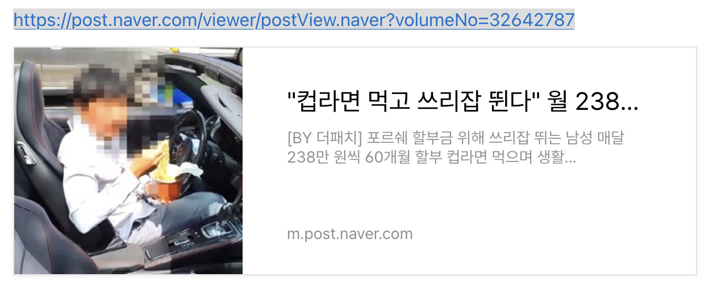

---
categories:
  - life-thoughts/opinions-is-my-own
date: 2024-07-09
description: 돈이 인생의 전부는 아니다. 그리고 여러 부자들의 말을 듣다보면 돈이 많다고해서 행복하다는 것도 아닌것 같다.
lang: ko
last_updated: 2026-11-14
naver_date: 2026-09-26
naver_url: https://blog.naver.com/martin-lee/224422158599
tags:
  - 일상·생각
title: 돈을 아끼면 안되는 순간
translation_key: 2024-07-09-when-to-spend
---

※ 본 글은 블로그 이전으로 인해 기존 글을 옮겨온 것입니다. (작성일: 2024년 7월 9일 12:50)

돈이 인생의 전부는 아니다. 그리고 여러 부자들의 말을 듣다보면 돈이 많다고해서 행복하다는 것도 아닌것 같다.

그럼에도 불구하고, 돈이 있으면 확실히 좋은 점은 선택의 폭이 넓어진다.

무언가를 소비하는 데 있어서 '**아.. A보다 B를 사고싶은데 돈이 없네...**' 라는 경험을 한번씩은 해봤을것이다.

돈만 있다면 모든게 해결될 것 같지만 지금 당장 돈이 없기때문에 우리는 갖고있는 돈을 최대한 효율성있게 사용하는 것을 원한다.

그러나, 살다보면 돈을 아끼면 안되는 순간들이 종종 찾아온다.

우리의 삶과 뗄레야 뗄 수 없고, 돈과 밀접하게 관련된 업종인데 흔히들 말하는 **의 식 주** 가 바로 그것이다.

다 중요한 부분이긴한데 사람들이 은근 신경을 많이 안쓰고 있는 부분이 음식인데

개인적으로 먹는거에는 가성비를 따져선 안된다고 본다.

[https://post.naver.com/viewer/postView.naver?volumeNo=32642787](https://post.naver.com/viewer/postView.naver?volumeNo=32642787)

요즘같이 보여주기 문화가 자리잡은 한국에서 집 사기에는 무리고 스포츠카타고 다니면서 매번 편의점 음식만 먹는다는 젊은이들이 있다.

이것도 다 인스타그램이 만들어낸 악습이라고 생각이 든다.

일단 본인은 보여주기 문화가 굉장히 싫다. 자동차, 시계 이런것들은 일단 사치품일뿐더러 없어도 살아가는데 전혀 문제없다.

여튼, 음식에 가성비 따지지 말라는 말이 오마카세가고 미슐랭 스타급 가서 사진찍으러 가지마라는게 아니다.

오마카세, 미슐랭 이런곳이 비싼 이유가 분위기도 있지만 일단 예약제로 운영하기 때문에 좋은 재료를 신선하게 사용한다는 점이다.

요즘같이 쿠팡 로켓 프레시 배송 잘 되고, 유튜브에 검색하면 레시피가 다 공개되어있는 시대인데 귀찮지만 않는다면 요리를 직접 해먹는 게 가장 건강하게 먹을 수 있는 방법이다.

현대인들은 직접 요리해먹고 치우는 시간이 너무 많이 들기때문에 외식을 즐겨한다고한다.

그리고 물가가 오르고 음식점 가격이 오를수록 가성비 제품을 많이 찾는데, 그중에서 하나가 냉동식품이나 저렴한 밥집일 것이다.

음식은 내 몸으로 직접적으로 섭취하기때문에 건강이랑 직결됨.

[https://www.mk.co.kr/news/society/11060486](https://www.mk.co.kr/news/society/11060486)

[24개 학교서 1000여명 식중독 의심…김치 하나에 난리 난 남원시 - 매일경제](https://www.mk.co.kr/news/society/11060486)

음식점에 들어갔을 때 위생이 더러워보인다? 그러면 뒤도 안돌아보고 튀튀하는걸 추천함...

특히 여름에는 더더더더더더욱 중요한듯

**결론: 먹는거에 돈 아끼지말라**
