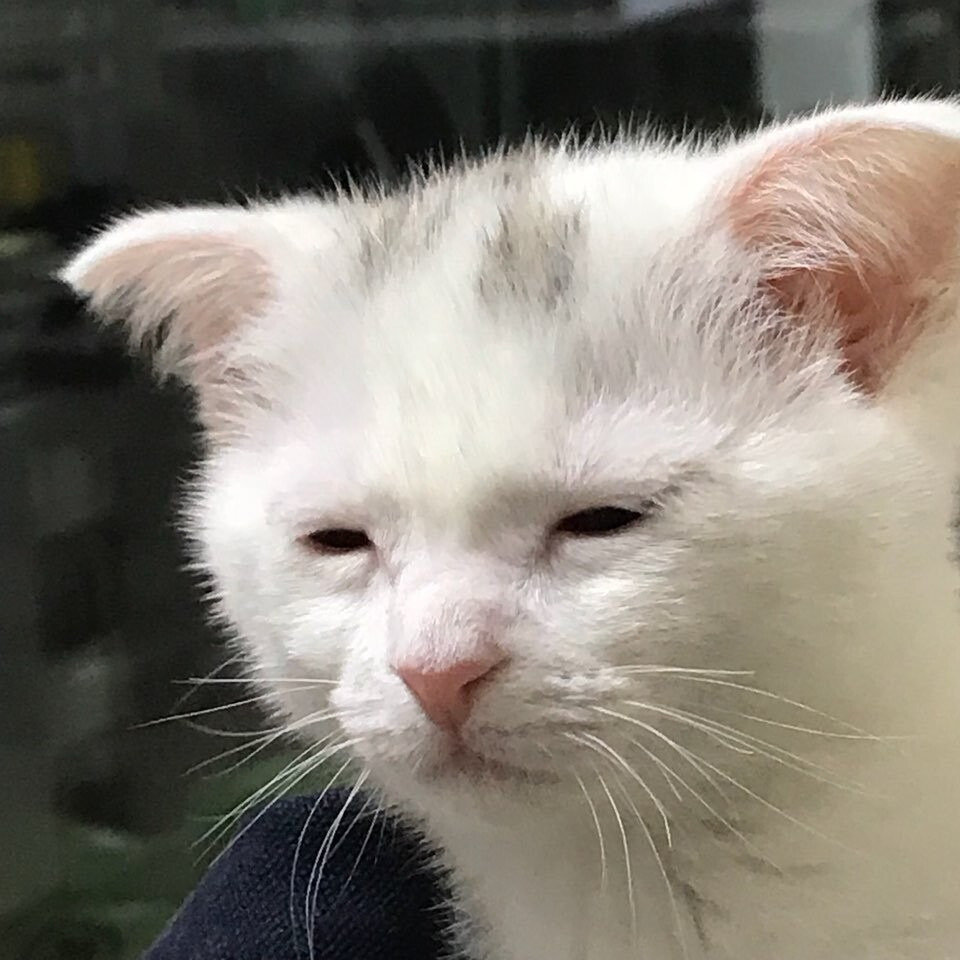

---
categories:
  - life-thoughts/opinions-is-my-own
date: 2024-07-13
description:
  나는 초조함을 느낄 때 손톱을 물어뜯는다. 어렸을 때부터 있던 버릇인데 이게 아직도 고쳐지지 않았다. 아니. 고쳐보기 위해 적극적으로 시도조차도 안해봤던 것 같다. 세 살 버릇 여든까지 간다 라는 말이 무심결에 떠올랐고 이 글을
  작성하는 시점으로부터 안좋은…
lang: ko
last_updated: 2026-11-14
naver_date: 2026-09-26
naver_url: https://blog.naver.com/martin-lee/224422164877
tags:
  - 일상·생각
title: 작은 것들이 모여 큰 것이 된다.
translation_key: 2024-07-13-small-things-add-up
---

※ 본 글은 블로그 이전으로 인해 기존 글을 옮겨온 것입니다. (작성일: 2024년 7월 13일 00:16)

나는 초조함을 느낄 때 손톱을 물어뜯는다. 어렸을 때부터 있던 버릇인데 이게 아직도 고쳐지지 않았다. 아니. 고쳐보기 위해 적극적으로 시도조차도 안해봤던 것 같다. 세 살 버릇 여든까지 간다 라는 말이 무심결에 떠올랐고 이 글을 작성하는 시점으로부터 안좋은 버릇을 고쳐보려고한다.

1\. 나의 행동과 생각들은 지난날의 나로부터 온다. 어제 밤을 샜더라면 오늘 피곤할 것이고, 지금 내가 영어 스피킹을 제대로 하지 못하는 이유는 10년 전에 영어 공부를 안해왔기 때문이다. 안한것과 못하는것에 대해서 잘잘못을 따지는 것이 아니라 못하는 이유는 안했기 때문이라는 것이다.

2\. 손톱 물어뜯기, 다리 꼬고 앉기, 집 오면 바로 누워있기, 대중교통 타면 바로 SNS보기 등등 이런 무의식적으로부터 하는 행동들이 나를 만든다. 이런 안좋은 습관들은 왜 계속 나한테 남아 있는 것일까? 안좋다는 걸 알면서도 고치려고 노력을 하지 않았기 때문이다. 노력을 하지 않아서 이런 것들이 체화되어 무의식으로 남게 된 것이다.

3\. 무의식적으로 하는 것에 대해서는 감정이 소모되지 않는다. 감정이란 AI 시대에서 인간이 유일하게 마지막으로 가지고 있는 존엄성 중 하나가 될 것이다. 그래서 감정을 느낄 수 있다는 것에 매번 감사함을 느끼고 살아야한다.

4\. 사소한 행동이 주는 작은 감정 또한 느낄 줄 알아야한다. 오늘 1을 알았으면 내일 2를 알 수 있을거야. 라는 나 자신에게 대한 기대보다 오늘 1을 알 수있게해준 나 스스로에게 감사함을 표하다보면 무의식적으로 꾸준히 무언가 하게되고, 결국에는 100까지 달성하게될 것이다.

5\. 처음부터 100부터 시작할 수는 없다.

6\. 작은 것들이 모여 큰 것이 된다.
