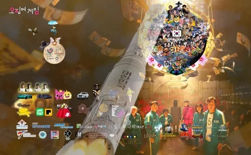
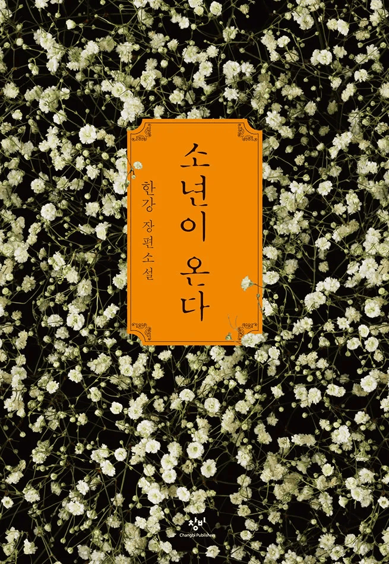
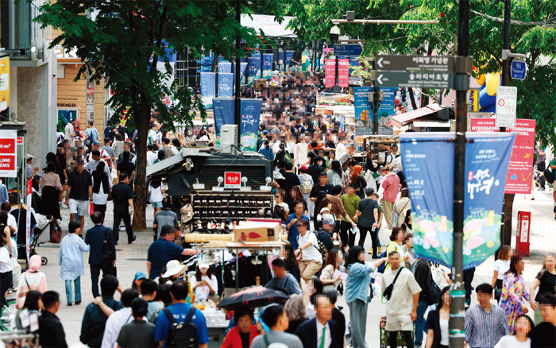
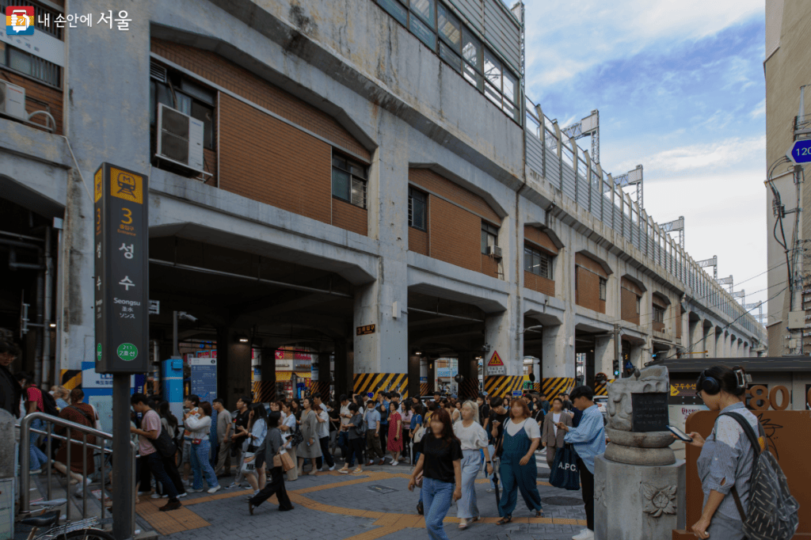
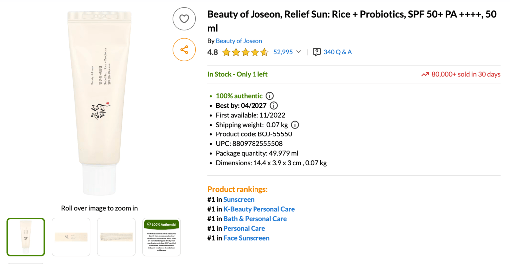
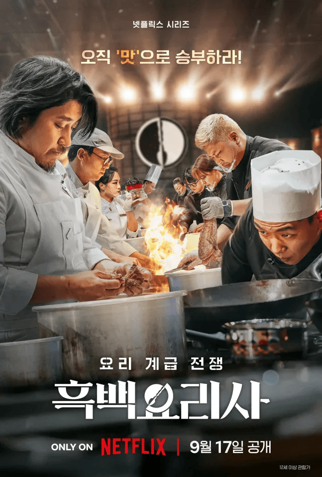
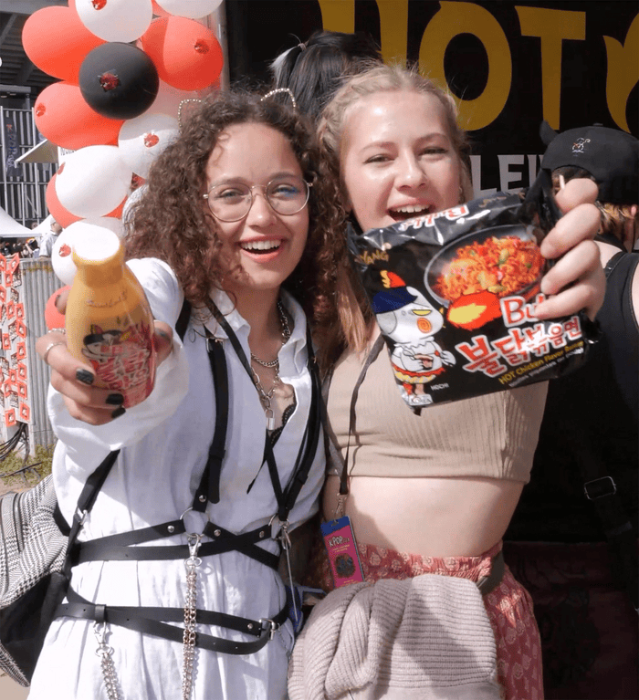

---
categories:
  - life-thoughts/opinions-is-my-own
date: 2024-10-23
description:
  위 사진은 세계적으로 한국을 알린, 소위말해 국위선양에 기여한 인물들 또는 작품들을 모은 사진이다. 우리는 이를 흔히 ‘두 유 노 클럽’이라고 부른다. 해외에서 “두 유 노 코리아?” 라고 물으면 외국인들이 알아챌 수 있도록
  한국의 위상을 높인 인물에게 두…
lang: ko
last_updated: 2026-11-14
naver_date: 2026-10-10
naver_url: https://blog.naver.com/martin-lee/224436714750
tags:
  - 일상·생각
title: 두유 노 코리아?
translation_key: 2024-10-23-do-you-know-korea
---

※ 본 글은 블로그 이전으로 인해 기존 글을 옮겨온 것입니다. (작성일: 2024년 10월 23일)

**두유 노 클럽**

위 사진은 세계적으로 한국을 알린, 소위말해 국위선양에 기여한 인물들 또는 작품들을 모은 사진이다. 우리는 이를 흔히 ‘두 유 노 클럽’이라고 부른다. 해외에서 “두 유 노 코리아?” 라고 물으면 외국인들이 알아챌 수 있도록 한국의 위상을 높인 인물에게 **두 유 노 클럽** (Do you know club)에 가입시켜야한다며 일종의 밈으로 시작되었다. 처음에는 박지성, 김연아와 같이 스포츠계의 월드 스타들이 대부분이었으나 지금은 싸이, BTS를 포함한 아이돌도 대거 포함되어있다.

과거에는 4년마다 열리는 올림픽, 월드컵과 같은 세계적인 행사는 국위선양을 할 수 있었던 대표적인 무대였다. 국위선양을 이룬 국민에게는 국가에서 포상금 지원과 같은 혜택을 주곤해왔다. 다만 요즘은 스포츠 뿐만 아니라 E-스포츠, 드라마, 음악적인 측면으로도 대한민국의 위상을 높힐 수 있는 방법들이 많아졌고, 이는 병역특례의 논란을 만들었다. 국위선양의 원칙과 기준은 애매모호하기도 하고, 지금은 그 의미는 과거와 다르게 많이 퇴색되어가고 있다.

실제로 여러 분야에서 많은 한국인들이 한국을 널리 알리고 있으며, 최근 한국이 세계적으로 평가받는 기사들이 자주 등장하고 있다. 이번 글에서는 그 대표적인 사례들을 살펴보자.

**K-문학**

얼마 전, 한국 작가 한강이 노벨 문학상을 수상했다는 소식이 전해지면서 많은 이들에게 큰 놀라움을 안겨주었다. 이는 노벨 평화상에 이어 한국인이 받은 두 번째 노벨상이자, 한국 최초의 노벨 문학상 수상이라는 점에서 더욱 의미가 깊었다. 또한, 노벨 문학상 부문에서 아시아인으로서 최초의 수상이기도 하다. 한강 작가의 노벨상 수상작 “소년이 온다”는 전 세계에서 품절 사태를 빚었고, 국내외 독자들 사이에서 큰 관심을 받고 있다.

그러나 노벨상을 수상하기 전까지만 해도 일부에서는 한강의 작품이 역사적 왜곡을 포함하고 있다고 주장하며, 이 책이 유해도서로 지정되기도 했다. 그럼에도 불구하고 그녀가 당당히 노벨상을 수상한 것은 많은 사람들에게 놀라움을 주었고, 한국 문학이 해외에서 인정받았다는 증거가 되었다.

최근 한국인들의 독서량이 줄어들고 있다는 기사가 종종 보도되었는데, 이런 상황에서 노벨상 수상 소식은 사람들에게 독서를 다시 시작하도록 불을 지폈다. 또한, 한글날이 있는 달이자 책 읽기 좋은 가을에 이런 상을 받게 되어 그 의미가 더욱 깊었다.

**K-POP**

이틀 전, 로제가 브루노마스와 콜라보한 신곡 “[APT](https://www.youtube.com/watch?v=ekr2nIex040)” 가 발매되었다. 이는 블랙핑크가 해체된 이후 로제의 첫 번째 개인 곡으로, 공개된 지 이틀 만에 유튜브 조회수 4000만을 기록하며 뜨거운 관심을 받고 있다. (글을 작성하는 시점에는 1억뷰를 앞두고 있다.) 브루노마스는 불과 세 달 전 레이디 가가와 함께 “[Die With A Smile](https://www.youtube.com/watch?v=kPa7bsKwL-c)”이라는 곡을 작업한 적 있으며, 이 곡은 현재 빌보드 차트에서 5위를 기록하며 많은 사랑을 받고 있다. 이 외에도 브루노마스는 “Uptown Funk”, “Nothin’ On You” 등 오랫동안 명곡들을 남겼으며, 남미를 대표하는 가수로 전세계적으로 많은 인기를 끌고 있다. 이런 정상급 위치에 있는 가수가 한국 아이돌과 콜라보를 했다는 것은 그만큼 K-POP 문화의 위상이 크게 높아졌다고 생각든다.

1990년대부터 시작된 한국의 아이돌 문화가 시간이 흐르면서 갈고닦아온 결과라고 생각한다. 한국의 아이돌 역사를 이야기할 때, 지금이 4세대 아이돌 시기라고들 말하곤 하는데, 특히 요즘 아이돌들은 세계적인 팝스타들과 협업을 이뤄내고 있다. 예를 들어, 세븐틴과 DJ Khaled, 방탄소년단과 콜드플레이, 블랙핑크와 셀레나 고메즈, 그리고 BTS의 정국과 찰리 푸스의 콜라보 곡들이 있다. 이러한 가수들의 팬덤은 전세계적으로 많이 퍼져있으며 엔터산업은 한국을 알리는데 가장 큰 기여를 하고 있다.

**K-뷰티**

K-POP과 K-드라마는 많은 해외 팬들의 마음을 사로잡았고, 그로 인해 가장 큰 수혜를 입은 분야는 미용과 패션 부문일 것이다. 외국인 여행객들이 자주 방문하는 관광지를 통해 이를 확인할 수 있을텐데, 코로나 이후로 외국인이 가장 많이 방문하는 거리를 꼽으라면 명동 거리와 성수동일 것이다. 모든 화장품 매장들이 많이 입점해 있는 명동 거리와 요즘 젊은 사람들 사이에서 패션의 1번지라고 불리는 성수동이 그들이 가장 많이 찾는 ‘핫플레이스’가 되었다.

또한, 영양제와 건강식품을 직구로 구매할 수 있는 쇼핑몰 아이허브에서는 ‘K-Beauty’라는 카테고리가 있으며, 그 중에서 한국 화장품 브랜드인 ‘조선미녀’의 선크림이 베스트셀러를 차지하고 있다. 유튜브에서 검색해 보면 외국인들이 이 화장품을 사용한 후기 영상을 쉽게 찾아볼 수 있다.

한편, 성형수술에도 많은 관심이 쏠리고 있다. 성형수술을 받기 위해 한국을 방문하는 외국인들이 크게 늘었고, 성형수술 원정을 돕는 브로커들까지 등장하고 있다고 한다. 이처럼 한국의 성형 기술 또한 해외에서 널리 알려지고 있으며 한국의 이미지를 만들어내는데 이바지하고 있다.

**K-푸드**

요즘 넷플릭스에서 가장 인기 있는 넷플릭스 시리즈인 흑백요리사는 다양한 요리사들이 나와 요리 경연을 펼치는 프로그램이다. (비록 아직 보지는 못했지만,) 이 프로그램에서는 한식뿐만 아니라 각 셰프의 개성을 살린 다양한 요리가 등장한다. 그중 중식 요리를 선보인 정지선 셰프의 빠스는 중국인들 사이에서도 큰 관심을 받았고, 흑백요리사에 출연한 쉐프의 음식점을 방문하기 위해서 해외에서 오는 여행객들도 있다고 한다.

그 외에도 SNS를 통해 젊은 사람들 사이에서 매운 음식을 먹는 챌린지가 유행했는데, 그중 불닭볶음면은 해외에서도 큰 인기를 끌었다. 한국인들은 매운 음식을 잘 먹는다는 인식이 강한데, 이는 아마도 새빨간 김치에서 비롯된 것일 것이다. 김치는 한국 식탁에서 빠질 수 없는 음식 중 하나로, 한국인들에게는 소울푸드이자 외국인들이 가장 쉽게 떠올리는 한국 음식이다. 예전에는 한국을 설명할 때 “두유 노 김치?”가 흔한 첫마디였지만, 요즘은 그 표현이 다소 촌스럽게 느껴질 정도로 인식이 변했다.

**결론**

**지금까지 한국의 K-문화에 대해서 알아보았다. 위와 같은 사례들만 들여다보면 세계는 한국인을 인정하고 있다는 것은 확실하다. 그러나 우린 스스로 우리 나라를 ‘헬 조선’이라고 부른다**. 참 아이러니하다. 외국인의 시선으로 바라보면 한국은 굉장히 살기 좋은 나라임은 분명하다. 그러나 여러 인터넷 커뮤니티에서는 한국의 미래는 없다며 “탈조선은 지능순” 이라는 가벼운 말과 함께 이민 또는 국제결혼을 장려하는 분위기로 가득차있으며 서로를 헐뜯기 바쁘다. 언제부터 이렇게 된 것일까. 이유는 모르겠지만 누구의 탓을 할 수도 없는 상황이다.

어렸을 때 아파트 단지에서 주민들이 모여 2002년 월드컵을 응원하며 골을 넣는 순간 아파트 전체에 동시에 함성이 울려 퍼졌던 기억이 있다. 하지만 지금은 강아지 짖는 소리, 아기들이 걸어다니는 소리 등 작은 소리에도 민감하게 반응하여 층간 소음 신고로 빈번하다. 필자가 초등학생 때는 노약자, 장애인, 임산부 같은 사회적 약자를 배려해야 한다고 배웠지만, 지금은 노인 공경이 사라져가고 있을 뿐 아니라, 노인을 하찮게 여기거나 적대시하는 경향으로 변질되고 있음을 느낀다.

비록 살아온 시간은 짧지만, 불과 20년 전과 지금을 비교해 보면 한국은 너무나도 빠르게 변했다. 개인의 성향이나 생활 습관, 소비 패턴, 나아가 문화까지 말이다. 이러한 변화가 긍정적인지 부정적인지에 대한 판단은 개개인의 해석에 따라 달라질 수 있다고 본다. 미래에도 많은 것들이 바뀔 수 있겠지만 당장 내일이 어떻게 될지도 모르는데 20년 뒤 한국의 모습을 예상하는 건 너무 어려운 일이다.

다만, 이러한 격변 속에서도 바뀌지 않는 것이 있다면 우리가 한국인이라는 사실이다. 한국인이라는 것은 우리가 태어나면서 자연스럽게 얻게 되는 고유한 특성이자, 바꿀 수 없는 것이다. 이러한 관점에서 한국인이라는 자긍심만큼은 잃지 않았으면 좋겠다. 한국에서 한국인은 너무나도 흔하고 평범해 보일 수 있겠지만 조금 더 시야를 넓혀 세계적인 관점에서 본다면 한국인은 소수 민족에 속하며 작은 땅 덩어리에 비해 월등한 영향력을 지닌 민족에 속한다.

그러니 더 이상 한국인이라는 사실에 부끄러워하지 않았으면 좋겠다. **한국에 살면서 한국을 욕하는 마치 누워서 침 뱉기와 같은 행동은 자제했으면 좋겠다. 최소한 이 글을 읽는 순간만큼은 국뽕에 차올랐기를 바란다.**
