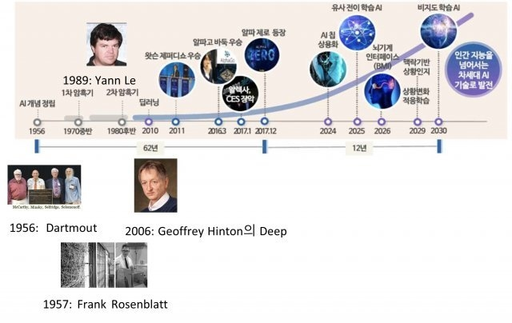

---
categories:
  - life-thoughts/opinions-is-my-own
date: 2024-11-12
description:
  오늘 웹 서핑을 하다가 우연히 흥미로운 글을 읽게 되었다. 아마 비슷한 주제의 글들은 이미 많은 사람들이 여러 번 이야기했을 것이다. 지루할 수 있겠지만 챗지피티의 새로운 버전이 공개될 때마다 많은 직업군들을 대체할 것이라는
  말들은 수많은 종사자들을 두려움에…
lang: ko
last_updated: 2026-11-14
naver_date: 2026-10-10
naver_url: https://blog.naver.com/martin-lee/224436713313
tags:
  - 일상·생각
title: 아무리 인공지능이 발전한다고 해도
translation_key: 2024-11-12-even-as-ai-advances
---

※ 본 글은 블로그 이전으로 인해 기존 글을 옮겨온 것입니다. (작성일: 2024년 11월 12일)

오늘 웹 서핑을 하다가 우연히 [<u>흥미로운 글</u>](https://opensea.kr/%ec%95%84%eb%ac%b4%eb%a6%ac-%ec%9d%b8%ea%b3%b5%ec%a7%80%eb%8a%a5%ec%9d%b4-%eb%b0%9c%ec%a0%84%ed%95%9c%eb%8b%a4%ea%b3%a0-%ed%95%b4%eb%8f%84/)을 읽게 되었다. 아마 비슷한 주제의 글들은 이미 많은 사람들이 여러 번 이야기했을 것이다. 지루할 수 있겠지만 챗지피티의 새로운 버전이 공개될 때마다 많은 직업군들을 대체할 것이라는 말들은 수많은 종사자들을 두려움에 떨게 만든다. 안타까운 현실이지만 받아들여야 한다.

[\[모두를 위한 인공지능\] 1부 – 환갑이 훌쩍 넘은 인공지능의 어제와 오늘 (동아일보)](https://www.donga.com/news/It/article/all/20220608/113851410/1)

인공지능이라는 개념과 용어는 지금으로부터 약 68년 전에 정립되었으나 챗지피티가 등장한 이후로 인공지능의 시대를 열었다고 생각한다. 그리고 우리는 정보화 시대에서 인공지능 시대에 접어드는 시기에 살고 있다. 과거 ‘닷컴 버블’과 ‘스마트폰의 최초 등장’ 당시에는 분위기가 어땠을지 모르겠다만 지금이 그때와 비슷하지 않을까 싶다.

앞으로 인공지능은 자연스럽게 우리한테 스며들 것이라 생각하고 지금도 실생활에서 많은 부분에서 사용되고 있다. 얼마 전, 은행 업무로 고객센터에 전화했던 일이 있었는데 AI 상담사가 업무를 대신하고 있었다. 카페나 음식점만 가봐도 사람이 아닌 키오스크를 통해 주문하는 것은 흔해졌음을 알 수 있다. 빠르게 변화하는 시대에 살아남기 위해서는 빠르게 적응하는 기술도 필요하다.

모든 기술의 발전의 궁극적인 목표는 인간의 삶의 질을 높이는 데 있고, 대부분의 발명품들을 살펴보면 인간의 신체로부터 확장되었다. 인공지능은 우리가 생각할 수 있는 뇌의 영역을 침범하기 시작했고 마음까지도 침투하기 위해 노력하고 있다. 즉, 시간이 지나면 지날수록 인간이 할 수 있는 모든 육체적 활동들은 기계가 대체할 수 있을 것이다. 단순노동과 반복적인 작업을 하는 행위들은 가장 먼저 대체화되기 쉬울 것이다. 개인적으로 의사, 판사, 변호사와 같이 전문 직종도 언젠가는 AI가 대체할 수 있을 거라고 생각한다.

그럼에도 불구하고 이 글의 제목처럼, 아무리 인공지능이 발전해도 범접할 수 없는 부분이 있다면, 그것은 바로 책임감과 윤리적인 부분, 그리고 호기심이다. 보이지 않는 것을 믿고, 상상하여 창조할 수 있는 것은 인간의 고유한 능력이다.
