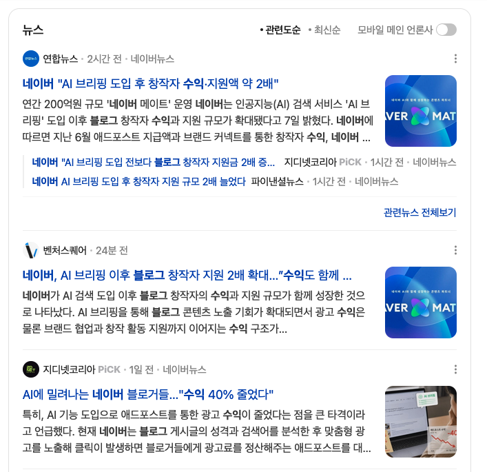
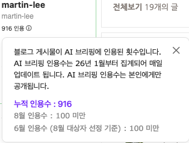
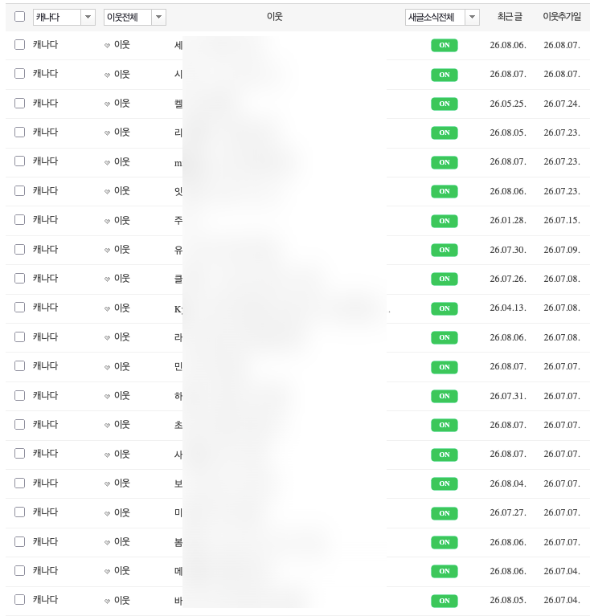

---
categories:
  - life-thoughts/opinions-is-my-own
date: 2026-08-07
description: 네이버 블로그가 망했다고들 말하지만 아직까지는 생각보다 네이버 블로그를 많이 한다.
lang: ko
last_updated: 2026-11-14
naver_date: 2026-08-07
naver_url: https://blog.naver.com/martin-lee/224371056466
tags:
  - 일상·생각
title: 2026 네이버 블로그 망했나요?
translation_key: 2026-08-07-naver-blog-in-2026
---

**네이버 블로그가 망했다고들 말하지만 아직까지는 생각보다 네이버 블로그를 많이 한다.**

AI 등장하면서 네이버 블로거들은 자리를 빼앗기고 있다.

대부분의 검색은 네이버 대신 챗지피티를 더 많이 선호하고 있으며

글 쓰는 사람들 조차도 AI가 써준 글을 그대로 포스팅 하는 경우도 있다.

그렇다면 향후 네이버 블로그는 어떤 포지션으로 흘러가게될까?

기존에 네이버 검색 자체는 광고 + 블로그 + 카페의 게시글들을 통해 보여줬다.

이는 네이버 검색 랭킹에 따라 노출을 해주기 때문에 광고글도 섞여있고, 신빙성이 떨어졌다.

앞으로는 네이버 자체에서 지원하는 AI 검색 기능(네이버 메이트)을 통해서 좀 더 밀접하게 연관된 정보를 보여주는데 쓰이지 않을까 싶다.

어느순간부터 내 프로필에서 인용된 횟수를 볼 수 있게 되었다.

쓴 글도 별로 없는데 내 글이 대체 어디서 인용되었는지 궁금하다. 생각보다 많아서 놀랐다.

즉, AI가 블로그 글을 판별하고 노출시켜주는것이다.

여기서 핵심은 인기 순이 아니라는 것이다.

파워블로거가 아니어도 내 글이 인용될 수도 있다라는 말처럼 들렸다.

지금처럼 이렇게 주절주절 작성하는 일상 글 또는 일기는 아무도 궁금해하지 않을것이다.

결국에는 사람들이 궁금해할 것들을 정성스럽게 작성하고 AI가 내 글을 사람들에게 잘 전달해주기를 기도하는 수 밖에 없다.

내가 요즘 보고 있는 블로그들이 여럿 있는데 이 사람들은 딱히 수익을 생각하지 않고 글을 꾸준히 작성하는 것 같다.

뭐든 꾸준히 하는게 제일 어렵다고 생각하고 위 사람들이 한편으로는 대단하다고 느낀다.

캐나다 워홀 혹은 해외살이를 하다보면 시간도 많이 생기고 여유가 있어서그런지 사람들이 블로그나 유튜브를 많이 시작하는 듯 하다.

기록용으로도 좋고 습관을 만들기에도 좋고 나쁠게 없다고 본다.

나 같은 경우에는 하나 그룹을 만들고 이웃신청을 걸어서 가끔 염탐을 하는 편인데

비슷한 사람들이 어떻게 사는지도 보고 어쩔때는 반성하기도 하고 여행지, 맛집, 꿀팁 정보도 얻을 수 있다.

대부분 사람들이 특정 카페, 커뮤니티에서 정보만을 얻으려고 하는데 내 생각에는 네이버 블로그가 오히려 더 꿀통이고 소식이 빠르다.

그래서 결론은 **네이버 블로그 시작하기 늦었다고 생각하지 말고 지금 당장 시작하라고 권하고 싶다.**
