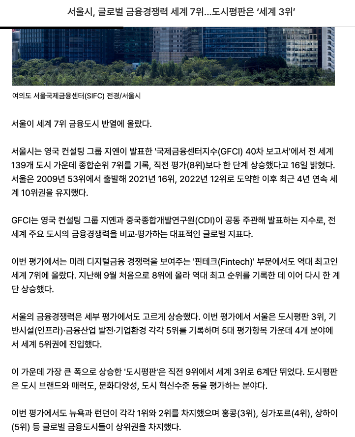

---
categories:
  - life-thoughts/opinions-is-my-own
date: 2026-09-19
description: 캐나다에서도 나름 한인 비율이 높은 밴쿠버에 살고 있다 보니
lang: ko
last_updated: 2026-11-14
naver_date: 2026-09-19
naver_url: https://blog.naver.com/martin-lee/224416632195
tags:
  - 일상·생각
title: "[공지] 교포들이 한국에 대해서 유독 더 지랄하는 이유"
translation_key: 2026-09-19-korean-diaspora-and-korea
---

[https://faceeast.substack.com/p/5a8?r=4iguvd&utm\_campaign=post-expanded-share&utm\_medium=post%20viewer](https://faceeast.substack.com/p/5a8?r=4iguvd&utm_campaign=post-expanded-share&utm_medium=post%20viewer)

[교포들이 한국에 대해서 유독 더 지랄하는 이유](https://faceeast.substack.com/p/5a8?r=4iguvd&utm_campaign=post-expanded-share&utm_medium=post%20viewer)

---

교포까진 아니지만?

공감이 많이 되는 글이다.

캐나다에서도 나름 한인 비율이 높은 밴쿠버에 살고 있다 보니

한인들의 진상 소식들도 접할 수 있고, 어딜 가나 한국인 한 명쯤은 있어 거진 한국과 크게 다를 거 없다.

한국에 대한 소식들은 한인 커뮤니티에 올라오는 뉴스나 SNS가 전부다.

그래서 한인 커뮤니티는 가능하면 안 하는 게 평화로운 듯하다.

불필요한 가십거리가 너무 많다.

그나마 네이버 블로그로 본인의 생각을 쓰는 게 가장 건전하다고 생각한다.

여하튼 요즘처럼 한국의 위상이 높아지는 시기에는 묘한 감정이 생기는 것 같다.

해외에 살고 있는 내 선택이 한국에 남아 있는 것보다 더 나은 선택이었기를 바라는 마음. 한편으로는 ‘괜히 여기 있는 건가?’, ‘내 선택이 잘못된 건 아닐까?’ 하는 생각도 든다. 실제로 역이민을 고민하는 사람들도 있다.

하지만 이미 이곳에서 보낸 시간이 있고, 다시 한국으로 돌아가 처음부터 시작하려니 겁이 난다. 그러다 보면 자신의 선택을 정당화하기 위해 “한국은 원래 그래”, “한국은 살기 힘든 나라야”, “한국은 아직도 나이를 따지는 고리타분한 사회야”라고 이야기하는 경우도 보게 된다. 반대로 캐나다의 문제에 대해서는 애써 외면한다.

한국에서는 사람의 생각이 한쪽으로 지나치게 기울었을 때 좌경화니 우경화니 하는 말을 쓰곤 한다. 나는 가끔 이런 모습을 보면서 농담 삼아 캐경화 되었다고 말한다.

한국에 대해서 올려치기 하는 것도 아니고 객관적인 시선으로 봤을 때 정말 좋은 나라임은 확실하다.

[https://www.asiatoday.co.kr/kn/view.php?key=20260916010006087](https://www.asiatoday.co.kr/kn/view.php?key=20260916010006087)

동의를 못한다면 그건 아마 서울에 살지 않았기에 그런 게 아닐까 싶다.

밴쿠버로 이민을 온 사람들 중에서 서울/경기권 출신보다 지방 사람들을 훨씬 많이 있어서 어쩌면 합리적일 수 있지 않을까 싶다.

물론 한국에서 진짜 너무 열심히 살고 일만 주구장창 하는게 힘들어서 좀 더 여유롭고 가족중심적인 라이프를 원해서 오신 분들이나 해외에서 경험을 쌓고 싶으신 분들 등등 각자 뭐 개인사정에 맞게 이민, 이주를 오신 분들, 도피성으로 왔건 등등 어떤이유로든 현재에 집중하는게 올바르고 어른다운 모습이라고 생각한다.

강제로 끌려온거 아니고 자발적 선택으로 오게된 나라이기에 무엇보다 본인의 마음먹기 달려있다. 책임감을 갖고 이왕이면 좋은 생각으로 행복하게 잘 살면 좋겠다. 다만 누군가를 깎아내리면서까지 우위로 설 생각보다는 인정할건 인정하자 이 말이다. 잘못된 건 잘못됐다고 말해야한다.

한국과 비교해서 캐나다에서 훨씬 더 나은 삶을 살고 있다는 분들이 많이 있다. 정말 다행이다. 축하드릴 일이다. 근데 더 안 좋아진 삶을 살면 당연히 한국으로 돌아갈 수 있으니까 그런 사람들은 보기 쉽지 않은 게 당연하다.

자신의 판단이 틀렸다는 걸 인정하는 건 어려운 일이다.

나이가 들면 더 그렇게 되는 것 같다.

고집이다.

어느 나라든 좋은 점과 나쁜 점이 있고, 내가 내린 선택도 언제든 달라질 수 있다.

캐나다에 왔다고 평생 캐나다에 살아야 하는 것도 아니고,

한국으로 돌아간다고 실패한 것도 아니다.

틀렸다면 바꾸면 된다.

나이가 들수록 필요한 건 고집이 아니라 원칙이다.

생각은 유연하게 신념은 굳건하게.
