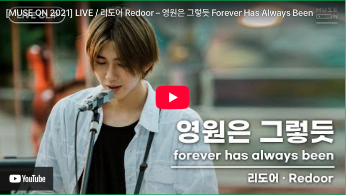

---
categories:
  - life-thoughts/opinions-is-my-own
date: 2026-10-09
description: 요즘 AI에 대한 개인적인 생각을 적어보자.
lang: ko
last_updated: 2026-11-14
naver_date: 2026-10-09
naver_url: https://blog.naver.com/martin-lee/224435902708
tags:
  - 일상·생각
title: 나 왜 이 순간이 영원할 것 같지?
translation_key: 2026-10-09-will-this-moment-last
---

영원할건가보다.

[\[MUSE ON 2021\] LIVE / 리도어 Redoor – 영원은 그렇듯 Forever Has Always Been](https://youtu.be/JNy_pVfs6yQ?si=KWSnFYls6x1dQoWW)

요즘 AI에 대한 개인적인 생각을 적어보자.

컴퓨터가 가장 잘하는 건 반복이다. 이 생각은 변하지 않는다.

아무래도 AI가 가장 많이 쓰이는 분야는 글쓰기, 영상 편집, 노래 만들기 또는 바이브 코딩일 것이다.

이전에는 전문성을 지닌 사람들만이 콘텐츠를 만들어내고 도구를 사용할 줄 알았는데, AI가 이 벽을 허물어주었다. 이 말은 즉 누구나 더 쉽게 개발자가 될 수 있고, 작가가 될 수 있고, 크리에이터 혹은 디렉터, 더 나아가서는 사업을 시작해볼 수도 있다는 것이다.

아직까지 변호사, 의사, 판사와 같은 전문직의 영역은 존재한다. 이게 라이선스가 지닌 파워라고 보고, 왜 대학과 자격시험이 중요한지 보여주는 것 같다. 그럼에도 불구하고 이 또한 언젠가는 대체될 수 있는 시대에 직면했다.

인적 네트워크, 인맥, 친밀감처럼 우리에게는 보이지 않는 선이 있다.

더 나아가서 어떤 사람을 보고 쎄한 느낌을 받을 수 있다. 우린 이런 걸 직감 혹은 예감이라고 부른다.

시각 = 보고

청각 = 듣고

후각 = 냄새 맡고

미각 = 맛보고

촉각 = 만지고

**우리는 이제 오감을 넘어서 여섯 번째 감각이라고 할 만한 무언가를 가져야 한다.** AI가 시각과 청각 활동을 지배할 것이기 때문이다. 시각과 청각을 자극하는 창작물들을 통해 우리의 뇌까지 침투한다. 또한 내 취향은 알고리즘이 만들어준 결과이기도 하다. 요즘 들어 AI가 생산해놓은 글과 영상을 보면 거부감이 든다. 하지만 모든 게 그렇지만은 않다. 강아지를 키우는 사람으로서 강아지가 귀엽게 나오는 영상은 쉽게 넘길 수 없다.

아직까지 후각, 미각, 촉각은 기계가 대체할 수 없는 영역인 것 같다. 이 세 가지 감각은 내가 직접 경험해야 한다. 그래서 지금은 경험이 더 중요해지는 시대라고 생각한다. 다만 언젠가는 이것도 원격으로 경험하고 물리적으로 느낄 수 있다면, 그로 인해 인간의 영역을 모두 빼앗기는 게 아닐까 싶다.

메타의 Muse나 오픈AI의 dot 출시를 기점으로 웹의 사용 방식이 바뀌는 시기라는 생각이 들었다. 솔직히 말해서 인터넷으로 하는 대부분의 활동은 이제 AI가 대신할 수 있다. 아마 이번 AI 업데이트로 인해서 해고는 더 늘어나고 주니어 신규 채용은 줄어들지 않을까 싶다. 대기업이 무서운 점은 한 번에 많은 기업들을 죽일 수 있다는 것이라는 걸 느꼈다.

그럼에도 불구하고 우리는 무엇을 해야 하는가?

AI의 발전이 멈추지 않는 이상 우리는 할 수 있는건 리타이어 하거나 라이이어 되는 것 뿐이다.

자발적으로 리타이어하지 않는다면 우리가 할 수 있는것도 정해져있다. 아직까지 이 필드에 대해서 모르는 사람들을 대상으로 선전활동을 하거나, 만일의 사태에 대비해두는 것뿐이다.

AI 시대의 수혜자로서 꾸준히 팔로우업하면서, 땅따먹기 싸움처럼 느껴지는 어느 한 분야에서 1등이 되기 위해 달려가야 한다. 뭐 하나가 잘 된다 그러면 누구나 득달같이 달려들고 따라 한다. 그리고 순식간에 트렌드는 변한다. 영원한 건 절대 없고 발 빠르게 변해야 한다. 그게 전부다.

