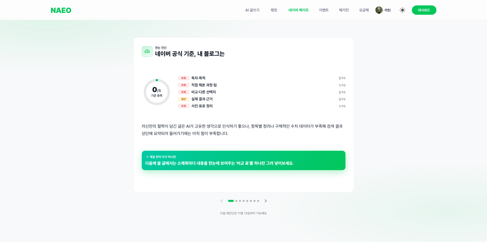
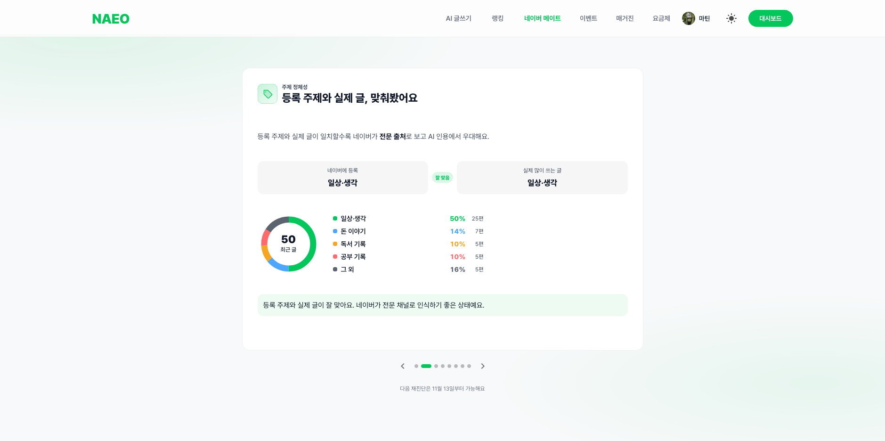
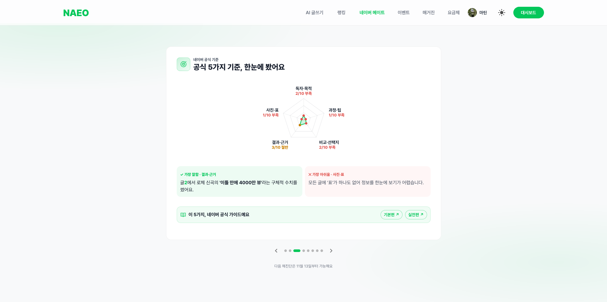
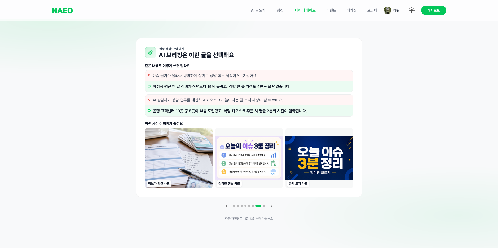

---
categories:
  - life-thoughts/opinions-is-my-own
date: 2026-10-14
description:
  최근에 이전에 이곳저곳에서 썼던 흩어진 글들을 다 모아서 이 블로그에다가 옮기고 있는 중이다. 노션에도 있었고, 워드프레스도 있었고, 티스토리에도 있었다. 페이스북에도 여러 글이 있지만 성격이 좀 다른 것 같아서 그 글은 옮기지
  않았다. 블로그를 여러개를 썼…
lang: ko
last_updated: 2026-11-14
naver_date: 2026-10-14
naver_url: https://blog.naver.com/martin-lee/224441008532
tags:
  - 일상·생각
title: 블로그를 쓰는 이유
translation_key: why-i-do-the-blog
---

<figure data-image-caption="true">
  
  <figcaption><a href="https://www.ogq.me/backgrounds/1514325">© CoolPubilcDomains, 출처 OGQ</a></figcaption>
</figure>

최근에 이전에 이곳저곳에서 썼던 흩어진 글들을 다 모아서 이 블로그에다가 옮기고 있는 중이다. 노션에도 있었고, 워드프레스도 있었고, 티스토리에도 있었다. 페이스북에도 여러 글이 있지만 성격이 좀 다른 것 같아서 그 글은 옮기지 않았다. 블로그를 여러개를 썼었는데 무난하게 괜찮은게 네이버 블로그라는 생각이 들었다. (모르겠다. 궁극적으로는 나만의 블로그를 갖는게 가장 이상적이라고 생각한다...ㅎ)

글을 옮기면서 이전에 썼던 글들을 다시 보니 감회가 새로웠다. 중간에 회원 탈퇴도 한번 했으니 사라진 글들도 많겠지만 필자가 처음에 블로그를 쓰게 된 이유는 부업때문이었을 것이다. 한때 네이버 블로그로 월 100 부수입을 벌 수 있다는 말에 시작했던 블로거들이 많았기에 아마 대부분의 블로거들의 시작은 나랑 비슷할 것이다. 한때 열심히 블로그 했던 때가 있는데 그것도 오래 못갔다. 그렇게 월 100은 고이 접었다가 펼쳤다가 하면서 여러 블로그 플랫폼을 이용했던 것 같다.

**단언컨데 블로그는 단점보다는 주는 장점이 더 크다. 일단 무료 스토리지를 얻는다는 점이다.**

블로그는 SNS랑 성격이 다르다. 나한테 페이스북과 X는 확실히 도움이 되었다. 온라인에서의 활동이 오프라인까지 이어졌고, 그로 인해서 내가 직업을 구하는데 있어서, 나의 평판을 올리는데 있어서 도움을 주었기 때문이다. 운이었다고 말하지만 되돌아보면 운이 아닐 수도 있다. 공개적인 공간에 공개적으로 글을 올렸고, 양질의 글을 올렸기 때문이다라고 말할 수 있다. 그래서 내 글은 대부분 전체 공개이고, 댓글도 웬만하면 전체공개로 올리는 편이다.

SNS가 정보를 교환하고 소통하는 곳이라면, 블로그는 일방적으로 정보를 주는 비중이 크다고 보고있다. 오늘도 알고리즘이 내 글을 누군가에게 잘 전달되기만을 바라는게 전부다. 네이버가 광고중심으로 바뀌면서 그렇게 된건지 AI가 쓰는 글들이 많아져서 그런지 모르겠지만 네이버 블로그는 점점 상업화되어가고 가짜 계정들이 써놓은 글들이 난무하고 있다. 심지어 'AI 브리핑' 기능을 도입하고 나서는 대놓고 AI의 글쓰기를 장려하고 있다.

네이버 AI, NAEO가 분석한 내 블로그는 기준 미달이다. 나는 네이버의 AI로부터 선택받지 못했나보다.. 아무래도 정보가 될만한 글보다는 개인적인 생각을 주로 올리고 이미지보다는 글이기에 낮은 점수로 평가를 했으리라 생각한다. 평가 기준을 살펴보면, '사진/표로 정리, 비교/다른 선택지'가 있는데 이는 AI가 더 잘할 수 있는 영역이 아닌가 생각한다. 게다가 추천해준 썸네일 이미지나 표를 보면 다 AI가 만들어놓은 양산형 이미지다. **대놓고 AI를 써서 유융한 글을 쓰라고 강요하는 것 같은데 나는 그게 싫다.**

AI가 코딩까지 해주는 시대다. 이제 IDE를 켜고 직접 코드를 짜는건 촌스럽고 놀라움을 받는다. 종이에 손으로 코드를 적는 일은 낭만이 되어버렸다. 어쩌면 언젠가는 블로그에 직접 글을 쓰는 일도 촌스러워지고, 펜을 들고 일기를 쓰는 일은 낭만으로 남게 될지도 모른다. 이런 블로그에서 살아남을 수 있는 방법이자 내가 흥미를 잃지 않기 위해서는 SNS처럼 쓰는 방법뿐이지 않을까 싶다. 좀 더 소통하고 그래야겠다.

나의 관심사는 돈 이야기, 테크 관련 이야기, 캐나다 소식들이다.
