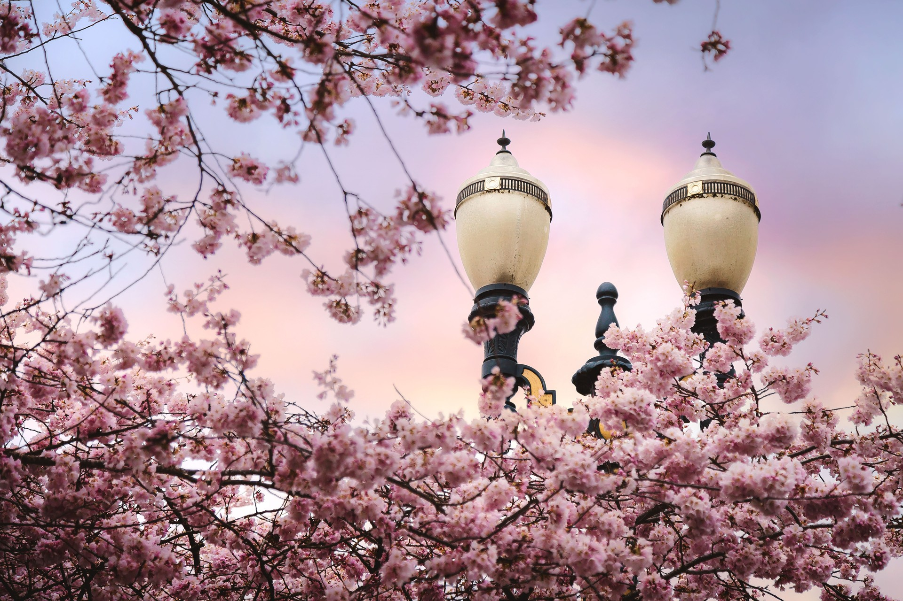

---
categories:
  - life-thoughts/retrospect
date: 2026-05-01
description: 얼마 전까지만해도 해피뉴이얼 했던 것 같은데 벌써 5월이라니 안믿긴다.
lang: ko
last_updated: 2026-11-14
naver_date: 2026-05-01
naver_url: https://blog.naver.com/martin-lee/224271510685
tags:
  - 일상·생각
title: 2026년의 1/3이 흘렀다.
translation_key: 2026-05-01-one-third-of-2026
---

<figure data-image-caption="true">
  
  <figcaption><a href="https://www.ogq.me/backgrounds/1535536">© CoolPubilcDomains, 출처 OGQ</a></figcaption>
</figure>

얼마 전까지만해도 해피뉴이얼 했던 것 같은데 벌써 5월이라니 안믿긴다.

1월부터 3월까지는 그냥저냥 살아왔다.

사실은 4월에 한국을 가는 것이 계획되어 있어 부푼 기대감으로 버티며 지냈었다.

한국을 다녀온 것이 나에게 있어서 가장 큰 이벤트였다.

4월 한달은 한국에 다녀왔다.

한국을 다녀와서 한국에서 살았을 땐 전혀 못느꼈던 감정들을 느낄 수 있었다. 예전에 글을 쓴 적이 있는지 모르겠지만 '탈조선은 지능순'이라는 말을 좋아하지 않는다. 아무리 성별과 세대 차이로 편 가르기가 심하고 정치적으로 위기가 있다한들 아직까지는 한국이 살기 좋은 나라임은 확실하다. 아마 내가 계속 한국에 살았더라면 알 수 없었을 것 이다.

그리고 이상하게도 캐나다에 사는 한인들 중 일부는 한국을 극도로 싫어하는 경우도 있는 것 같다. 이해할 수 없지만 그런 사람들은 피할 수 있다면 피하고 싶다.

한국을 이야기할 때 빠질 수 없는 것 중에 하나가 '비교를 많이 한다.' 라는 문화인데 나도 예전 같았으면 이런 습성이 좋지 않다고 생각 들었을법도 한데 이제와서 보니 나쁜건가?(비교를 하면서 남을 깎아내리는 것이 아니라면) 라는 생각도 든다. 한국에 있었을 때 그런 문화 속에서 직장 생활을 하느라 체감을 못했을 수도 있다. 물론 스트레스도 받고 더 높은 연봉을 위해 어쩔 수 없는 갓생을 선택했어야야 했다. 한편으로는 열심히 사는게 나쁜건 아니라 생각도 들었다.

차라리 비교 보다는 불공평해서 한국이 싫은 것이 더 타당한 이유라고 생각한다. 커뮤니티를 보다보면 '위로 올라가는 사다리를 걷어 차고 있다.', '앞으로 개천에서 날 용은 없다.' 는 등의 사기를 꺾는 유형의 댓글들이 보일 때가 있다. 그렇지만 이는 태생부터 선택할 수 없는 조건이 있기에 누구나 출발점이 다를 수 밖에 없다고 생각한다. 어느정도는 받아들여야할 것 같고 그 이후로부터는 나름 기회가 있다고 느껴진다. 이런 생각도 해외에 한번 살다보니 깨닫게 된 걸수도 있다.

자신의 모국을 스스로 욕한다는 것은 부끄러운 행동이었다라는 걸 반성한다. 특히나 요즘같이 위상이 높아지는 시대에 거스르는 것은 더욱 더 해서는 안되겠다.

별개로 앞으로는 기록을 남기기 위해서라도 블로그를 좀 더 열심히 활동해봐야겠다.

매번 실패하는 약속이긴 하지만...

이번에도 다짐을 해본다..
