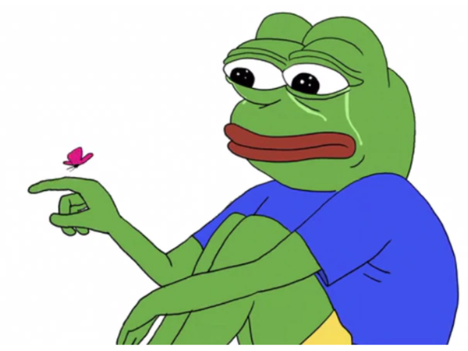
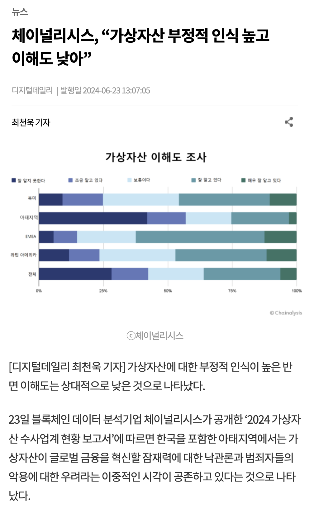

---
categories:
  - money-talk/business
date: 2024-06-28
description:
  아직까지 한국에서는 블록체인보다는 코인이란 단어가 대중들에게는 더 익숙할 테다. 그리고 '코인'이라 하면 그거 사기 아니야?라는 반응이 돌아오는 게 현재 이 시장에서의 문제이자 현실이다. 물론 이는 국내뿐만 아니라 다른
  나라에서도 비슷할 것 같다(본인은 해외…
lang: ko
last_updated: 2026-11-14
naver_date: 2026-09-25
naver_url: https://blog.naver.com/martin-lee/224422173418
tags:
  - 돈 이야기
title: 국내 블록체인 산업 활성화를 위해서 필요한건 무엇일까?
translation_key: 2024-06-28-blockchain-industry-in-korea
---

아직까지 한국에서는 블록체인보다는 코인이란 단어가 대중들에게는 더 익숙할 테다. 그리고 '코인'이라 하면 그거 사기 아니야?라는 반응이 돌아오는 게 현재 이 시장에서의 문제이자 현실이다. 물론 이는 국내뿐만 아니라 다른 나라에서도 비슷할 것 같다(본인은 해외 나가본 적이 없어서 잘 모르겠음).

최근 들어서 '[가상자산 이용자 보호법](https://martin-lee.tistory.com/entry/%EA%B0%80%EC%83%81%EC%9E%90%EC%82%B0-%EC%9D%B4%EC%9A%A9%EC%9E%90-%EB%B3%B4%ED%98%B8%EB%B2%95-%EC%82%B4%ED%8E%B4%EB%B3%B4%EA%B8%B0)' 관련해서 서치를 해보다가 간신히 숨만 붙어있는 [거래소들이 줄줄이 폐업을 하고있다는 기사](https://www.dailian.co.kr/news/view/1377010/)들을 봤다. 그 외에도 '[대주주 수사 시 거래소 심사 중단](https://www.hankyung.com/article/2024062482161)', '[법무부 관련 직원 코인 보유 금지](https://www.hankyung.com/article/2024062480611)' 등 여러 방면으로 규제가 빠르게 심사되고 진행 절차를 밟고 있는데 말 그대로 국내에서 블록체인 관련 사업을 하기에는 더 어려워진 현실이다. 개인적으로 이러한 정부의 개입들은 FTX 파산 or 마운틴곡스의 해킹 사건들을 미리 방지할 수 있는 대안으로 매우 긍정적인 대책이라고 생각하고 있다.

[코인마켓거래소 폐업 가속화…큐비트, 서비스 종료 선언](https://www.dailian.co.kr/news/view/1377010/%EC%BD%94%EC%9D%B8%EB%A7%88%EC%BC%93%EA%B1%B0%EB%9E%98%EC%86%8C-%ED%8F%90%EC%97%85-%EA%B0%80%EC%86%8D%ED%99%94%ED%81%90%EB%B9%84%ED%8A%B8-%EC%84%9C%EB%B9%84-2024)

현재 한국에는 다양한 블록체인 사업자들이 있다. 몇가지 부류를 살펴보자면 거래소는 다들 알다시피 5대 거래소(업비트, 빗썸, 코빗, 코인원, 고팍스)가 대표적이다. 거래소들과 가상자산 사업을 관리해 주는 사업체들은 가상 자산 사업자로 분류되어서 이번에 개정되는 '가상자산 이용자 보호법'을 반드시 따라야 한다. 반면에 여기에 속하지 않는 사업자들은 주로 정보통신업(소프트웨어 개발 및 공급업)으로 분류된다. 예시로 체인이다. 한국을 대표하는 블록체인이라고 하면 아쉽게도 이미 져버린 루나, 클레이튼, 위메이드, 핀시아(구 링크), 그 외로 오르빗 체인, 크로마(위믹스 캔버스)가 있다. 정확한 이유는 모르겠지만 코인을 찍어내고 나면 많은 사람들로부터 인식이 안 좋아진다. 반면에 나름 국내에서 견고하게 유지되고 글로벌리하게 인정받고 꾸준히 지속되고 있는 사업을 살펴보면 인프라(노드) 분야이다. DSRV, A41, 코스모스테이션이 여기에 속한다. 그리고 마케팅 및 리서치 분야도 오래 지속되고 있는 것 같다. 쟁글, 디스프레드, 포필러스, 코인니스가 떠오른다. 한때 교육쪽으로는 코드스테이츠, 멋쟁이 사자처럼, 루디움이 있었는데 지금은 사라진 것 같다(?). 지금 떠오르는 기업들만 작성해 봤고, 이 외에도 특정 디앱을 개발하는 회사들 또는 해시드같은 벤처들도 있다.

위 기업들 중 진짜 온전히 돈을 벌고 있는 곳은 몇군데나 될까? 보통 토큰을 찍어내지 않고서는 지속가능하게 순수히 돈을 벌고 있는 곳은 정말 손에 꼽을 것이다. 이는 전 세계적으로 블록체인 기업들 중 95%가 공통적으로 겪고 있는 문제점일 것이다. 그럼에도 불구하고, 사람들은 무엇에 신경 쓰고 있는가, 어떤 문제들을 해결해가고 있는지 살펴보자. 2024년인 지금은 2018년 꿈을 팔던 ICO 시기와는 다르다. '탈중앙화'는 이제 옛말이고, 아무도 공감해주지 않는 것 같다.

루나 사태, FTX 파산 사태 등등 많은 수모를 겪은 나머지 이 씬에 고인물들만 남게 되었고, 예전과 다르게 신규로 들어오는 사람들은 KOL이 되기도 하고, 누군가는 트레이더가 되기도 하고, 누군가는 자신의 커리어를 위해 접근하기도 한다. 어떠한 이유로 이 시장에 입문했던 간에 어려운 기술에 높은 진입 장벽을 마주치곤 한다. 개인적으로 뉴비들이 이 진입장벽을 마주치는 과정이 예전과는 달라졌다고 느낀다. 이것도 이유가 뭔지는 잘 모르겠다만, AI 기술이 발달해서 그런 건지 아니면 기술보다는 마케팅을 중요시되고 있는 블록체인 시장의 문제가 된 건가 싶다.

체인아날리시스 데이터에 따르면 [한국은 블록체인 이해도가 낮고, 부정적 인식이 높다고](https://m.ddaily.co.kr/page/view/2024062312193349137) 한다.

한국에서의 블록체인 인식은 루나 폭락과 하루인베스트 그리고 위믹스 등등 기존에 있었던 사건들에 의해 부정적으로 생각하는 사람들이 많다. 이 업계에 오래 있다보면, 그게 사기가 아닐지라고 해도 이미 많은 사람들이 사기다라고 하면 사기가 되는게 맞다. 안타깝지만 이러한 현실을 받아들이고 대중들을 이해시키고 그 생각을 바꾸기 위해 노력해야 하는데, 여전히 그런 노력들은 잘 보이지 않는 것 같고 마냥 시간이 지나면 묻히고 모든 게 해결되겠지라는 식으로 마이웨이로 그냥 가고 있는 경우가 많다고 느낀다... 트위터에서 보면 본인들끼리 서로 칭찬하기 바쁜데, 제삼자가 바라보기엔 그들만의 리그에서 친목을 하고 있는 것으로 밖에 보이지 않는다. 정보의 비대칭성, 블록체인의 대중화 등 이런 꿈들을 위해 달려가는 것들도 좋지만 조금만 시야를 넓히고 이 업계의 현 상황을 인지하고 타겟을 설정하는 것도 필요하지 않을까 생각이 든다.

※ 본 글은 블로그 이전으로 인해 기존 글을 옮겨온 것입니다. (작성일: 2024년 6월 28일 17:57)
