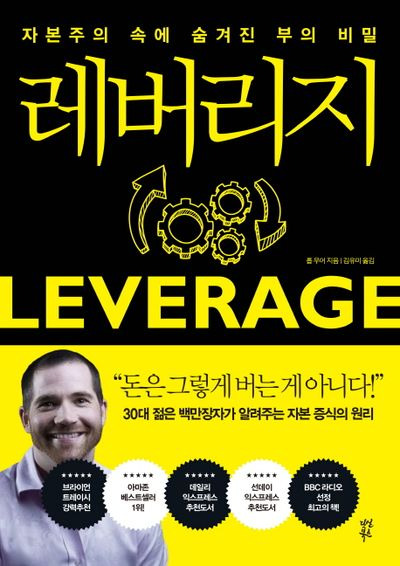
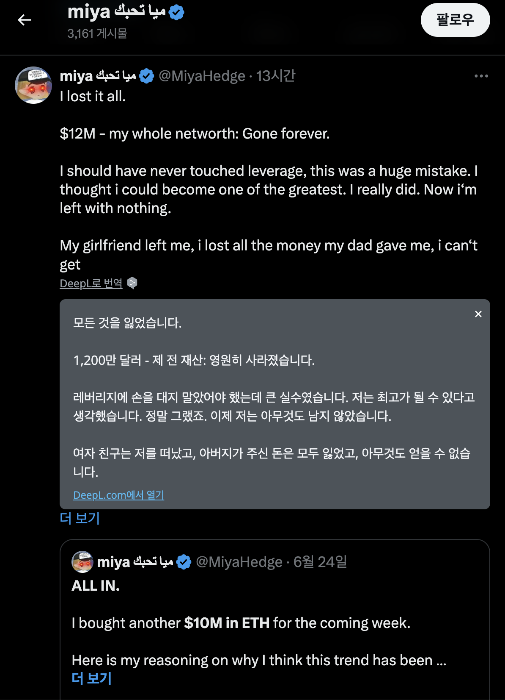

---
categories:
  - money-talk/finance
date: 2024-06-25
description: 자본주의에서의 꽃은 주식시장이라 한번쯤은 들어봤을 거임
lang: ko
last_updated: 2026-11-14
naver_date: 2026-09-25
naver_url: https://blog.naver.com/martin-lee/224422172534
tags:
  - 돈 이야기
title: 레버리지(Leverage)에 관한 생각
translation_key: 2024-06-25-thoughts-on-leverage
---

[레버리지](https://search.shopping.naver.com/book/product/0y5cqemv%2F2bxYMT37tDLo6cdCCu9su%2BCb2p4aDhdHFk%3D)

롭무어, 레버리지

자본주의에서의 꽃은 주식시장이라 한번쯤은 들어봤을 거임

주식의 원리는 싸게 사서 비싸게 파는 것이다.

그리고 자산 증식을 돕는 도구 중 하나로 '**레버리지**'라는 것이 있다.

마진거래는 증권사한테 돈을 빌려 매수하는 것으로, 레버리지를 사용한다.

또한, 레버리지는 변동성이 적은 원자재, 금융 지수 상품 등의 선물 시장에서 유동성을 불어 넣는 역할을 한다.

단, 레버리지에는 만기일 혹은 가격에 따라 청산이 따르는 경우가 존재한다.

그렇기 때문에 은행에서 **빚을 내서, 선물을 하는 경우에는 리스크가 가중되기때문에 절대 해서는 안된다.**

코인시장에서는 무기한 선물 거래를 통해서 많은 사람들이 마진 거래를 하는데 있어서,

거래소한테 돈을 빌려서하는게 아니기 때문에 그냥 가지고 있는 돈이 날라가고 끝인데 해외 선물 같은 경우는 그대로 빚더미에 앉음..

선물거래는 청산의 위험이 있기 때문에 비추천하는 경우도 있고, 누군가는 추천하기도 한다.

개인적으로는 선물거래/현물거래 둘 다 해야한다라고 생각함.

사실 정답이 있다라기보다, **본인만의 기준에 맞는 것을 찾아 매매하는것을 권장함**

선물거래를 할 때, 레버리지를 최대한 활용해야하는데,

펀비를 이용한 1배숏(헷징), 김프매매 이런 잔잔바리들 보다는 직접 매매하는 경우에서의 주의할 점 두 가지를 소개하겠음

**가장 기본적인 방법은 배율 조절이다.**

100배, 125배 이런거는 진짜 도박이고, 날릴 돈으로만 시도해보는거지..

아무리 확신이 가득차더라도 이걸 전략으로 들고가기에는 너무나도 리스크가 크다.

이것도 각자 재량에 따라 다르지만 본인은 보통 2배 ~ 10배 사이로 매매함

**두번째로 중요한 건 철저한 손절 관리이다.**

왜냐하면, 청산을 피하기 위함이다.

간절히 기도했다가 한큐에 밀리는 경우에 돌이킬 수 없기때문에

현물이랑 다르게 손절라인을 더 엄격하게 지켜야한다.

살아남았다면 언젠가는 그 복구할 수 있을테니 최대한 0이 되면 안된다.

어제 마운틴곡스 발 뉴스 및 비트코인 하락으로인해서 한 사람이 1,200만 달러.

한국돈으로 약 160억정도의 돈을 한번에 잃었음..

이더를 풀매수했다는데, 솔직히 저 사람은 10배 이상으로 포지션을 들어갔을거라 예상함.

안타깝지만 본인의 욕심이 큰 화를 불러온것과도 같음.

이런 일이 나한테는 안일어나겠지? 라는 생각은 접어두고,

금액이 적을때부터 차근차근 좋은 매매습관을 들여두는걸 추천함..

※ 본 글은 블로그 이전으로 인해 기존 글을 옮겨온 것입니다. (작성일: 2024년 6월 25일 15:54)
