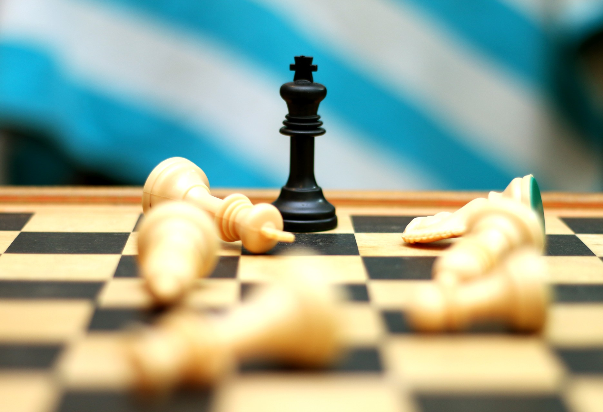

---
categories:
  - money-talk/finance
date: 2026-08-07
description: 게임이론 = 여러 사람이 서로의 행동을 예상하면서 전략적으로 의사결정하는 상황을 연구하는 이론
lang: ko
last_updated: 2026-11-14
naver_date: 2026-08-07
naver_url: https://blog.naver.com/martin-lee/224370928546
tags:
  - 돈 이야기
title: 게임이론
translation_key: 2026-08-07-game-theory
---

[© CoolPubilcDomains, 출처 OGQ](https://www.ogq.me/backgrounds/1514246)

게임이론에 대해서 알아보자.

게임이론 = 여러 사람이 서로의 행동을 예상하면서 전략적으로 의사결정하는 상황을 연구하는 이론

예를 들어 내가 가격을 낮출지 말지는 경쟁 회사가 가격을 어떻게 정할지에 따라 달라진다.

게임이론의 기본 구조는 보통 4개로

1\. 플레이어(Player): 의사결정을 하는 주체. 개인, 기업, 국가 등이 될 수 있다.

2\. 전략(Strategy): 플레이어가 선택할 수 있는 행동.

3\. 보수(Payoff): 각 전략을 선택했을 때 얻는 결과. 돈, 이익, 효용, 승패 등이 될 수 있다.

4\. 정보(Information): 상대방의 행동이나 상황을 얼마나 알고 있는가.

가장 유명한 예시는 **죄수의 딜레마**가 있다.

두 명의 범죄자 A, B가 각각 선택을 한다.

<table><tbody><tr><td></td><td>
B 침묵
</td><td>
B 배신
</td></tr><tr><td>
A 침묵
</td><td>
A -1 / B - 1
</td><td>
A - 10 / B 0
</td></tr><tr><td>
A 배신
</td><td>
A 0 / B - 10
</td><td>
A -5 / B -5
</td></tr></tbody></table>

둘 다. 침묵하면 둘에게 가장 좋은 결과에 가까운 -1, -1이 나온다.

그런데 A 입장에서 보면, B가 침묵해도 배신하는 게 유리하고 B가 배신해도 배신하는 게 유리하다. B도 똑같다.

그래서 결국에는 A 배신 + B 배신 = (-5, -5)가 나올 수 있다.

**즉, 둘에게 더 좋은 결과가 존재하는데도 각자가 자기 이익을 추구하면서 더 나쁜 결과에 도달하게 된다.**

여기서 중요한 개념이 **우월전략(Dominant Strategy)**이다.

\= 상대방이 무엇을 하든 나에게 유리한 전략.

위 죄수의 딜레마 예시에서 배신이 바로 우월전략이다.

그리고 게임이론에서 가장 중요한 개념 중 하나가 **내시균형(Nash Equilibrium)**이다.

\= 다른 사람이 전략을 바꾸지 않는 상황에서 나 혼자 전략을 바꿔도 더 좋아질 수 없는 상태

위 예시에서 \`배신 / 배신\` 이 내시균형이다.

A가 혼자 침묵으로 바꾸면 -5 -> -10이 되어 손해고, B도 마찬가지라서 아무도 혼자 전략을 바꿀 이유가 없다.

내시균형은 사회적으로 가장 좋은 결과라는 뜻은 아니다.

게임이론은 기업 경쟁, 국제 관계, 일상 생활 등 실제로 엄청 자주 보인다.

두번째 예시인 **제로섬 게임**으로 게임이론을 알아보자.

제로섬 게임은 말 그대로, 한쪽이 얻는 만큼 다른 쪽이 잃어서 전체 보수의 합이 0이 되는 게임이다.

<table><tbody><tr><td></td><td>
A
</td><td>
B 
</td><td>
합계
</td></tr><tr><td>
A 승리
</td><td>
+10
</td><td>
-10
</td><td>
0
</td></tr><tr><td>
무승부
</td><td>
0
</td><td>
0
</td><td>
0
</td></tr><tr><td>
B 승리
</td><td>
-10
</td><td>
+10
</td><td>
0
</td></tr></tbody></table>

핵심은 파이가 커지거나 줄어드는 게 아니라, 이미 정해진 파이를 누가 더 가져가느냐다.

상대방의 이익이 곧 내 손실이다.

대부분의 승패 혹은 경쟁을 하는 구도는 제로섬 게임에 가깝다. 가위바위보도 마찬가지이다.

죄수의 딜레마와 다르게 제로섬 게임은 "**상대방에게 뺏기지 않고 내가 얼마나 가져갈 것인가?**"가 더 중요하다.

여기서 **미니맥스(Minimax)**라는 개념이 등장한다.

\= 최악의 상황에서 내가 입는 손실을 최소화하는 전략

앞에서 본 죄수의 딜레마나 가위바위보(제로섬 게임)가 보통 "동시에 선택하는 게임"이라면, **순차게임은 누군가 먼저 행동하고, 다음 사람이 그 행동을 본 뒤 대응하는 게임**이다.

핵심은 "누가 먼저 움직이느냐가 전략과 결정을 바꾼다." 라는 것이다.

가장 큰 예시로는 체스가 있으며 실생활에서도 흔히 보인다.

새로운 카페 A, B가 개업을 앞두고 있다.

A가 먼저 선택한다.

A: 카페를 열까, 말까?

카페를 열면 다음으로 B가 선택을 해야한다.

B: 가격을 낮춰서 열까? 그냥 경쟁할까?

<table><tbody><tr><td></td><td>
A 이익
</td><td>
B 이익 
</td></tr><tr><td>
A 가 카페 오픈을 안함
</td><td>
0
</td><td>
+10
</td></tr><tr><td>
A 카페 오픈 + 가격 전쟁
</td><td>
-5
</td><td>
-2
</td></tr><tr><td>
A 카페 오픈 + 그냥 경쟁
</td><td>
+5
</td><td>
+5
</td></tr><tr><td>
B가 카페 오픈을 안함
</td><td>
+10
</td><td>
0
</td></tr></tbody></table>

한 사람이 먼저 행동하고 다른 사람이 그걸 본 뒤 행동하는 것이 순차게임의 핵심이다.

다음은 **반복게임(Repeated Game)**이다.

\=

...

순차게임, 반복게임, 조정게임, 치킨게임,
