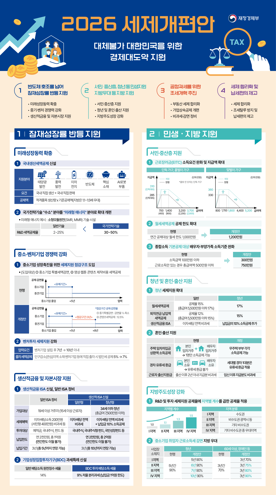
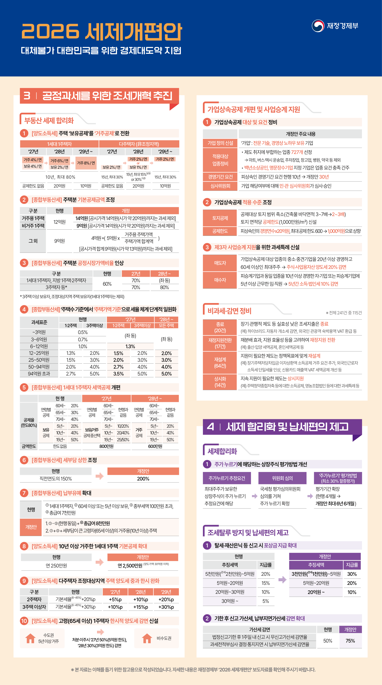
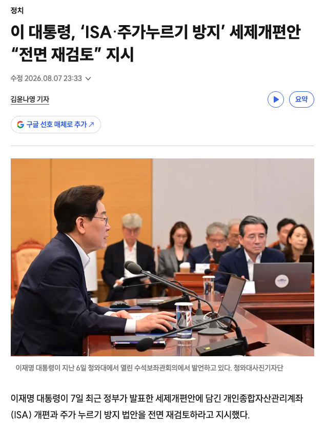

---
categories:
  - money-talk/finance
date: 2026-08-08
description: 세제개편안은 매년 재정경제부(구 기획재정부)가 발표를 한다.
lang: ko
last_updated: 2026-11-14
naver_date: 2026-08-08
naver_url: https://blog.naver.com/martin-lee/224371685317
tags:
  - 돈 이야기
title: 2026년 세제개편안 발표
translation_key: 2026-08-08-korean-tax-reform-2026
---

세제개편안은 매년 재정경제부(구 기획재정부)가 발표를 한다.

올해 8월 3일, 2026년 세재개편안을 발표했다.

[https://www.mofe.go.kr/nw/nes/detailNesDtaView.do?searchBbsId1=MOSFBBS\_000000000028&searchNttId1=MOSF\_000000000078809&menuNo=4010100](https://www.mofe.go.kr/nw/nes/detailNesDtaView.do?searchBbsId1=MOSFBBS_000000000028&searchNttId1=MOSF_000000000078809&menuNo=4010100)

[재정경제부](https://www.mofe.go.kr/nw/nes/detailNesDtaView.do?searchBbsId1=MOSFBBS_000000000028&searchNttId1=MOSF_000000000078809&menuNo=4010100)

발표와 동시에 세법이 바뀌는 것은 아니다.

발표 → 입법예고 → 국무회의 → 국회에 세법개정안 제출 → 국회 심의⋅의결 → 공포 → 시행

위와 같은 과정을 거쳐 세법 개정이 확정되며, 국회를 최종 통과한 내용이 법률로 공포된 된 뒤 각 법률에서 정한 시행일부터 적용된다.

세제개편안 상세본 pdf 를 다 읽어보고 싶은데 250페이지나 된다.

다음은 정부에서 발표한 2026 세제개편안 인포그래픽 사진 2장이다.

주택 보유자라면 부동산 관련 섹터를 중점으로 봐야겠지만 나처럼 자가 없는 서민, 중상층이 눈 여겨볼 점은 아래 내용인 것 같다.

**1-3. 생산적금융 및 자본시장 지원 - ISA 개편**

**2-1. 서민****⋅중상층 지원**

**2-2. 청년 및 혼인⋅출산 지원**

**4-1. 세제합리화 주가누르기??**

읽으면서 세법에 대해서도 기본적인 공부를 좀 해둬야겠다는 생각이 들었다..

ISA개편에는 '**일반 ISA 정비, 생산적금융 ISA를 신설**' 두 가지가 포함되어있다.

ISA는 정부가 국민의 자산 형성과 장기 투자를 장려하기 위해 세제혜택을 부여한 계좌다. 서민에게는 얼마 남지 않은 자산 형성의 사다리이자 작은 한 줄기 빛과도 같다. **순소득에 대해 일반형은 200만원, 서민형·농어민형은 400만원까지 비과세**하고, 이를 초과한 금액에도 낮은 세율이 적용된다

**기존 ISA 계좌는 3년의 최소 의무가입기간을 채운 뒤 계약을 계속 연장할 수 있었**다. 그래서 본인이 계속 연장만 한다면 장기적으로 유지하는 것이 가능했다. 그런데 **이번 개편안에서는 일반 ISA를 최초 3년 → 최대 2년 추가 연장 → 총 5년까지만 운용하도록 바꾸겠다고한다.** 뿐만아니라 납입한도에서도 바뀌는 점이 있다. 바로 '**연간한도 이월불가**' 라는 항목이다. 한도 기간을 두어서 최대한 ISA계좌를 장려하는걸 목표로 하는건가 싶다..

하나 더 눈여겨 볼 점은 이번에 새로 신설된 '**생산적 ISA 신설'** 부분이다.

생산적 ISA 계좌는 일반형과 청년형으로 두 개로 나뉜다.

납입 기간이 3년 총 10년까지 연장가능, 연 2천만원, 이자⋅배당 전액 비과세(청년형은 납입금 10% 소득공제)까지 해주니 기존 ISA계좌보다 훨씬 장점이 많다. 다만 투자대상은 국내주식, 국내주식형펀드, 국민성장펀드 등 '국내'에 한정에서만 가능하다. 이는 곧 국내 주식 시장만을 끌어올리겠다.라는 것으로 보인다.

세제개편안이 발표된 이후로 ISA계좌를 건들였다라는 이유로 여론이 좋지 않다.

[https://www.khan.co.kr/article/202608072329001](https://www.khan.co.kr/article/202608072329001)

정부가 보기에도 말이 안되는지 재검토를 지시했다고 한다.

다행이다.
