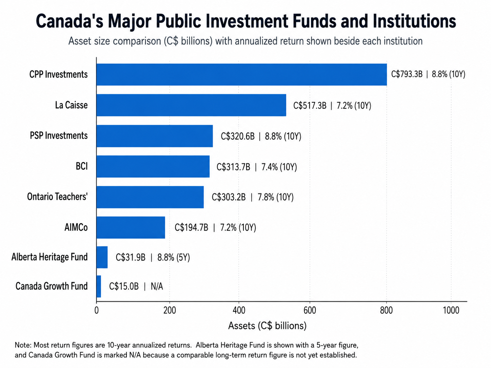
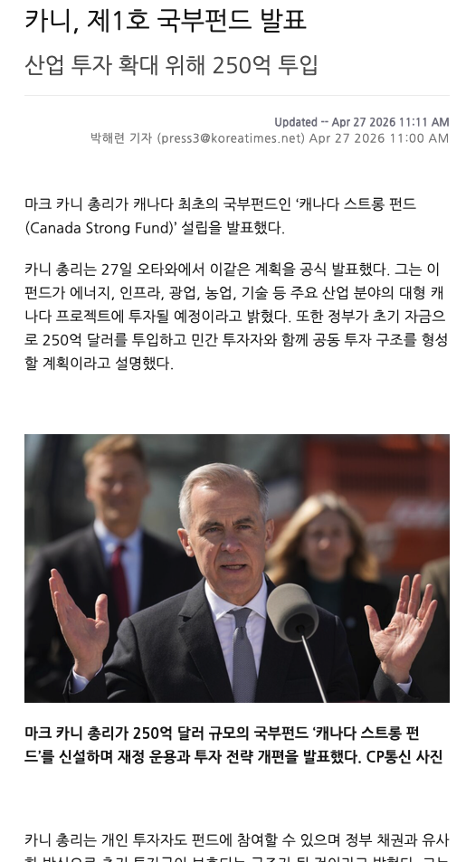

---
categories:
  - money-talk/finance
date: 2026-08-12
description: 캐나다 국부 펀드에 대해서 갑자기 궁금해져서 기록할 겸 알아보기로 하였다.
lang: ko
last_updated: 2026-11-14
naver_date: 2026-08-12
naver_url: https://blog.naver.com/martin-lee/224376077768
tags:
  - 캐나다
  - 캐나다국부펀드
  - CanadaStrongFund
title: 캐나다 국부 펀드 & Canada Strong Fund
translation_key: 2026-08-12-canada-strong-fund
---

<figure data-image-caption="true">
  
  <figcaption><a href="https://www.ogq.me/backgrounds/1499856">© CoolPubilcDomains, 출처 OGQ</a></figcaption>
</figure>

캐나다 국부 펀드에 대해서 갑자기 궁금해져서 기록할 겸 알아보기로 하였다.

알아보게 된 근본적인 이유는 최근 한국의 국민연금 리밸런싱 관련한 글을 보고나서 캐나다는 어떻게 운용이 되는지 알고싶었기 때문이다. 한국-캐나다-일본은 비슷한 유형으로 연금이 운용되고 있는데 '**의무가입형 소득비례 공적연금**' 또는 '**사회보험형 공적연금**'이라고 불린다.

**한국의 국민연금(NPS)**

월급 → 국민연금 보험료 → **NPS** → 투자 → 국민연금 지급

**CPP(Canadian Pension Plan, 캐나다 연금)**

월급 → CPP contribution → **CPP Investments** → 투자 → CPP 지급

일본 역시 국민연금과 직장인을 대상으로 하는 후생연금을 운영한다. **월급을 받으면 소득의 일정부분을 국민연금에 납부해야만 하고, 국가 공적 연금기금이 운용을 한다.**

그렇다면 세계적으로 잘 운용되고 있다고 평가받는 **노르웨이의 국부펀드**와는 무엇이 다를까?

처음에는 캐나다 CPP도 노르웨이 국부펀드와 비슷한 구조라고 생각했다. 하지만 알아보니 둘은 **투자 방식은 비슷한 부분이 있지만 출발점은 완전히 다르다.**

노르웨이의 국부펀드는 '석유 → 정부 수입 → 투자 → 미래 세대를 위한 자산' 이라는 발상으로부터 시작되었다.

석유와 천연가스라는 한정된 자원을 팔아 얻은 수입을 지금 모두 사용하지 않고 금융자산으로 바꿔 미래 세대에게 남기는 것이다. 즉 노르웨이 국부펀드는 **국가가 자원으로 벌어들인 돈을 운용하는 국부펀드**이고, CPP는 **근로자와 고용주가 납부한 보험료를 운용하는 공적연금**이다. CPP Investments를 흔히 캐나다의 국부펀드처럼 생각할 수 있지만, 엄밀히 말하면 국부펀드는 아니다.

CPP의 규모는?

**$793.3B,** 한국돈으로 약 800조에 달하는 금액이다. (한국의 국민연금 규모는 1,600조)

CPP 연금 구조는 **Base CPP / Additional CPP** 로 2개로 분리해서 관리한다.

**\* Base CPP**: 기존부터 운영되어온 캐나다의 기본 CPP

**\* Additional CPP**: CPP의 노후소득 보장 수준을 높이기 위해 2019년부터 추가된 강화분

즉 별개의 두 국민연금이 존재한다기보다는, 기존 CPP 위에 추가적인 연금 보장 부분이 만들어졌다고 이해하면 편하다.

한국은 '국민연금'이라고 하면 NPS라는 하나의 거대한 기관이 먼저 떠오르지만, 캐나다는 공공자금을 운용하는 초대형 투자기관이 여러 개로 분산되어 있다.

**\* CPP Investments = 전국 공적연금**

**\* PSP Investetments = 연방 공공부문 연금(공무원, 군인, RCMP 등)**

**\* La Caisse = 퀘백 공공기관 연금**

**\* BCI = BC주 공무원/교사 등 공공부문 연금**

**\* AlMCo = AB주 공공연금 + 정부기금**

**\* Ontario Teacher's = ON주 교사 연금**

**\* Alberta Heritage Fund = AB주 자원 수입 펀드**

**\* Canada Growth Fund = 연방 정책형 투자 펀드**

그래서, CPP Investments가 어떤 종목을 매수/매도를 하는지 알 수 있는 방법은 cpp investmetns holdings/portpolios 로 구글링을 하면 보유하고 있는 종목을 확인할 수 있다.

[https://www.koreatimes.net/ArticleViewer/Article/176634](https://www.koreatimes.net/ArticleViewer/Article/176634)

위 기사는 2026년 4월 27일 기사이다.

주된 내용은 캐나다 총리인 마크 카니의 국부펀드가 신설된다는 것 이었다.

**'Canaada Strong Fund'**

자세한 내용은 아직 공개되지 않았지만 추후에 계속 눈여겨 볼 필요가 있어 보인다.

#캐나다

#캐나다국부펀드

#CanadaStrongFund
