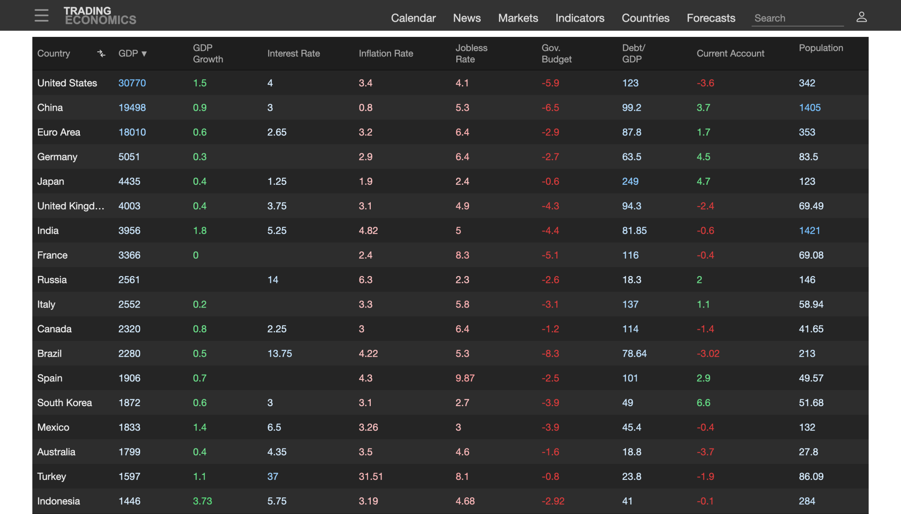
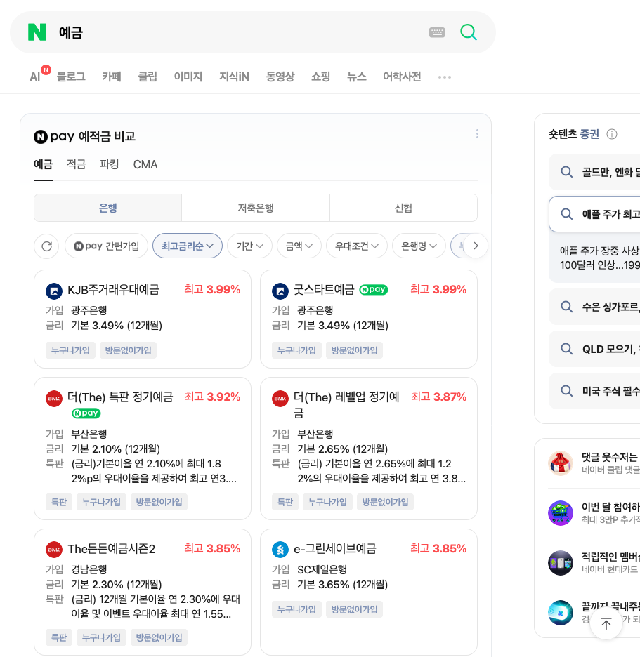
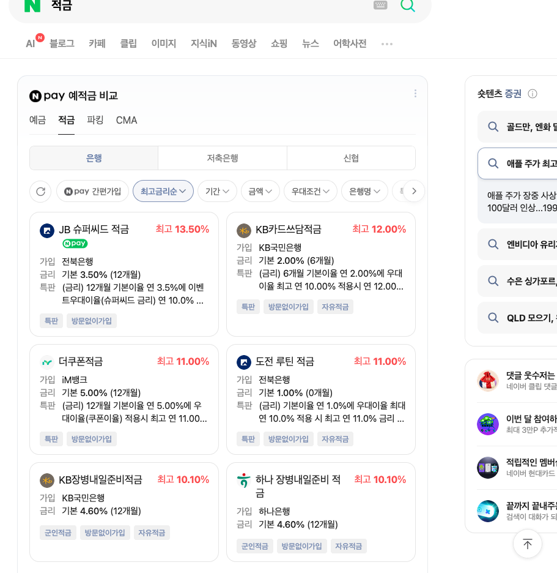

---
categories:
  - money-talk/finance
date: 2026-09-27
description: ex)100만원을 연 5% 금리로 1년간 빌렸다면, 단리 기준으로 이자율은 5%, 이자금은 5만원이다.
lang: ko
last_updated: 2026-11-14
naver_date: 2026-09-27
naver_url: https://blog.naver.com/martin-lee/224422906367
tags:
  - 채권
  - 주식
  - 예금
  - 적금
  - 이자
  - 은행
  - 신용
title: 금리와 채권에 대한 이해
translation_key: 2026-09-27-interest-rates-and-bonds
---

<figure data-image-caption="true">
  
  <figcaption><a href="https://www.ogq.me/backgrounds/1490017">© CoolPubilcDomains, 출처 OGQ</a></figcaption>
</figure>

**'금리 = 이자율'**

이자 = 돈의 액수

ex)100만원을 연 5% 금리로 1년간 빌렸다면, 단리 기준으로 이자율은 5%, 이자금은 5만원이다.

이자를 계산하는 방식

\* 단리 = 원금에만 이자를 붙이는 방식

\* 복리 = 원금에 이자를 더한 금액에 다시 이자를 붙이는 방식

**금리는 돈을 빌려줄 때도, 빌릴 때도 적용된다.**

보통 뉴스에서 금리인상 소식이 나온다면, 중앙은행의 기준금리를 말한다.

그렇다면 중앙은행의 기준금리가 왜 중요할까?

**은행의 기본적인 수익구조는 '자금 조달'이다.**

은행의 주요 업무 중 하나는 자금을 마련해 **돈이 필요한 개인과 기업에 빌려주는 것**이다. 고객의 예금을 받거나 채권을 발행하는 등의 방법으로 자금을 조달하고, 대출에서 받는 이자와 자금 조달에 드는 이자의 차이로 수익을 얻는다. **중앙은행의 기준금리(Policy Rate)가 올라가면, 은행이 돈을 구할 때 내는 이자도 대체로 올라간다.**

즉, **기준금리 상승 → 은행끼리 돈을 거래하는 금리 상승 → 은행의 자금 마련 비용 증가 → 고객의 대출금리** **인상** 으로 흐른다. 이는 고객의 대출금리 상승으로 이어져 가계와 기업의 이자 부담을 키운다. 고객의 돈을 확보하려는 경쟁이 치열하면 예금금리를 더 높일 수도 있다. 그 결과 **소비와 투자가 줄어들고, 부동산과 주식 같은 자산 시장도 위축**되는 경향이 있다.

trading economics

이 글을 작성하는 시점의 국가별 금리를 한번 봐보자. 네 번째 열에 있는 Interest Rate이 금리이다.

미국 연 4.0%, 일본 1.25%, 한국 연 3.0% 이다. (금리 인상⋅인하⋅동결 여부 발표는 연 8회/6~7주에 한번 진행한다.)

네이버 예적금 비교

7080년도에 살아보지 않아서 모르겠지만 어르신들 얘기들어보면 그때만해도 이자가 20%가 넘었다고 한다.... 그게 얼마나 유지됐는지는 잘 모르겠다. 그래서 연세 좀 있으신 분들이 주식같은거 하지말고 은행에 차곡차곡 돈 모아놓으라고 하시는 것 같다. 여튼 예금, 적금, 파킹통장 가입할 때보면 금리 높은 걸 선택해서 가입하면 된다. 요즘은 특판, 우대이율 이런게 많아서 잘 따져보고 현명하게 가입해두길 바란다. 여튼 저것도 풍차돌리기만 잘 하면 안정적인 수익이 나니깐 말이다.

---

금리랑 또 깊은 연관이 있는게 채권이다.

**'채무 =** **빚'**

**'채권 = 돈을 받을 권리'**

**'채권자 = 돈을 받을 사람'**

**'채무자 = 돈을 갚아야 할 사람'**

'신용 = 이 사람이 돈을 갚을 것이라고 믿을 수 있는 정도'

'담보 = 못 갚았을 때 대신 가져갈 수 있도록 잡아놓은 자산'

'부도 = 약속대로 원금이나 이자를 갚지 못하는 것'

ex) 은행에서 1억을 연 5%로 3년간 빌리고 자동차를 담보로 잡았다. (만기일시상환)

채무자 = 나

채권자 = 은행

원금 = 1억

금리 = 연 5%

이자 = 416,667 \* 36개월

만기 = 3년

담보 = 자동차

위 같은 경우는 은행 대출⋅신용이고,

다른 하나는 빚/채권을 거래하는 **채권시장(Bond Market)**이다.

채권의 종류는 발행하는 주체에 따라 **국가채 / 지방채 / 회사채 / 금융채 / 기관채** 이렇게 존재한다.

채권(Bond) = 빚을 증권화한 것

액면가(Coupon) = 채권이 약속한 정기 이자

만기(Maturity) = 원금을 돌려주는 시점

수익률(Yield) = 현재 가격 기준으로 투자자가 얻는 수익률

ex) 정부가 1억 원을 조달하기 위해 3년 만기, 연 3% 국채를 발행했다.

채무자 = 정부

채권자 = 국채 투자자

원금 = 1억 원

쿠폰금리 = 연 3%

이자 = 연 300만원

만기 = 3년

만기가 다가와서 국채를 새로 발행하기도 하며, 실제로 자금이 필요해서 국채를 발행하는 경우도 있는데 이는 정부가 계속 빚을 늘린다 라는 의미와도 같다. 결국에는 국채를 누가 사주는가? 를 봐야한다.

금리와 국채에 대해서 이해하자면 여러모로 복잡하다..

**\* 기준 금리↑ → 기존 채권 가격↓→채권 수익률↑**

**\* 기준 금리↓ → 기존 채권 가격↑→채권 수익률↓**

**\* 채권을 사람들이 팜 → 채권 가격 ↓ → Yield ↑**

**\* 채권을 사람들이 삼 → 채권 가격 ↑ → Yield ↓**

이는 지금까지의 시장에서 거의 공식처럼 통용된다. 더 나아가면 '**인플레이션↑ → 금리 인상 기대↑ → 국채수익률↑ → 채권가격↓ → 할인율↑ → 주식 밸류에이션 압박**' 처럼 보기도 한다.

#채권

#주식

#예금

#적금

#이자

#은행

#신용
