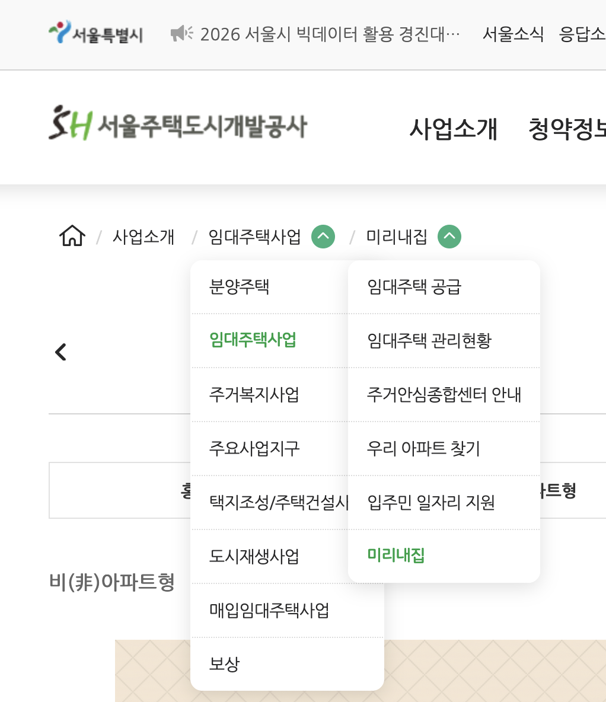
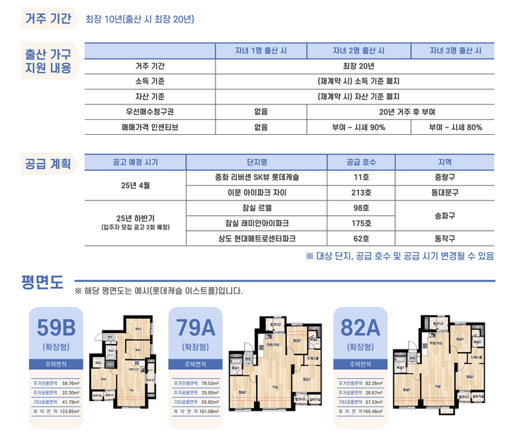
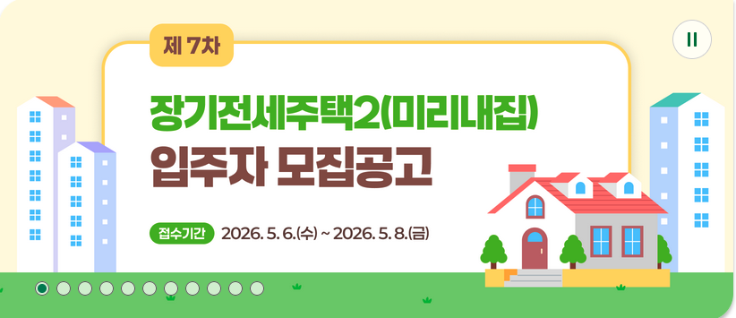
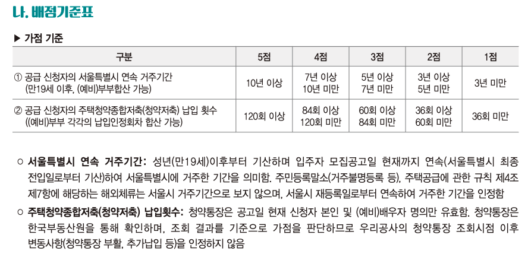
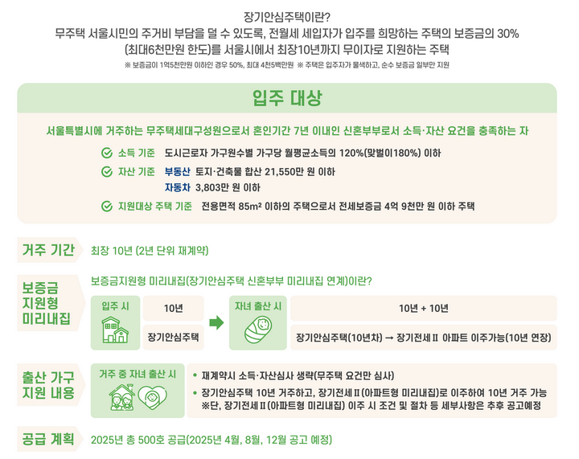
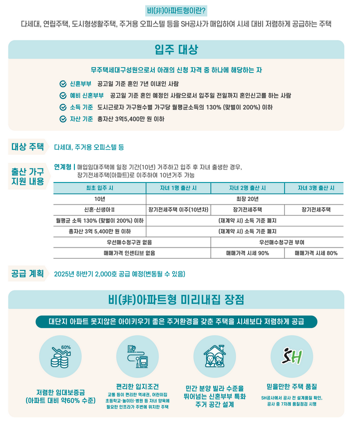

---
categories:
  - money-talk/property
date: 2026-05-01
description: SH(서울주택도시개발공사) 에서 '미리내집' 이라는 임대주택사업에 대해서 알게되었다.
lang: ko
last_updated: 2026-11-14
naver_date: 2026-05-01
naver_url: https://blog.naver.com/martin-lee/224271573222
tags:
  - 돈 이야기
title: SH 미리내집 알아보기
translation_key: 2026-05-01-sh-mirinaejip
---

[https://www.i-sh.co.kr/main/lay2/S1T7312C7332/contents.do](https://www.i-sh.co.kr/main/lay2/S1T7312C7332/contents.do)

SH(서울주택도시개발공사) 에서 '**미리내집**' 이라는 임대주택사업에 대해서 알게되었다.

최근 국가에서는 **신혼부부를 대상으로 주거비 부담을 줄이기 위한 다양한 지원 정책**을 시행하고 있다.

미리내집은

**1\. 아파트형**

**2\. 보증금지원형**

**3\. 비 아파트형**

세 가지 유형의 공고로 분류할 수 있다.

공통점은 신혼·출산 가구의 주거 안정 + 장기 거주 + 내집 마련의 기회를 위한 주택 정책이라는 것이다. 여기서 **가장 눈여겨 볼 점은 20년 뒤에 거주한 집을 80%-90% 수준의 가격에 매수를 할 수 있다는 것이다**. 아파트형에는 브랜드 아파트가 포함되어있기에 많은 사람들의 관심을 받고 있다. 입주 대상은 당연히 무주택자여야한다는 점이다. 그리고 공고에 따른 소득기준과 자산기준을 갖춰야한다.

**1\. 아파트형**

입주 대상

입주자 모집 공고일 기준 혼인신고를 한 날로부터 7년 이내

입주자 모집 공고일로부터 6개월 이내 법률에 따른 혼인 사실을 증명 (예비 신혼도 가능)

입주자 모집 기준 5년동안 주택을 소유하지 않았을 것 (무주택자)

소득 기준

전용면적 60m ² 이하: 월평균 소득의 120% (맞벌이 180%) 이하

전용면적 60m ² 초과: 월평균 소득의 150% (맞벌이 200%) 이하

(\* 가구 수에 따라 다르니 반드시 모집공고를 확인바람)

총 자산 = 부동산 + 자동차 + 일반자산 + 금융자산 - 부채

자녀 1명: 704,000,000원

자녀 2명: 768,000,000원

해당하지 않는 경우: 648,000,000원

25년 4월 이문 아이파크 자이,

25년 하반기 잠실 르엘, 잠실 래미안 아이파크가 가장 인기 있을 것으로 예상된다.

2026년 4월 24일에 올라온 최근 공고를 살펴 보자.

미리내집 7차 특별공급

모집 정보 (신규)

**힐스테이트 동작시그니처**

45m² (66호): 469,560,560원

50m² (6호): 521,820,000원

59m² (19호): 593,580,000원

**엘리프 미아역**

49m² (5호): 380,640,000원

59m² (9호): 493,740,000원

74m² (2호): 541,320,000원

84m² (1호): 606,060,000원

**보라매역 프리센트**

44m² (16호): 364,260,000원

공급호수: 총 441세대

신규 124호 / 재공급 317호

(재공급 매물은 세대당 모집 호수가 적어서 경쟁률이 높을 듯, 반포자이도 포함되어있음)

**청약 신청: 2026년 5월 6일 ~ 5월 8일**

당첨자 발표: 2026년 9월 18일

계약 체결: 2026년 10월 19일 (단지별 상이)

(\*\*보증금 분할납부제로 70%만 납부하고 나머지 30%는 퇴거시까지 나눠서 낼 수 있다. 30%에 대해서는 연 2.73%의 이자가 적용된다.)

**선발 기준**

[https://www.i-sh.co.kr/main/lay2/program/S1T294C295/www/brd/m\_241/view.do?seq=303480](https://www.i-sh.co.kr/main/lay2/program/S1T294C295/www/brd/m_241/view.do?seq=303480)

[sh서울주택도시개발공사](https://www.i-sh.co.kr/main/lay2/program/S1T294C295/www/brd/m_241/view.do?seq=303480)

반드시 지원공고를 확인해보기를 바란다.

**2\. 보증금지원형**

주택의 보증금의 30%, 최대 6천만원을 무이자로 빌려주는 지원사업이다.

주택은 입주자가 물색을해야하고 보증금을 지원받는 건데 서울에 전세 1.5억이면 작은 원룸이나 투룸일 것이다. 작은 집으로부터 시작해서 큰 집으로 점프한다는 계획을 갖고 있다면 이 공고가 매력적일 것 이다. 거주 중 자녀 출산 시, 장기전세 아파트로 이주 가능하다는 것이 장점이다.

**3\. 비 아파트형**

아파트형과 달리 SH가 매입한 건물에 들어간다는 것이 특징이다. 이것도 보증금지원형이랑 마찬가지로 거주 중 출산 시, 장기전세주택으로 이주하여 10년 거주가 가능하다.

---

여러모로 월급만 모아서는 서울에 내집마련을 하기 어려운 시대이다. 이런 지원사업을 통해서 20년 몸으로 존버하면서 집을 매수할 계획을 세워보는것도 현실적으로 좋은 대안이 될 것 같다. 꾸준히 관심을 갖도록 해야겠다.
