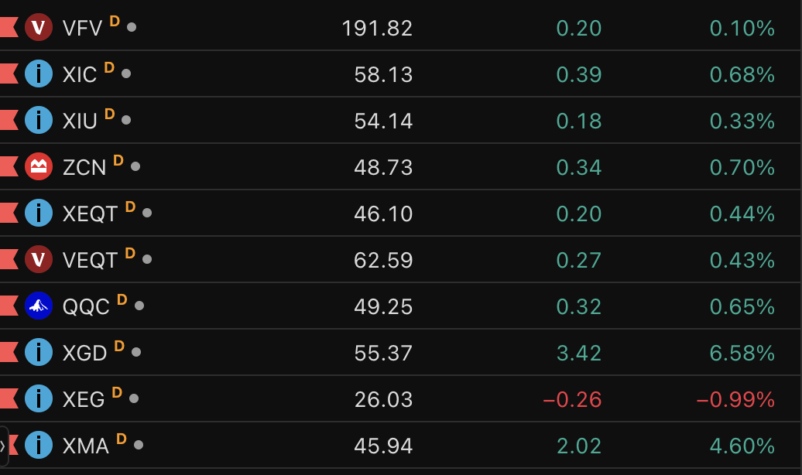
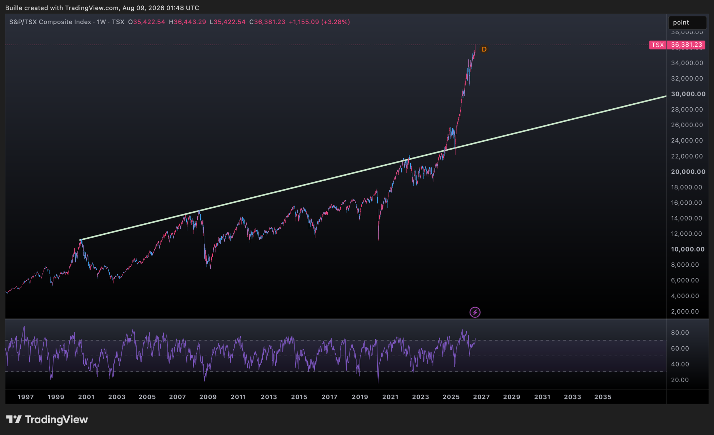

---
categories:
  - money-talk/stock
date: 2026-08-09
description: 주식에서는 "계란을 한 바구니에 담지 말라"는 유명한 격언이 하나 있다.
lang: ko
last_updated: 2026-11-14
naver_date: 2026-08-09
naver_url: https://blog.naver.com/martin-lee/224372793980
tags:
  - 캐나다주식
  - 캐나다ETF종목
  - XIU
  - VEQT
  - XGD
  - XEG
  - XMA
title: "[캐나다 주식] ETF 종목 추려보기"
translation_key: 2026-08-09-canadian-etf-shortlist
---

[© CoolPubilcDomains, 출처 OGQ](https://www.ogq.me/backgrounds/1481518)

주식에서는 "계란을 한 바구니에 담지 말라"는 유명한 격언이 하나 있다.

종목 하나에 몰빵하지 말라는 말과도 같다.

물론 코카콜라처럼 우상향 하는 경우도 있겠지만

그 반대로 나이키를 담았더라면 처참한 결과를 맞이했을 것이다.

그래서 투자의 위험성을 낮추기 위해 분산투자를 이야기할 때 위 말을 자주 사용한다.

분산투자를 하는 방법 중 하나는 종목의 개수를 늘리는 것도 있지만

ETF 종목을 매수하는 것 또한 분산투자의 일종이다.

ETF = Exchange-Traded Fund, 한국어로는 상장지수펀드.

여러 자산을 모아놓은 펀드이다.

가장 대표적인 ETF는 미국의 기술주 100개에 투자하는 QQQ.

엔비디아 / 애플 / 마이크로소프트 / 아마존 / 마이크론 .... 등 여러 종목들을 비중을 다르게 담는 ETF 이다.

블랙록(iShare), 뱅가드(Vanguard), 인베스코(Invesco) 같은 대형 자산운용사들이 ETF를 만들어서 운용한다.

ETF 종목을 매수하는것은 한 번에 여러 기업에 투자하므로 편하고 안전하다는 장점이 있다. 다만 시장 전체 혹은 특정 섹터에 투자하는 것이므로 시장 전체가 떨어지면 ETF 가격이 떨어지고 개별주에 투자하는 것보다 수익률은 낮을 수 있다. 또한 여러 ETF를 사면 종목이 중복될 수도 있다.

캐나다에서는 보통 어떤 ETF 종목들을 선호하는지 알아보자.

[https://www.reddit.com/r/CanadaInvesting/](https://www.reddit.com/r/CanadaInvesting/)

[r/CanadaInvesting](https://www.reddit.com/r/CanadaInvesting/)

토스나 네이버처럼 종토방 개념이 아직 없는 것 같다. 그나마 레딧이 가장 활성화 되어 있다.

시기에 따라 바뀔수도 있겠지만 근래 봐왔던 Reddit에서는 **VFV, XEQT**와 **QQC**를 굉장히 좋아하는 느낌이 들었다.

추가로 몇 개 더 정리해보자면,

**VFV =** 미국 S&P 500 ($34B)

**XIC =** 캐나다 전체 시장 ($32.9B)

**XIU = 캐나다 대기업 60개 ($24.6B)**

**XEQT =** 전 세계 주식 ($21.5B)

**ZCN =** 캐나다 전체 시장 ($18.1B)

**VCN =** 캐나다 전체 시장 ($16.9B)

**VEQT = 전 세계 주식 ($16.2B)**

**ZAG =** 캐나다 채권 ($13.1B)

**VDY =** 캐나다 고배당 ($9.2B)

**ZEB =** 캐나다 은행 ($7.3B)

**XGRO =** 주식 80% + 채권 20% ($5.2B)

**XUU =** 미국 전체 시장 ($4.7B)

**XGD = 글로벌 금광주 ($4.0B)**

**QQC** \= 나스닥 100 ($3.7B)

**XEG = 캐나다 에너지 ($2.2B)**

**XRE** = 캐나다 리츠 ($1.1B)

**CGL.C** \= 실물 금 (0.77B)

**XMA = 캐나다 광산, 금속, 비료 ($0.71B)**

만약 포트폴리오를 편성하고 ETF 편입을 앞두고 있다면 초록색으로 칠한 XIU, VEQT, XGD, XEG, XMA 중에서 고민을 해봐야겠다. (**개인적으로 그냥 캐나다가 잘 할 수 있을거라는 기대감이 있기때문. 절대 종목 추천이 아님**).

(지수에다가 차트를 긋는건 별로 안좋아해서 그냥 가격으로만 가져옴)

지금까지보면 꾸준히 우상향해와서 언제 들어가야할 지 모르겠다.

ETF는 시장 혹은 섹터에 영향을 크게 받는 듯 하다.

그러니 적립식으로 매수하자.

TSX 주봉 차트

캐나다 주식도 나스닥 만큼이나 우상향 그래프다.

계속해서 올타임 하이 프라이스를 찍고 있음에도 조용하다.

먼가 성과가 있어서 오른다기보다는 미국 추종을 해서 그런건지 올드머니가 많아서 그런건지는 그냥 오르는 느낌이다. 그래서 더 불안하고 무섭다. 언젠가 터질거같다.

#캐나다주식

#캐나다ETF종목

#XIU

#VEQT

#XGD

#XEG

#XMA
