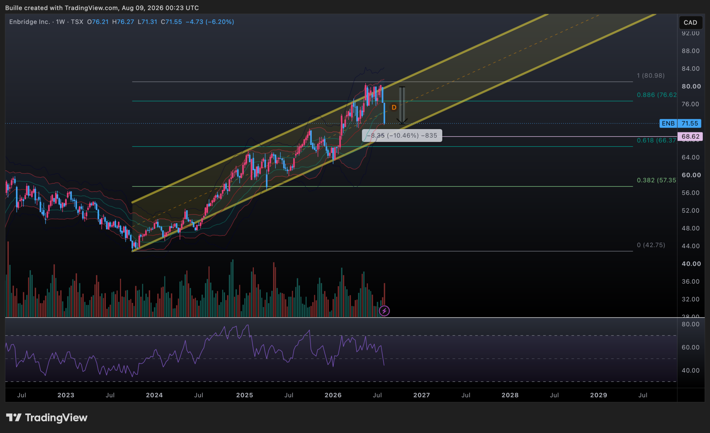
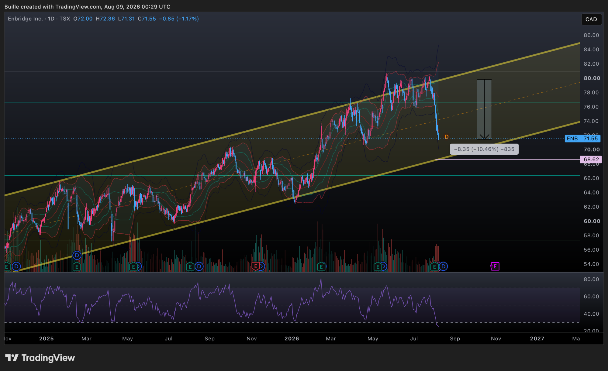

---
categories:
  - money-talk/stock
date: 2026-08-09
description: 엔브릿지가 -6.2% 하락으로 주봉 마감을 했다. 2주동안 -10%를 기록했다.
lang: ko
last_updated: 2026-11-14
naver_date: 2026-08-09
naver_url: https://blog.naver.com/martin-lee/224372753700
tags:
  - 엔브릿지
  - ENB
  - EnbridgeInc
title: "[캐나다 주식] 엔브릿지 ENB, Enbridge Inc."
translation_key: 2026-08-09-enbridge-stock-notes
---

**※** **이 글은 종목 추천 글이 아님을 미리 알립니다.**

주봉 차트

엔브릿지가 -6.2% 하락으로 주봉 마감을 했다. 2주동안 -10%를 기록했다.

엔브릿지는 배당 수익률과 배당 주기가 좋아 배당주 중에서 상위 티어에 속하는 종목 중 하나이다.

일봉 차트

일봉으로보면 내리기만 했다. 과매도 구간이라 다음주에 하락이 이어질지는 잘 모르겠지만 횡보 혹은 하락이 이어진다면 68~70불(현재 가격으로부터 -3%) 구간까지는 떨어질 수도 있어 보인다.

배당주라서 큰 변동성이 없겠지만 일단 차트로 보면 매수하기 괜찮은 자리임은 확실하다.

다가오는 배당 일정도 나쁘지 않다.

예상 배당락일: 2026년 8월 14일

배당 지급일: 2026년 9월 1일

주당 배당금: 약 $0.97 CAD (배당 수익률 5% ~ 5.4% 수준)

아무래도 배당주다보니 살 구간이 나오면 꾸준히 모아가는게 최고인 것 같다.

#엔브릿지

#ENB

#EnbridgeInc.
