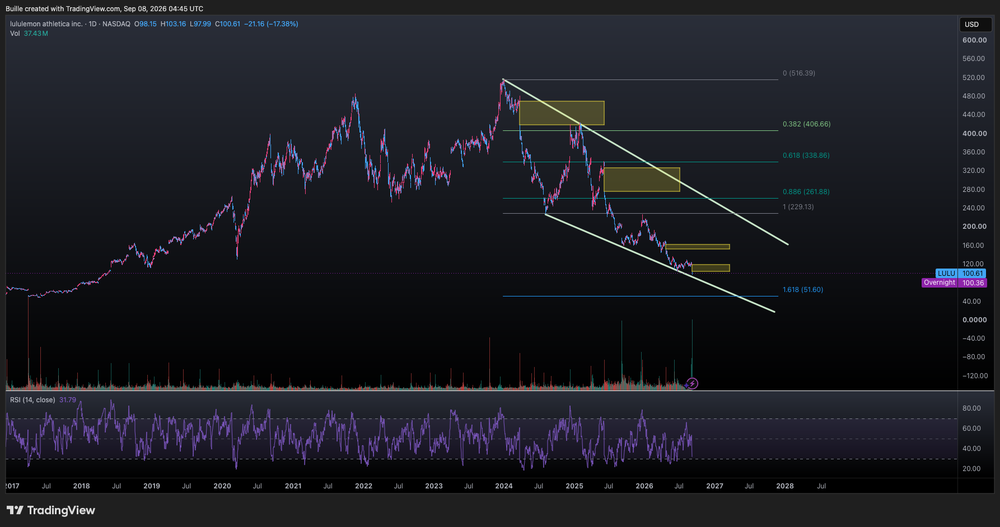

---
categories:
  - money-talk/stock
date: 2026-09-08
description: 룰루레몬 신임 CEO가 취임을 한지 얼마 안지나 바로 -17% 주가 하락을 맞이했다..
lang: ko
last_updated: 2026-11-14
naver_date: 2026-09-08
naver_url: https://blog.naver.com/martin-lee/224404756274
tags:
  - 나이키주가
  - 나이키
  - 룰루레몬주가
  - 룰루레몬
title: "'버리픽' 룰루레몬은 과연 살아날 수 있을까?"
translation_key: 2026-09-08-lululemon-and-burry
---

룰루레몬 차트 일봉

[https://www.newspim.com/news/view/20260908000747](https://www.newspim.com/news/view/20260908000747)

[\[미국 특징주\] 룰루레몬, 연간 전망 또 하향…신임 CEO 취임 전부터 '험로'](https://www.newspim.com/news/view/20260908000747)

룰루레몬 신임 CEO가 취임을 한지 얼마 안지나 바로 -17% 주가 하락을 맞이했다..

코로나 이전 고점 대비 -80% 하락한 셈이다..

[https://www.mk.co.kr/news/stock/12145453](https://www.mk.co.kr/news/stock/12145453)

[룰루레몬 주가 8년만에 최저 … 물타기하던 버리도 "죽을맛" - 매일경제](https://www.mk.co.kr/news/stock/12145453)

참고로 마이클 버리의 평단은 거진 $288 수준이라고 알려져있다.

과연 회복이 가능할까에 대해서 의문이다.

룰루레몬은 한때 유행이었고(실제로 거리에서 많은 사람들이 즐겨입는걸 봐서는 현재도 유행인 듯하다.) 필수소비재라고 알려져서 주가 방어가 잘되는 섹터 중 하나였다.

그런데 코로나 이후로 의류, 스포츠 산업이 전반적으로 하락세를 겪고 있는 듯 하다.

어쩌다 이렇게 몰락하고 있는건지 참 모르겠지만

미중 갈등, 소비의 변화, 다이어트 의약품의 등장 등 여러 이유가 복합적으로 적용된 것 같다.

[https://www.joongang.co.kr/article/25459969](https://www.joongang.co.kr/article/25459969)

[‘S&P 100’서 18년 만에 빠진다…잘나가던 나이키의 굴욕, 무슨 일 | 중앙일보](https://www.joongang.co.kr/article/25459969)

심지어 나이키는 S&P 100으로부터 탈락된다고 하니 말이다...

나이키를 보유하고 있는 사람으로서 정말 큰일이다..

#나이키주가

#나이키

#룰루레몬주가

#룰루레몬
