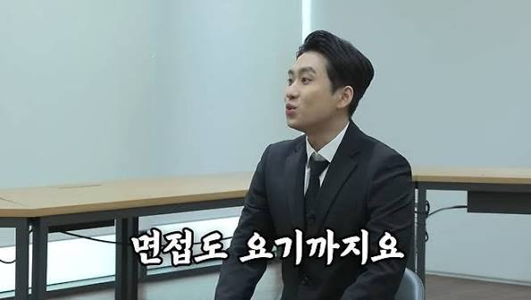

---
categories:
  - study-log/career
date: 2024-11-13
description:
  일을 쉰 지 거의 6개월이 지나가고 있다. 그동안 나는 무엇을 했는가에 대해 생각해 보면, 이 시간 동안 정말 잘 쉬었고, 다양한 경험을 통해 많은 것들을 배웠다. 물론 지금도 계속해서 배우는 중이다. 고등학교 졸업 이후,
  대학교 진학과 입대, 그리고 취업까…
lang: ko
last_updated: 2026-11-14
naver_date: 2026-10-10
naver_url: https://blog.naver.com/martin-lee/224436718979
tags:
  - 일상·생각
title: 채용은 소개팅과 닮았다.
translation_key: 2024-11-13-hiring-and-blind-dates
---

※ 본 글은 블로그 이전으로 인해 기존 글을 옮겨온 것입니다. (작성일: 2024년 11월 13일)

일을 쉰 지 거의 6개월이 지나가고 있다. 그동안 나는 무엇을 했는가에 대해 생각해 보면, 이 시간 동안 정말 잘 쉬었고, 다양한 경험을 통해 많은 것들을 배웠다. 물론 지금도 계속해서 배우는 중이다. 고등학교 졸업 이후, 대학교 진학과 입대, 그리고 취업까지 통틀어 이렇게 오랜 기간 공백기를 가진 적이 없었다. 운이 좋았던 것 같다. 어쩌면 내가 끊임없이 준비된 상태였기에, 이런 연속적인 삶을 살아올 수 있었던 게 아닐까 싶기도 하다.

**커리어적인 관점에서 공백기간을 갖는다는건 경력단절과도 같다.** 그렇기에 경력 상 결점 또는 두려움의 대상이기 되기도 한다. 나는 이 기간을 절대 손해라고 생각하지 않는다 아마 앞으로도 후회하지 않을 것 같다. 내가 이 공백기간을 가지면서 가장 크게 변한 것은 사고방식인데, **오늘은 문득 채용 과정은 소개팅은 많이 닮아 있다라고 생각이 들었다.**

아마 한 번쯤은 “면접 자리가 내가 회사를 고를 수 있는 자리이기도 하다” 혹은 “면접은 소개팅과도 같다”는 이야기를 들어봤을 것이다. 사실 나도 소개팅을 살면서 단 한 번밖에 해본 적이 없지만, 운이 좋게도 그 첫 번째 소개팅에서 지금의 여자친구를 만날 수 있었다. 경험은 적지만 해본 입장에서 소개팅이나 연애라는 건 가능하다면 해보는 것을 권한다. 젊은 사람들이 연애를 못 해보고, 경험해보지 못하는 건 안타까운 일 중 하나이다.

보통 소개팅에는 주선자가 있기 마련이지만, 사람인 또는 링크드인과 같은 취업 사이트들이 이러한 주선자의 역할을 대신해준다.

소개팅은 주선자가 “너, ㅇㅇㅇ 한번 만나볼래?”라고 시작할 수 있지만, 취업 시장은 그리 친절하지 않다. 하지만 비슷한 점도 존재한다. 주선자에게 이런 질문을 받는 상황은 대개 두 가지로 나뉜다. 연애를 해보려는 노력이 있지만 잘되지 않을 때, 혹은 누군가의 연민을 자극했을 때다. 이처럼 취업을 원한다면 주변 사람들에게 내가 구직 중임을 알리는 것이 중요하다. 그래서 필자는 블로그나 링크드인과 같은 활동은 긍정적이라고 본다. 아무것도 하지 않으면 아무 일도 일어나지 않는다.

주변에 소개팅을 자주 하는 사람을 본 적이 있을 것이다. 왜일까? 왜 나에게는 “소개팅 해볼래?”라는 말을 해주는 사람이 없었던 걸까? 그 질문에 대한 답을 알고 있다면 다행이지만, 모르고 있었다면 한 번 되돌아보자. 대부분의 문제는 본인한테 달려있다. 그리고 그 문제는 준비가 부족해서일 것이다. 취업 시장에서도 마찬가지이다. 만약 당신이 회사가 원하는 인재로 준비되어 있었다면, 취업의 기회도 훨씬 더 많아졌을 것이다.

다행히 채용이 소개팅보다 난이도가 낮은 편이라고 생각한다. 소개팅에서는 상대방을 만나기 전까지 그 사람이 어떤 취향을 가지고 있고, 어떤 생각을 하는지 전혀 알 수 없다. 반면, 채용에서는 회사가 채용 공고를 통해 원하는 인재상과 필요로 하는 기술들을 미리 알려주기 때문에 준비할 수 있는 정보가 훨씬 많다.

소개팅에서 나름 성공하는 멘트나 원하는 조건들이 있듯이, 채용 시장에서도 회사들이 원하는 인재상과 조건들이 있다. 그러므로 채용 사이트에서 공고를 보고 무작정 딸각 한 번으로 이력서를 제출하기보다는, 그 회사가 나와 잘 맞을지 한 번 자세히 살펴보고, 회사에 맞게 이력서를 수정하여 지원해보자. 그것이 최소한의 예의이기도 하다.

면접은 상대방을 처음 만나는 자리다. 소개팅에 나가기 전, 우리는 무엇을 입고 나갈지, 어디에 갈지, 어떤 이야기를 나눌지 고민하고 답변을 준비하듯, 면접에서도 예상되는 질문에 대한 답변을 미리 준비해둔다. 우리가 면접에서 떨어지는 이유는 면접관들의 기대에 못미쳤기 때문일 것이다.

소개팅과 채용 시장은 모두 치열하다. 요즘 들어 특히 취업 시장이 어렵다는 기사가 자주 나오지만, 사실 취업이 힘들었던 건 언제나 이어져 온 일인 듯하다. 오히려 취업이 쉬웠다면 그게 더 문제였을지도 모른다. 취업이든 소개팅이든 어려운 만큼, 그에 걸맞은 노력을 기울여야 하는 것은 당연하다.

한 번의 소개팅으로 연애에 성공하기란 쉽지 않다. 마찬가지로 채용에서 최종 합격 메일을 받지 못하더라도 너무 낙담하지 말자. 연애의 성공 확률을 높이는 방법은 소개팅을 여러 번 시도해보는 것이며, 채용도 이와 같다. 이력서를 가능한 한 많이 제출하고, 지속적인 회고를 통해 나에게 적합한 회사를 찾아가도록 하자.

**한 줄 요약: 상대방이 원하는 사람이 되자.**
