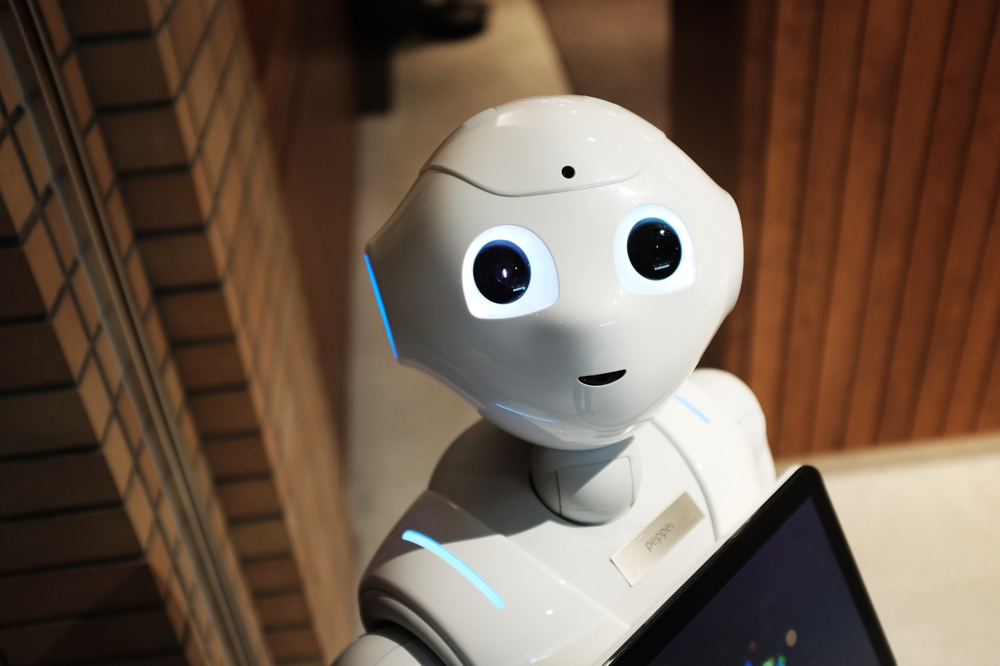

---
categories:
  - study-log/dev
date: 2026-04-11
description: ‘대 AI 시대에 개발자는 정말 사라질까?’, ‘그렇다면 앞으로 나는 뭘 하며 살아가야 할까?’
lang: ko
last_updated: 2026-11-14
naver_date: 2026-04-11
naver_url: https://blog.naver.com/martin-lee/224249014056
tags:
  - 일상·생각
title: 대 AI시대에 'HarvardX CS50x' 온라인 강의 듣는 나
translation_key: 2026-04-11-cs50-in-the-ai-era
---

[© CoolPubilcDomains, 출처 OGQ](https://www.ogq.me/backgrounds/1476739)

‘대 AI 시대에 개발자는 정말 사라질까?’, ‘그렇다면 앞으로 나는 뭘 하며 살아가야 할까?’

요즘 내가 가장 자주 하는 생각 중 하나다.

AI는 발전을 거듭할수록 인간의 일을 점점 더 대체하고 있다. 물론 이런 일은 AI만의 문제는 아니다. 과거부터 지금까지 산업이 발전하는 과정에서도 늘 반복되어 온 일이었다. 다만 지금은 AI가 대체하는 범위와 규모가 훨씬 더 크다는 점이 다를 뿐이다.

시간이 흐를수록 인간이 기존에 해오던 많은 일은 결국 대체될 것이다. 이 말은 곧, 인간이 활용해 온 고유한 능력들, 이를테면 오감을 기반으로 한 영역조차 AI가 대신할 수 있게 된다는 뜻이기도 하다. 그렇다면 이제 우리는 오감을 넘어서는 무언가를 고민해야 한다. 나는 요즘 이것을 ‘초월해야 할 영역’이라고 부른다. 여섯 번째 감각이라 불리는 ‘영감’, ‘직감’처럼 눈에 보이지 않는 것들, 혹은 사람들이 흔히 ‘취향’이라고 부르는 영역 말이다.

나 역시 업무를 하면서 AI를 많이 사용하고 있다. 덕분에 생산성은 분명히 올라갔고, 예전에는 하지 못했던 일들도 해내게 되었다. 학습 곡선도 훨씬 가팔라진 것처럼 느껴진다. 하지만 한편으로는, 이렇게 얻은 결과가 과연 진짜 내 것이 맞는지 확신이 들지 않을 때도 있다. 그래서 나는 더더욱 자만하지 말아야 한다고 생각한다. 그것이 나만의 원칙이다.

이른바 바이브 코딩을 하다 보면, 순식간에 무언가를 뚝딱 만들어낼 수 있다. 그리고 그 결과물 앞에서 쉽게 우쭐해지기 마련이다. 나 역시 그런 감정을 경계한다. 지금 우리는 AI의 도움을 받고 있을 뿐이지, 그 도움이 언제까지나 당연하게 주어질 것이라고 장담할 수는 없다. 예를 들어 ChatGPT나 Claude에 장애가 생기거나, 토큰을 다 써버리거나, 비용이 점점 오르게 된다면 꽤 난감한 상황이 벌어질 수도 있다. 그래서 나는 그런 상황도 대비해야 한다고 생각한다.

그런 이유로 나는 하버드대학교의 CS50 강의를 듣기 시작했다. 앞으로는 대학에 입학하려는 학생 수도 줄어들 것이고, 문을 닫는 학교도 점점 늘어날 것이라고 본다. 인구는 감소하고, 학위의 중요성은 예전보다 낮아지고 있으며, 교육을 반드시 오프라인에서만 받아야 할 이유도 점점 줄어들고 있기 때문이다.

그럼에도 불구하고 절대 변하지 않는 것이 있다. 나는 그것을 ‘본질’이라고 부른다. 개발자의 본질은 단순히 코드를 작성해 무언가를 만드는 데 있지 않다. 결국 개발자는 문제를 구조적으로 해결하는 사람이다. 물론 AI를 활용하면 문제를 찾고 해결하는 속도는 훨씬 빨라진다. 하지만 계속 사용할수록, AI에 기대는 만큼 무력감에 빠지는 내 자신을 발견할 때도 있다. 내가 AI에 지나치게 의존하고 싶지 않은 이유도 여기에 있다. 그래서 앞으로 강의를 끝까지 들으면서, 컴퓨팅적 사고를 조금이라도 더 단단하게 길러보려 한다.

보다 유연하고 창의적인 그런 사고를 갖도록.
