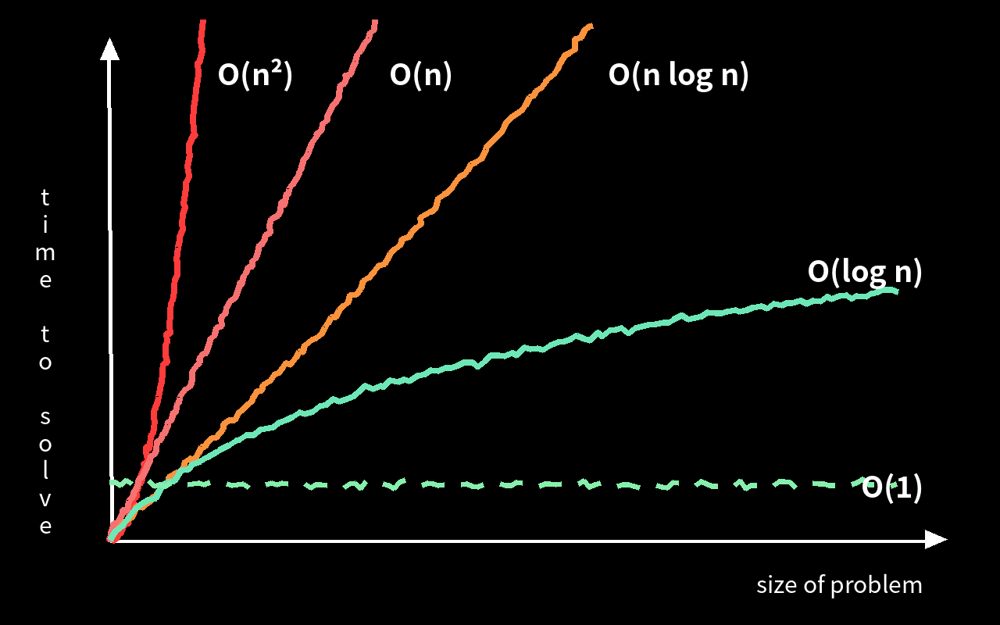

---
categories:
  - study-log/dev
date: 2026-09-22
description: C 는 메모리 관리(할당, 해지)가 굉장히 짜증나는 언어다.
lang: ko
last_updated: 2026-11-14
naver_date: 2026-09-22
naver_url: https://blog.naver.com/martin-lee/224419464839
tags:
  - 공부 기록
title: "[CS50] 복습 #2"
translation_key: 2026-09-22-cs50-review-2
---

**C 는 메모리 관리(할당, 해지)가 굉장히 짜증나는 언어다.**

Array 배열은 비효율적이다.

필요할 때만 메모리를 할당하고 보다 동적인 데이터 구조를 만들기 위해

포인터만을 이용하는 Linked List가 등장하였다.

2차원 데이터 구조 중 첫번째는 Trees 이다.

```javascript
dypedef struct node
{
  int number;
  struct node *left;
  struct node *right;
}
```



O(n^2)

O(n log n)

O(n)

O(log n)

O(1)

**Hashing 해싱 / Hash function**

**Hash tables =** "Key-Value"

**Tries**

---

이해가 안되는 군..

어렵다...
