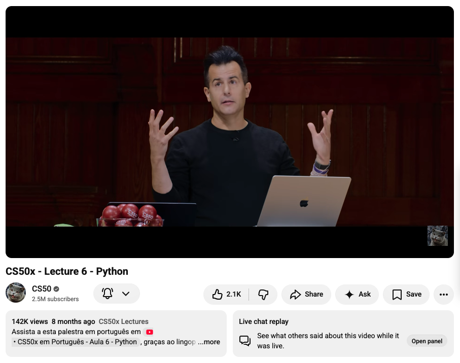

---
categories:
  - study-log/dev
date: 2026-09-23
description: 우리는 컴퓨터가 더 많은 일을 하도록 하기 위해 더 많은 자원을 투자해왔다.
lang: ko
last_updated: 2026-11-14
naver_date: 2026-09-23
naver_url: https://blog.naver.com/martin-lee/224420584596
tags:
  - 공부 기록
title: "[CS50] 복습 #3"
translation_key: 2026-09-23-cs50-review-3
---



우리는 컴퓨터가 더 많은 일을 하도록 하기 위해 더 많은 자원을 투자해왔다.

그 결과 문법적으로 꼼꼼할 필요가 없고, 코드를 많이 작성할 필요가 없다.

```javascript
python hello.py
```

파이썬은 프로그래밍 언어일 뿐만 아니라 그 자체로 프로그램이기도 하다.

C와 비교해보자면 훨씬 코드가 간결해진다.

```javascript
// ;(세미콜론 없음), % 연산자 없음, #include <studio.h> 없어도 됨, main함수 없어도 됨, type 없어도 됨
answer = input("What's your name?");
print(f"hello, {answer}")
```

```javascript
// named parameters로 파라미터 이름을 직접 지정해서 넘기는 방식
greet((greeting = "안녕"), (name = "마틴"));
```

**조건문은 if, elif, else 로 표현한다.**

```javascript
if x < y:
  print("x is less than y");
elif x > y
  print("x is greater than y")
else:
  print("x is equal to y")
```

**Container type**

**\- range / list / tuple / dict / set ...**

```javascript
s = input("Do you agree? ").lower()

if s in ["y", "yes"]:
  print("Agreed")
else:
  print("Not agreed")
```

```javascript
before = input("Before: ")
after = before.upper()
print(f"After: {after}")
```

```javascript
// list
// scores = [72, 73, 33]
for i in range(3):
  score = int(input("Score: "))
  scores.append(score)

average = sum(scores) / len(scores)
print(f"Average: {average}")
```

```javascript
// dict
people = {
    "Kelly": "+1-617-495-1000",
    "David": "+1-617-495-1000",
    "John": "+1-123-465-1000"
}

name = input("Name: ")

if name in people:
    number = people[name]
    print(f"Found {number}")
else:
    print("Not Found")
```

**Object-Oriented Programming; OOP (객체 지향 프로그래밍)**

문자열들은 객체이고, 그 객체들은 메서드를 가지고 있다.

**Loop 반복문**

```javascript
for i in range(3):
  print("meow")
```

파이썬에서 do while 은 없다.

```javascript
while True:
  n = int(input("Height: ")
  if n > 0:
      break

for i in range(n):
  print("#")
```

**Exception 예외**

```javascript
try:
  n = int(input("Integer: "))
  print("Integer")
except ValueError:
  print("Not integer")
```
