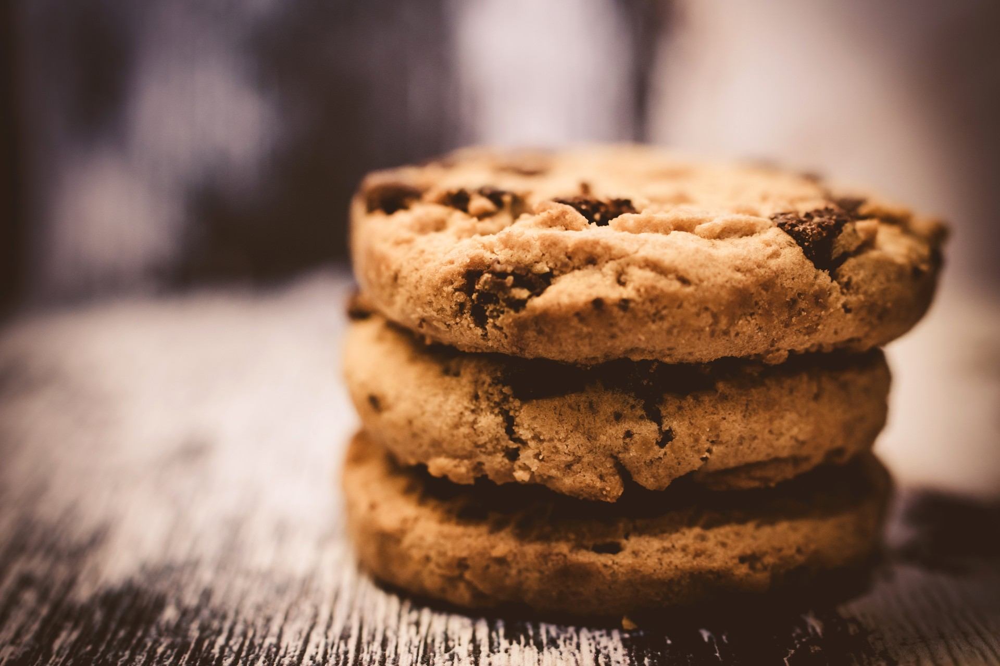
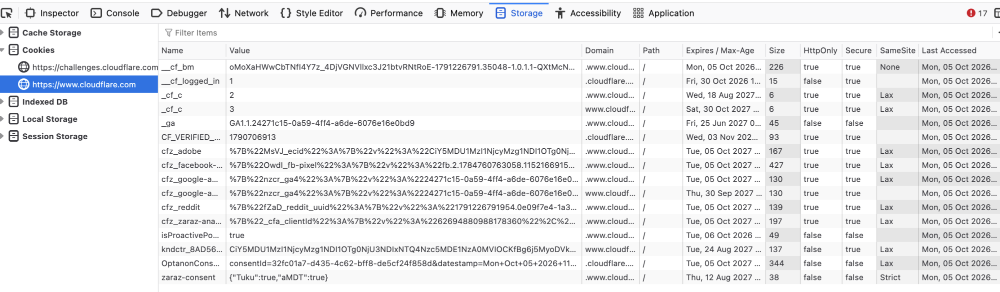

---
categories:
  - study-log/dev
date: 2026-10-06
description: 웹 사이트를 돌아다니다 한번쯤 봤을 "쿠키 수집에 동의하시겠습니까?" 문구에 우리는 무심코 동의함을 누르지만 정작 쿠키가 뭔지 모른다. 그래서 오늘은 쿠키에 대해서 알아보고자 한다.
lang: ko
last_updated: 2026-11-14
naver_date: 2026-10-06
naver_url: https://blog.naver.com/martin-lee/224432543358
tags:
  - 공부 기록
title: 쿠키
translation_key: 2026-10-06-web-cookies
---

<figure data-image-caption="true">
  
  <figcaption><a href="https://www.ogq.me/backgrounds/1487600">© CoolPubilcDomains, 출처 OGQ</a></figcaption>
</figure>

웹 사이트를 돌아다니다 한번쯤 봤을 "쿠키 수집에 동의하시겠습니까?" 문구에 우리는 무심코 동의함을 누르지만 정작 쿠키가 뭔지 모른다. 그래서 오늘은 쿠키에 대해서 알아보고자 한다.

쿠키(Cookie)의 이름은 '[매직 쿠키](<http://catb.org/jargon/html/M/magic-cookie.html)%EC%9D%B4%ED%9B%84>)'에서 유래했다.

쿠키는 **웹 사이트가 사용자의 브라우저에 저장하는 작은 크기의 텍스트 파일**이다.

이는 **사용자 식별, 로그인 유지, 개인화 설정, 장바구니 기능, 방문 기록 및 행동 추적 을 저장하는 데 사용**된다. 쉽게 말해 사용자들의 효율적이고 안전한 웹 사용을 보장하는데 쓰이는 것이 쿠키다.

브라우저에서 쿠키를 확인하고자 한다면, 개발자 도구 > Storage > Cookies 에서 확인할 수 있따. 또는 개발자 도구 > Console > \`document.cookie\` 입력을 해보면 된다. 그리고 개발자 도구 > Network 를 통해서도 쿠키의 흐름을 확인할 수 있다. 쿠키의 실제 위치는 브라우저가 설치된 디렉토리 안에 DB형태로 찾아볼 수 있다.

[https://support.mozilla.org/en-US/kb/about-your-important-data-and-their-files?utm\_source=chatgpt.com](https://support.mozilla.org/en-US/kb/about-your-important-data-and-their-files?utm_source=chatgpt.com)

[About your important data and their files | Firefox Help](https://support.mozilla.org/en-US/kb/about-your-important-data-and-their-files?utm_source=chatgpt.com)

위 스크린샷을 보면 알 수 있듯 쿠키는 **Name, Value, Domain, Path, Expires/Max-Age, HttpOnly, Secure, SameSite** 속성을 가지고 있다. 이 중에서 **HttpOnly** 속성은 Javascript가 인증 쿠키를 직접 읽거나 수정하지 못하게하는 설정이다. **Secure**은 HTTPS 연결에서만 쿠키를 전송하는 설정, 거의 필수다. **SameSite**는 다른 사이트에서 시작된 요청에 쿠키가 붙는 것을 제한하는 설정으로 CSRF 위험을 줄인다. SameSite=Lax가 일반적이고, Strict은 더 제한적이지만 외부링크로 들어오는 로그인 흐름에 영향을 줄 수 있다.

가장 많이 사용되는 쿠키는 \_ga(GA4), \_cf\_bm(Cloudflare) 일 것이다. 쿠키는 다크 테마나 언어설정을 기억하는 데에도 사용된다. HttpOnly 를 적용하지 않아야하며, 필요한 범위로 Domain을 제한해야 한다.

쿠키에도 종류가 있다.

세션 쿠키: Expires/Max-Age가 없는 쿠키. 보통 브라우저 세션 종료 시 삭제되지만, 복원 시 살아날 수 있다.

영구 쿠키: 만료 조건이 있어 브라우저를 닫아도 남을 수 있다.

인증 쿠키: 로그인한 사용자를 인증하는 데 사용

추적 쿠키: 방문, 행동을 추적하거나 분석하는 데 사용

퍼스트 파티 쿠키: 현재 방문한 사이트와 같은 사이트 맥락에서 사용

타사 쿠키: 현재 방문한 사이트와 다른 사이트의 쿠키, 광고, 임베드 서비스 등에 사용

좀비 쿠키: 삭제해도 다른 저장소 등에 남긴 정보를 이용해 다시 생성되는 쿠키

쿠키는 유지 기간, 사용 목적, 사이트와의 관계 등에 따라 분류할 수 있다. 로그인 유지용 쿠키 하나가 동시에 영구 쿠키 + 인증 쿠키 + 퍼스트 파티 쿠키 일 수 있다.

[https://www.cloudflare.com/ko-kr/learning/privacy/what-are-cookies/](https://www.cloudflare.com/ko-kr/learning/privacy/what-are-cookies/)

[쿠키란? | 쿠키의 정의](https://www.cloudflare.com/ko-kr/learning/privacy/what-are-cookies/)

이해를 돕기위해 예시를 들어보자.

Frontend는 손님을 맞이하는 음식점 매장 홀, Backend는 주문을 처리하는 주방을 담당한다고 상상해보자.

가게는 손님마다 주문한 메뉴와 요청 사항을 기억해야 한다. 손님이 많아지면 누가 무엇을 주문했는지 구분하기 어려워지므로, 각 손님에게 번호표를 나눠준다. 손님이 추가 주문을 할 때 번호표를 보여주면, 가게는 해당 번호의 주문 기록을 찾아 이어서 처리한다. 쿠키를 이용한 세션 관리도 이와 비슷하다. 브라우저가 보관하는 세션 ID 쿠키는 손님의 번호표이고, 서버에 저장된 세션 데이터는 가게의 주문 기록이다. 쿠키에는 번호만 담을 수도 있고, 다크 테마나 언어 같은 간단한 설정값을 직접 담을 수도 있다.

위와 같은 예시를 들었는데 마치 쿠키가 마케팅 목적으로 사용되는 것 처럼 들린다. 요즘날 쿠키는 마케팅 목적에도 사용되는건 사실이다. 그러나 웹 쿠키의 초기 목적은 장바구니처럼 서로 독립적인 HTTP 요청 사이에서 상태를 유지하는 것이었다. 시간이 지나 Memcached나 Redis는 서버의 세션 데이터를 저장하고 여러 서버가 같은 기록을 조회하는 데 활용할 수 있다. 음식점으로 치면 여러 주방이 함께 확인하는 주문 관리 시스템이다. 하지만 기록을 어디에 보관하든 요청이 어느 손님의 것인지 구분해야 하므로, 쿠키와 이런 저장소는 함께 사용될 수 있다.

쿠키 동의에 관한 법은 국가마다 다르므로, 서비스에 적용되는 법과 쿠키의 사용 목적에 따라 이용자에게 사용 내용을 알리고 필요한 동의를 받아야 한다.
