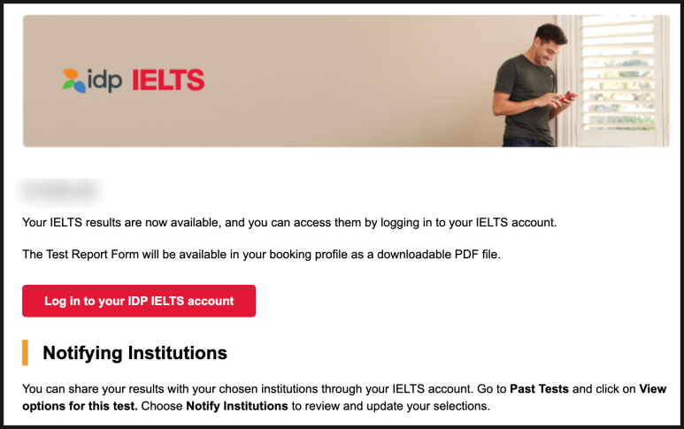
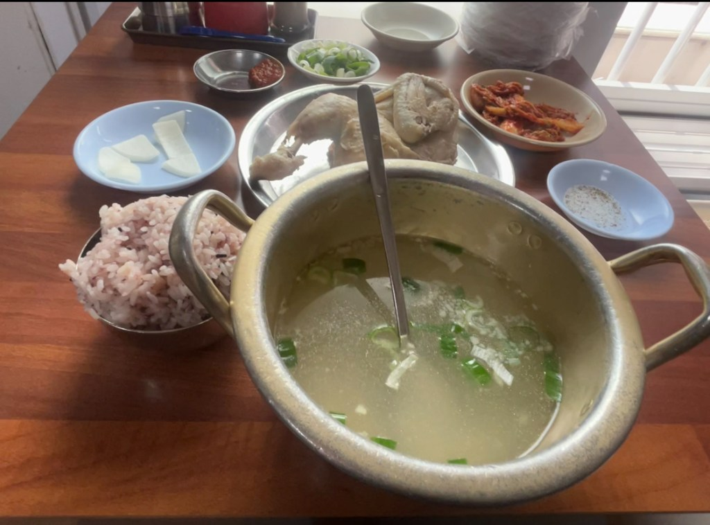
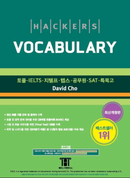
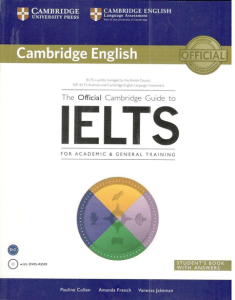
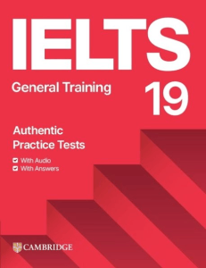

---
categories:
  - study-log/english
date: 2024-10-26
description:
  10월 12일 토요일 아이엘츠 시험을 치렀고 13일 일요일 저녁 9시쯤 결과 메일을 받았다. 예상보다 빠른 결과 소식에 놀랐다. 목표했던 점수를 받지는 못했지만 처음 치른 영어 시험 치고받은 결과에 만족한다. 무엇보다도 시험
  준비 기간 동안 알게 된 정보들이…
lang: ko
last_updated: 2026-11-14
naver_date: 2026-10-10
naver_url: https://blog.naver.com/martin-lee/224436717451
tags:
  - 정보 공유
title: 아이엘츠(IELTS) 후기
translation_key: 2024-10-26-ielts-test-review
---

※ 본 글은 블로그 이전으로 인해 기존 글을 옮겨온 것입니다. (작성일: 2024년 10월 26일)

10월 12일 토요일 아이엘츠 시험을 치렀고 13일 일요일 저녁 9시쯤 결과 메일을 받았다. 예상보다 빠른 결과 소식에 놀랐다. 목표했던 점수를 받지는 못했지만 처음 치른 영어 시험 치고받은 결과에 만족한다. 무엇보다도 시험 준비 기간 동안 알게 된 정보들이 많았는데 이것들을 기록하고자 뒤늦게 회고글을 작성하게 되었다.

(추가: 다 쓰고나서 보니 회고글보다는 후기글에 살짝 가깝다고 느꼈다. 다음부터는 제대로 된 회고글을 작성할 수 있도록 해야겠다.)

---

**아이엘츠?**

아이엘츠(IELTS, International English Language Testing System)는 영어 능력을 평가하는 국제 공인 시험 중 하나이다. 시험은 **Listening / Reading / Writing / Speaking** 으로 4개의 영역으로 구성되어있으며, 아이엘츠 시험은 Listening(40분), Reading(1시간), Writing(1시간) 영역이 연이어 쉬는 시간 없이 2시간 40분 동안 진행되며, Speaking은 별도로 12~14분 정도 진행된다. 시험 유형은 **General Training / Academic** 중에서 선택할 수 있고, 시험 방식은 컴퓨터와 종이 중에서 고를 수 있다.

**선택 – 시험 유형, 시험 방식, 시험장**

아이엘츠 시험은 토익처럼 정기적으로 시행되는 것이 아니라, 언제든지 치를 수 있다. IDP 공식 사이트에서 빈 자리가 있는지 확인하고 신청하면 되며 적어도 일주일 전에는 미리 신청하는 것을 권한다. 참고로, 시험 접수할 때 여권 정보를 기입하는 란이 있으니 미리 여권을 발급받아야한다. 본인은 제네럴에 컴퓨터 방식을 선택했고 시험장은 IDP 강북지점(남북스퀘어)에서 오후 시간대로 접수를 했다.

시험 유형과 시험 방식을 선택하는데 있어서 고민하는 사람들이 간혹가다 있는데, 시험 유형같은 경우에는 본인이 아이엘츠 시험을 치르는 목적에 따라 선택하면된다 (예 – 대학원 진학이라면 아카데믹, 이민이 목적이라면 제네럴). 시험 방식은 단순히 취향 차이이다. 본인은 타자가 익숙하기 때문에 컴퓨터를 택했고 시험방식마다 각각의 장단점이 있다고 느꼈다. 그리고 최대한 시험준비를 할 때에도 시험 환경과 비슷하게 공부하는게 좋을 것 같다.

시험장은 아쉽게도 사진 찍을만한 분위기가 안나서 못 찍었다. 대중교통을 타더라도 역에서 멀지 않은 위치에 있어서 찾아가는데 어려움은 없었고 시험장은 건물 20층에 위치해 있었고, 건물의 한 공간을 빌려 운영하는 듯한 느낌이 들었다. 내부는 사람 20명 정도 들어가면 꽉 찰 정도로 조금 좁았지만, 시설은 깨끗했다.

첫 아이엘츠 시험이라 비교할 대상은 없지만, 내가 방문한 시험장에서는 특별히 불편한 점은 없었다. 다만 다른 후기에서는 시험 도중 소음이 들리기도 한다는 이야기를 들었다.

혹시나 점심을 먹는다면, 시험장 가까이 있는 ‘사랑방칼국수’ 라는 곳에서 백숙백반을 먹어보는 것을 추천한다. 가격과 맛 그리고 1인 좌석까지 겸비되어 있으니 굉장히 만족스러울 것이다.

**시험 후기**

**Speaking**

영어 말하기는 12분 ~ 14분정도로 진행된다. 시험 방식은 세가지 파트로 나뉘며 Part1 은 기본적인 대화 형태로 진행되고, Part2 는 질문지를 받으면 1분간 시간을 주고 이후에 혼자서 영어로 말하기를 진행한다. Part3 은 Part2에 말했던 내용을 토대로 조금 더 심도있게 대화하는 형태이다.

개인적으로 시험을 준비할 때, 말하기는 대화를 할 상대가 없어서 어떻게 공부해야할 지 막막했다. 본인은 아이토키라는 1:1 화상 영어 플랫폼을 이용하면서 공부했는데 이는 약간의 금액이 부담될 수 도 있다. 공부 방법을 찾다보니 무료로 공부할 수 있는 방법들 중 하나를 추천한다. 바로 [IELTS Prep 디스코드에 참가](https://discord.com/invite/ielts-prep-868524158743633981)하는 것이다. 전세계의 아이엘츠를 준비하는 수험생들이 있는 채널인데, 이곳에서 스피킹 상대를 구해서 실시간으로 연습할 수 있다. 무료인데다가 외국인들이기에 실제 시험관 느낌도 나서 굉장히 좋다.

11:40 시험이었고 아래는 실제 시험에서 받았던 질문들이다.

**Part 1**

Q: 지금 살고있는 곳이 City 인지 Town 인가요? (두 개가 뭐가 다른거지..?)

Q: 지금 살고있는 곳의 장점은 무엇인가요? 왜?

Q: 지금 살고있는 곳 주변에 추천하고 싶은 곳이 있는가? 왜?

Q: 사진찍는거 좋아하나요? 왜?

**Part 2 & Part 3**

Q: 가족 or 친구들을 도와준 경험을 이야기해보시오.

어떤 일이었는지?

누구를 도왔고 무엇을 했는가?

나는 그 순간에 무엇을 했었는지?

왜 했는가?

Part1 첫 질문을 받자마자 조금 얼탔다. City랑 Town이랑 다른건가? 싶으면서도 일단 답은 해야될 것 같아서 후딱 대답했다. 그리고나서는 순탄하게 대답했던 것 같다. 이어서 Part 2 질문지를 받았을 때 유튜브 영상에서 보던 것들이 그대로 눈 앞에서 이뤄지고 있으니 신기했다. Part 3 에서는 어떤 질문을 했는지 기억이 잘 나지가 않는다. 쌩뚱맞는 답변을 했을 수도 있겠지만, 시험관이 질문했던 것들에 대해서 막혔던 것은 없었던 것 같다.

살면서 처음으로 외국인이랑 대면해서 대화를 해보는거라 굉장히 떨렸다. 시험은 굉장히 편한 분위기 속에서 진행되었고 중도에 말을 끊거나 무례하다는 느낌은 전혀 안들었다.

**Listening, Reading, Writing**

시험은 듣기, 읽기, 쓰기 순으로 진행된다. 그리고 중간에 쉬는 시간 없이 이어서 진행된다는 점을 반드시 잊지 말자. 총 시험 시간이 거의 3시간 가까이 진행되기에 생각보다 피곤하고 오랜 시간동안 집중하기엔 쉽지 않다. 시험 준비를 할 때에도 최대한 각 파트를 연달아서 문제풀이하는 습관을 들여 미리 대비하는 것도 좋은 방법일 것 같다.

시험 준비는 캠브릿지 아이엘츠 가이드와 캠브릿지 교재 15~19 와 해커스 보카 책으로만 했다. 가장 유명하기도 하고 대부분 학원에서도 이 책들을 사용하기 때문에 이 책을 골랐다. 시험을 한번 치른 입장에서 확실히 도움은 많이 되었던 것 같다. 아이엘츠 영역별 문제 유형같은 경우는 유튜브에 검색 해보면 잘 나와있다. 문제를 많이 풀면서 감을 익히는 것도 중요하지만 미리 알아두면 좋으니 한번쯤은 시간내서 시험 문제 유형에 대해서 알아두면 좋겠다. 그리고 확실히 단어는 많이 알고 있으면 좋고 특히나 동의어를 많이 알고 있으면 문제를 푸는데 유리하다.

참고로, 캠브릿지 교재같은 경우에는 기출 문제들로만 수록되어있는 모의고사 같은 책인데 가격이 34,000원으로 비싸다. 중고 거래를 통해서 싸게 구매하거나 인터넷 검색으로 PDF 를 쉽게 구할 수 있다.

---

**결론**

아이엘츠를 준비하면서 항상 어렵기만 할 거라고 생각했던 영어에 대한 두려움이 조금 줄어들었다. 이 시험은 다른 영어 인증 시험보다 더 실용적이라고 생각한다. 시험 준비 과정에서 영어 공부를 어떻게 해야 할지 조금씩 깨달았고, 실제로 영어를 쉽게 접할 수 있도록 내 주변 환경도 바꾸었다. 공부를 하다보면 우리가 생활하는 곳곳에서 은근히 영어를 많이 사용하고 있음을 느낄 수 있다. 그리고 외국인들과 대화하는데도 문제 없이 소통할 수 있을정도로 교육수준이 많이 올라왔다고 생각한다. 다만, 우리가 흔히 사용하는 영어들은 얕은정도의 수준일 뿐이다. 언어를 배울때에는 많이 접하고 익숙해져야 한다. 아이엘츠 시험을 다시 치를지는 모르겠지만, 꾸준히 하다 보면 더 나은 결과를 얻을 수 있을 것 같다.
