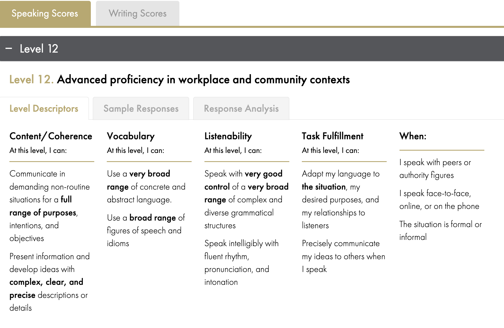

---
categories:
  - study-log/english
date: 2025-11-16
description:
  CELPIP을 공부하는 사람들의 목적은 단언컨대 캐나다에서 영주권을 취득하기 위해서일 것이다. 최근에는 호주에서도 이민 심사과정에서 CELPIP 점수를 인정한다는 내용을 본 것 같긴하지만, 너무 최신 정책이기도 하고 아직까지는
  캐나다 영주권을 신청하는 사람들…
lang: ko
last_updated: 2026-11-14
naver_date: 2025-11-16
naver_url: https://blog.naver.com/martin-lee/224077467213
tags:
  - 공부 기록
title: CELPIP 공부 전, 봐야할 글
translation_key: 2025-11-16-before-studying-for-celpip
---

**영어는 필수이다.**

CELPIP을 공부하는 사람들의 목적은 단언컨대 캐나다에서 영주권을 취득하기 위해서일 것이다. 최근에는 호주에서도 이민 심사과정에서 CELPIP 점수를 인정한다는 내용을 본 것 같긴하지만, 너무 최신 정책이기도 하고 아직까지는 캐나다 영주권을 신청하는 사람들이 시험을 응시한다.

대학교/대학원을 진학 또는 칼리지 등록과 같이 학업을 위해서 영어점수가 필요한 경우도 존재하지만 이 경우에는 IELTS 아카데믹 또는 듀오링고 시험을 주로 보는 듯 하다.

영주권 같은 경우에는 아직 **듀오링고 시험을 인정해주지 않고, IELTS 제네럴 보다는 CELPIP 이 더 쉽고**, **응시료가 더 저렴하고**, **시험 결과가 빨리 나오기 때문에** 사람들은 CELPIP을 더 선호하는 경향이 있다. 사실 이게 CELPIP 시험을 공부해야하는 이유이자 전부이다.

**CELPIP = 캐나다 이민 시험**

우리는 영어 성적이 필요한 거지 영어를 잘하기 위해 이 시험을 보는 것이 아님을 명심해야 한다. 물론, 사람마다 공부 스타일이 다를 수 있겠지만 목적이 높은 점수를 받는것이라면 우리는 이것에 초점에 맞춰서 준비를 하고 목적만 달성하면 그만이다. 그리고 캐나다 영주권 이민 프로그램 Express Entry는 점수 평가 방식이기에 일단 영어 점수를 높게 만들수록 유리하다.

우선 CELPIP을 제대로 이해해야 한다.

(이 글은 CELPIP 공식 사이트와 ChatGPT를 활용하여 CELPIP을 보다 더 깊게 이해하고자 개인 정리 차원에서 작성하는 글이며, 절대 공부 방법 공유 및 추천글이 아님을 미리 알린다.)

**1\. CELPIP 공식 홈페이지**

[https://www.celpip.ca/](https://www.celpip.ca/)

[Home - CELPIP](https://www.celpip.ca/)

\- 시험비용은 $290 + Tax 이다.

\- 시험은 L > R > W > S 순으로 진행된다.

\- 총 시간은 2시간 50분정도

\- 회원가입을 마치면 모의고사 문제 2개를 응시해볼 수 있다. 우선 회원가입 후 내 실력이 어느정도인지 알아보고 전반적인 시험에 대해서 익숙해지는 것이 좋을 듯 하다. 그 외에 유료 모의고사집을 별도로 판매하고 있다.

**2\. CELPIP 공식 유튜브**

[**https://www.youtube.com/@CELPIPOfficial/videos**](https://www.youtube.com/@CELPIPOfficial/videos)

[CELPIP Test](https://www.youtube.com/@CELPIPOfficial/videos)

각 파트별로 유형에 대해서 분석하고 어떤식으로 준비를 하면 되는지 도움을 주는 영상들이 올라오는데 출/퇴근길에 오고가며 들어보면 좋을 것 같다.

**3\. 각 파트별 유형**

<table><tbody><tr><td></td><td>
파트 - 유형
</td><td>
문제 수 / 시간
</td><td>
내용
</td></tr><tr><td rowspan="6">
리스닝

(총 문항: 38문항 / 총 시간: 약 47-55분)
</td><td>
Part 1 - Problme Solving
</td><td>
8 문항 / 11-13분
</td><td>
두 사람이 일상 문제 해결하는 대화 (예약, 일정, 구매, 고장 문제). 필요한 정보 고르기.
</td></tr><tr><td>
Part 2 - Daily Life Conversation
</td><td>
5 문항
</td><td>
친구/가족/동료 간의 일상 대화. 감정, 의도, 세부사항 파악.
</td></tr><tr><td>
Part 3 - Listening for Information
</td><td>
6 문항
</td><td>
한 사람이 장소, 규칙, 절차 등을 설명. 정보 매칭 문제.
</td></tr><tr><td>
Part 4 - News Item
</td><td>
5 문항
</td><td>
뉴스 기사 듣고 중요한 사실·숫자·사건 흐름 파악.
</td></tr><tr><td>
Part 5 - Discussion
</td><td>
8 문항
</td><td>
여러 명이 토론. 각각의 의견/주장 차이 구분.
</td></tr><tr><td>
Part 6 - Viewpoints
</td><td>
6 문항
</td><td>
한 사람이 의견을 길게 말함. 태도·감정·근거 파악.
</td></tr><tr><td rowspan="4">
리딩

(총 문항: 38문항 / 총 시간: 55-60분)
</td><td>
Part 1 - Correspondence
</td><td>
11문항 / 9-13분
</td><td>
이메일/메시지 읽고 발신자 의도, 감정, 답변 내용 파악.
</td></tr><tr><td>
Part 2 - Apply a Diagram
</td><td>
8문항 / 9-13분
</td><td>
안내문/표/다이어그램 보고 조건 맞는 선택 찾기.
</td></tr><tr><td>
Part 3 - Reading for Information
</td><td>
9문항 / 10-15분
</td><td>
길이 있는 정보성 글(공지, 설명문). 사실 및 세부정보 파악.
</td></tr><tr><td>
Part 4 - Reading for Viewpoints
</td><td>
10문항 / 13-18분
</td><td>
의견/주장 글. 글쓴이의 태도, 의견 근거, 비교 문제.
</td></tr><tr><td rowspan="2">
라이팅

(총 문항: 2문항 / 총 시간: 53분)
</td><td>
Part 1 - Writing an Email
</td><td>
1문항 / 27분
</td><td>
상황 설명 + 요청 + 해결 제안 등 ‘목적이 분명한 이메일’ 작성.
</td></tr><tr><td>
Part 2 - Responding to Survey Questions
</td><td>
1문항 / 26분
</td><td>
두 개 선택지 중 하나 선택 → 이유 3개 이상 + 구체적 설명.
</td></tr><tr><td rowspan="8">
스피킹

(총 문항: 8문항 / 총 시간: 약 15-20분)
</td><td>
Part 1 - Giving Advice
</td><td>
준비 30초 / 답변 90초
</td><td>
친구가 고민함 → 조언 2–3개 제시.
</td></tr><tr><td>
Part 2 - Personal Experience
</td><td>
준비 30초 / 답변 90초
</td><td>
본인의 실제 경험을 자연스럽게 설명.
</td></tr><tr><td>
Part 3 - Describing a Scene
</td><td>
준비 30초 / 답변 90초
</td><td>
사진/그림에서 보이는 것 묘사. 사람·행동·상황 중심.
</td></tr><tr><td>
Part 4 - Making Predictions
</td><td>
준비 30초 / 답변 90초
</td><td>
장면 보고 앞으로 일어날 일 예측.
</td></tr><tr><td>
Part 5 - Comparing &amp; Persuading
</td><td>
준비 60초 / 답변 90초
</td><td>
두 옵션 비교 → 상대방을 설득.
</td></tr><tr><td>
Part 6 - Difficult Situation
</td><td>
준비 60초 / 답변 90초
</td><td>
난처한 상황에 대한 해결책 제시. 공손하게 요청·설명 중요.
</td></tr><tr><td>
Part 7 - Expressing Opinions
</td><td>
준비 30초 / 답변 90초
</td><td>
주제 하나 주고 의견 + 이유 2–3개.
</td></tr><tr><td>
Part 8 - Unusual Situation
</td><td>
준비 30초 / 답변 90초
</td><td>
“비정상적인 상황” 묘사 (ex. 뭔가 이상한 장면). 창의력 필요.
</td></tr></tbody></table>

**4\. CELPIP** **Score Comparison Chart**

[**https://www.celpip.ca/prepare-for-celpip/score-comparison-chart-2/**](https://www.celpip.ca/prepare-for-celpip/score-comparison-chart-2/)

[Score Comparison Chart - CELPIP](https://www.celpip.ca/prepare-for-celpip/score-comparison-chart-2/)

위 시험은 문제마다 배점이 다른 형태가 아니다. 고로 문제만 많이 맞추면 된다는 말이다. 실수를 최대한 줄이고 맞출 수 있는 문제는 무조건 맞춰야한다. 시험 시간이 거의 3시간에 달하기에 집중력이 필요하다.

IELTS나 TOEIC, TOFLE과 같은 공인영어시험을 한번이라도 응시해본 사람이라면 다른 시험들과 별 다를건 없을 것 같다.

어짜피 CELPIP을 응시해야하는 상황이라면, 한번에 준비 잘 해서 단번에 점수를 획득했으면 좋겠다. 비용과 시간 측면에서 이 시험 자체가 오랜 기간동안 붙잡고 있는다고 해서 늘 수 있는 것도 아니고 그만큼 가치도 못하는 것 같으니 말이다.
