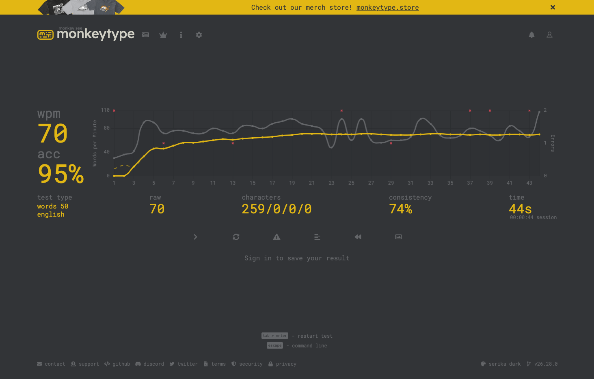
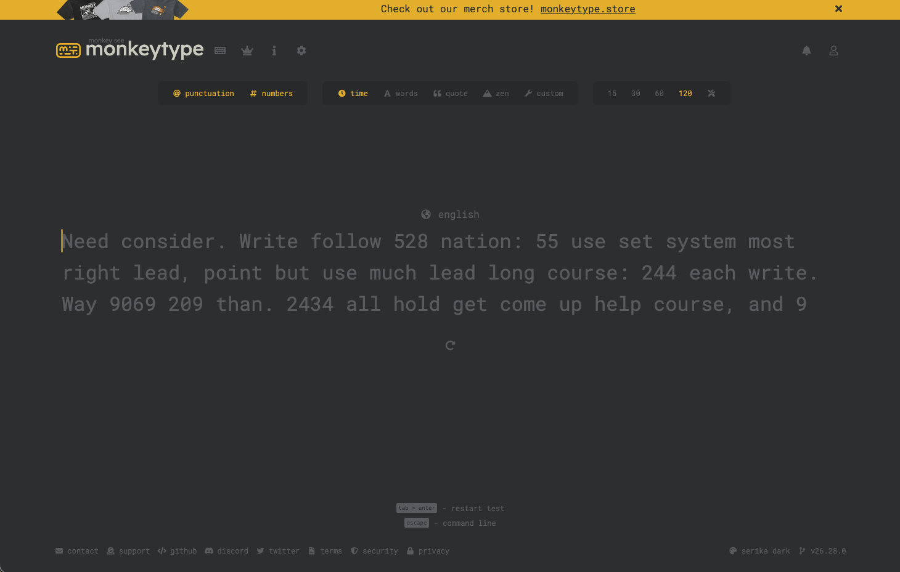
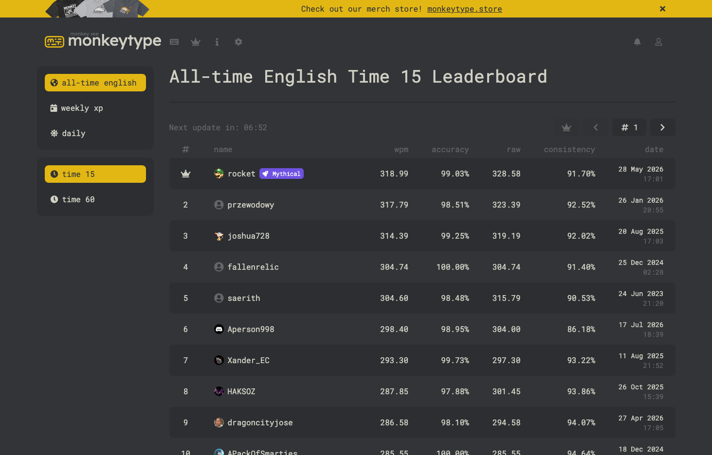
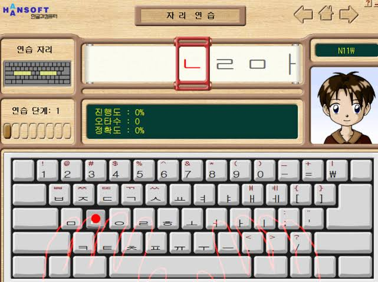

---
categories:
  - study-log/english
date: 2026-07-23
description: 영어로 타자를 치는게 익숙치 않아서 연습할 겸 사이트를 찾다가
lang: ko
last_updated: 2026-11-14
naver_date: 2026-07-23
naver_url: https://blog.naver.com/martin-lee/224354982503
tags:
  - 영문타자연습
  - monkeytype
  - 몽키타입
  - 영문타자
title: 영문 타자 연습하기 - monkeytype.com
translation_key: 2026-07-23-typing-with-monkeytype
---

[https://monkeytype.com/](https://monkeytype.com/)

영어로 타자를 치는게 익숙치 않아서 연습할 겸 사이트를 찾다가

[https://monkeytype.com/](https://monkeytype.com/)

[Monkeytype | A minimalistic, customizable typing test](https://monkeytype.com/)

monkeytpye.com 을 알게되었다.

랭킹도 볼 수 있는데 사람들 참 빠르다...

나도 한국어로 타자 치면 어디가서 꿇리지 않는 편이다.

영어로 바뀌니까 쉽지 않다.

연습하면 된다.

익숙해지자.

나 어렸을 때는 컴퓨터 수업이 있었는데,,

한컴타자 300타/500타 넘는게 수행 과제였다.

요즘에도 있는지 모르겠다...

#영문타자연습

#monkeytype

#몽키타입

#영문타자
