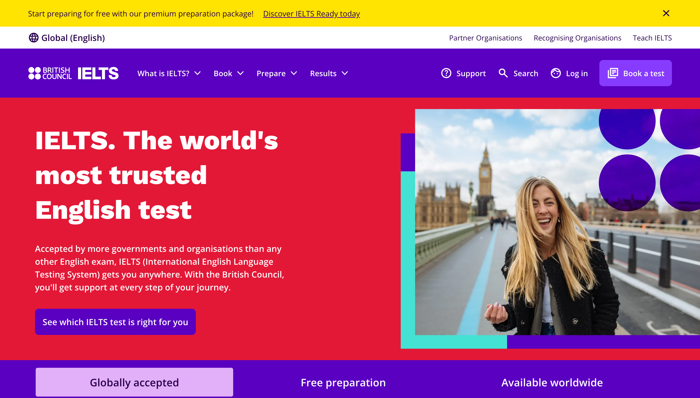
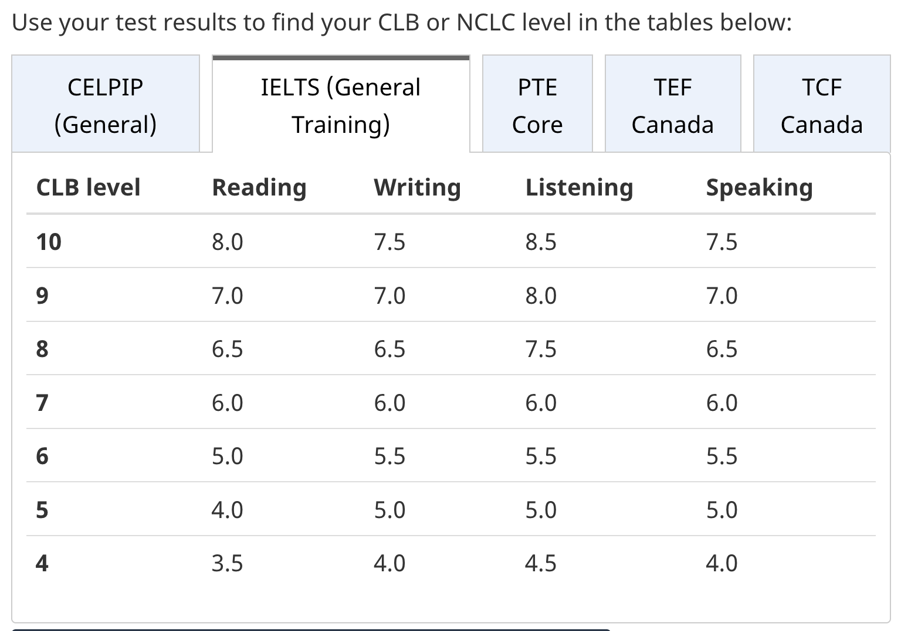

---
categories:
  - study-log/english
date: 2026-11-11
description: 아이엘츠 시험 준비하면서 작성하는 글
lang: ko
last_updated: 2026-11-12
tags:
  - ielts
  - english
title: 아이엘츠 시험 준비 (edX 강의, Anki, Engnovate, ieltsbro, 팟캐스트...)
translation_key: ielts-preparation
---

이전에 아이엘츠 시험을 본 적이 있다. 한 달? 두 달? 학원도 다녔으나... 결과는 처참했던 것으로 기억한다.. (최근에 시험 점수 만료일이 다가온다는 메일 덕분에 그 사실을 알게되었다.) 다시 영어 시험을 공부하기 위해 셀핍과 아이엘츠 중에서 고민을 하다 결국에는 돌고돌아 아이엘츠를 다시 준비하기로 결심했다.

주관적이지만, 셀핍보다 아이엘츠를 선택해야 하는 이유를 나름 적어보자면

1.  셀핍은 공부 자료가 많지 않다.

2.  제대로 된 영어 공부 하기를 원한다면, 아이엘츠를 정복하라는 말을 많이 들어서이다.

이 두 가지를 제외하면, 셀핍 CELPIP이 더 점수 받기 쉽다는 후기도 많고 가격도 저렴하다는 말이 있는데 각자 원하는 방식에 맞춰서 결정하고 빠르게 공부를 시작하는게 좋다고 생각한다.

---

## **아이엘츠 IELTS**

아이엘츠 IELTS는 **영어권 국가의 대학 및 대학원 입학, 취업, 이민 등을 위해 널리 활용되는 국제 공인 영어능력시험**이다.

IELTS는 영국의 British Council, 호주의 IDP Education, Cambridge University Press & Assessment가 공동으로 운영하는 시험이다. 시험 접수는 주로 British Council이나 IDP를 통해 진행하며, 두 기관의 시험 난이도와 채점 기준은 동일하다. 따라서 시험장 위치, 일정, 응시료, 제공되는 학습 자료 등을 비교하여 선택하면 된다.

시험은 목적에 따라 **IELTS Academic**과 **IELTS General Training**으로 구분된다. **두 시험 모두 Listening, Reading, Writing, Speaking의 네 영역을 평가하며, Listening과 Speaking은 동일한 시험을 사용하지만 Reading과 Writing은 출제 내용이 다르다.** 일반적으로 대학 및 대학원 입학을 준비한다면 Academic을, 캐나다 영주권 신청을 준비한다면 General Training을 선택하면 된다. 응시료는 한국에서 약 34만원, 밴쿠버에서는 시험장과 응시 방식에 따라 약 CAD $362-389 수준이다. 시험 결과는 일반적으로 시험일로부터 2년간 인정된다.

## IELTS 시험 구성과 영역별 문제 유형

### **리스닝 Listening**

**시험 시간**

- Approximately 30 minutes

- Paper-based: 10 minutes to transfer answers

- Computer-delivered: 2 minutes to review answers

**시험 구성: 4 Parts (40 Questions)**

- Social Conversation — Two speakers

- Social Monologue — One speaker

- Academic Discussion — Two to four speakers

- Academic Lecture — One speaker

**문제 유형: 7 Question tpyes**

- Form / notes / flowchart

- Multiple-choice

- Short answer

- Sentence completion

- Labelling diagram / map

- Classification

- Matching

### 스피킹 Speaking

**시험 방식은 1:1, 시험 구성 3 parts, 시험 시간 11-14 minutes**

- Part 1 — Introduction & Interview (4–5 min)  
  Identity check, questions about familiar topics (home, work, studies, hobbies).

- Part 2 — Individual Long Turn (3–4 min)  
  Task card with a topic and prompts, 1 minute to prepare and make notes, 1–2 minutes to speak, possible follow-up questions

- Part 3 — Discussion (4–5 min)  
  More abstract questions related to Part 2, including opinions, comparisons, and explanations.

**평가 방식**

- **Fluency and coherence**

- **Lexical resource**

- Grammatical range and accuracy

- Pronunciation

### **리딩 Reading**

### **라이팅 Writing**

## **캐나다 영주권을 목표로 한다면?**

영주권 언어 점수 만점인 CLB 10 을 받기 위해서는 <strong><em><u>리딩 8, 라이팅 7.5, 리스닝 8.5, 스피킹 7.5 </u></em></strong> 을 받아야한다. 이정도 수준이라면 오버롤 밴드 8.0 정도이며, 각 영역당 2개나 3개만 틀려야 받을 수 있는 점수라고 할 수 있다.. 가능하면 높은 점수를 받기 위해 노력을 해보자..

---

## **공부 자료**

- [https://takeielts.britishcouncil.org/](https://takeielts.britishcouncil.org/)

- [https://ielts.idp.com/](https://ielts.idp.com/)

- [https://www.edx.org/learn/test-prep/the-university-of-queensland-ielts-academic-test-preparation](https://www.edx.org/learn/test-prep/the-university-of-queensland-ielts-academic-test-preparation)

- [https://ankiweb.net/](https://ankiweb.net/)

- [https://engnovate.com/ielts-tests/](https://engnovate.com/ielts-tests/)

- [https://ieltsbro.com/](https://ieltsbro.com/)

- [https://www.youtube.com/@EnglishProTips](https://www.youtube.com/@EnglishProTips)

- [https://open.spotify.com/show/5ISJgLQXgXRzeumkV4eR40](https://open.spotify.com/show/5ISJgLQXgXRzeumkV4eR40)
