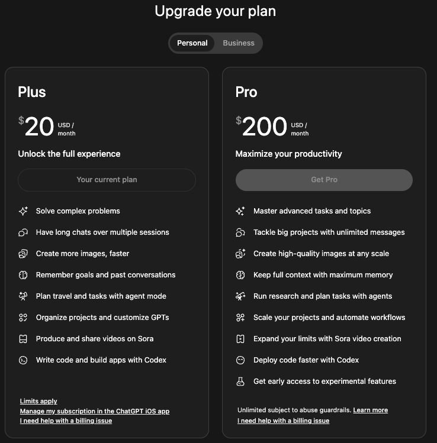
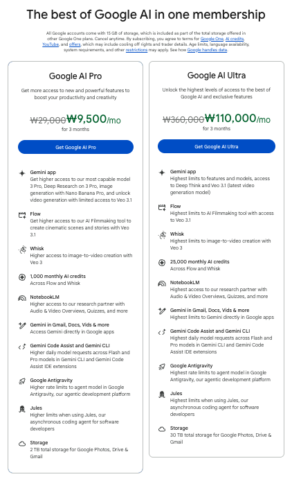
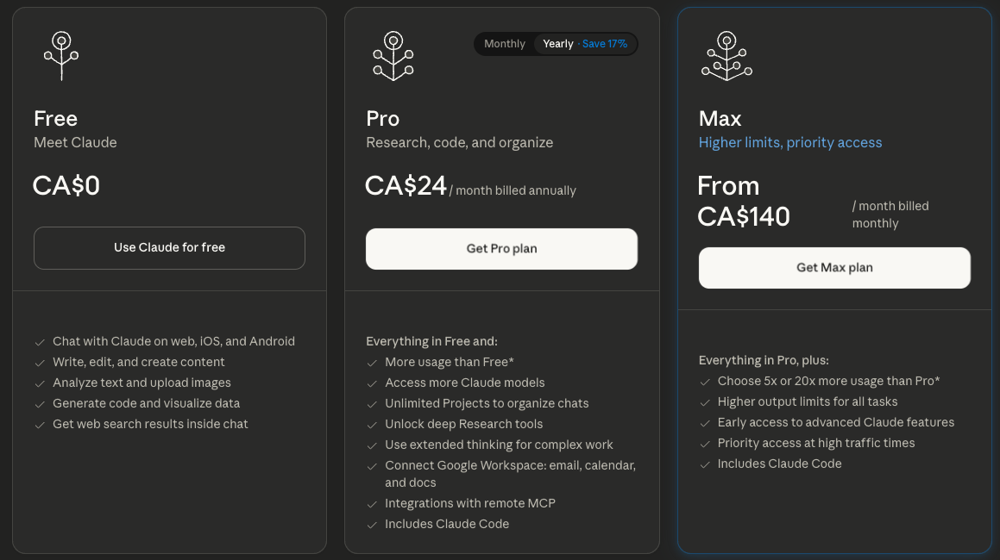
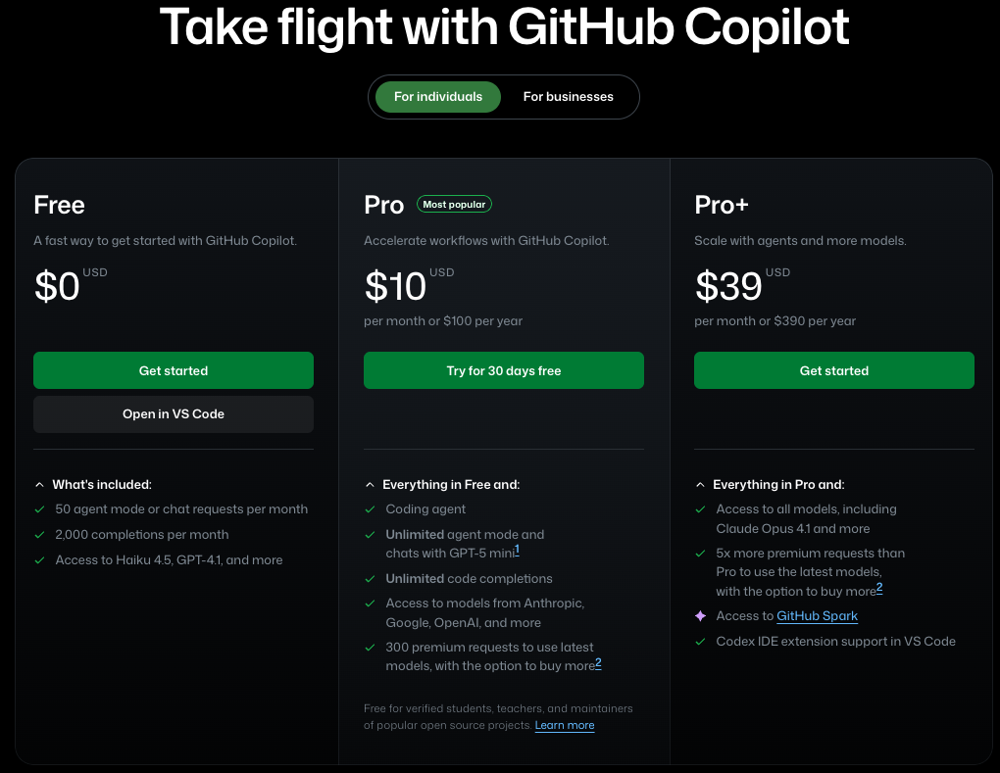
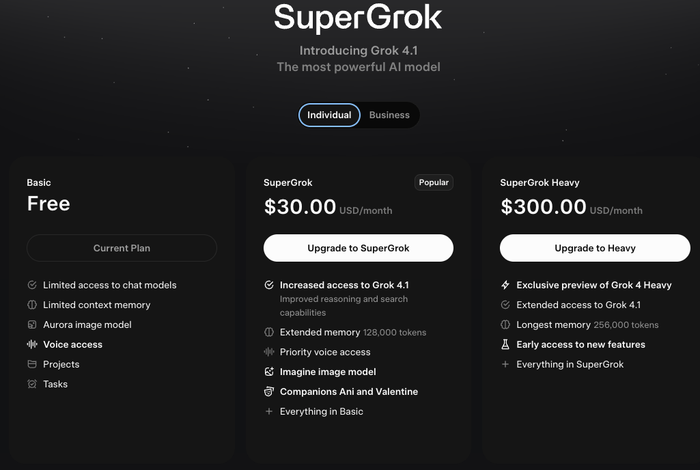
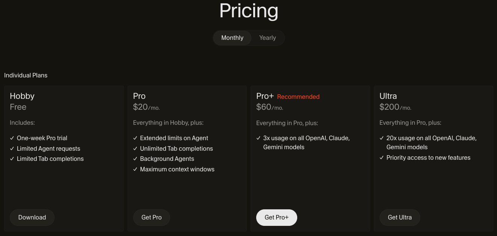

---
categories:
  - useful-tips/general
date: 2026-01-08
description: 요즘은 바이브 코딩이 유행이 되어버려서인지 비개발자들도 쉽게 코딩을 할 수 있게 되었다. 가끔은 개발자들보다 더 잘만드는 경우도 있다. 그래서인지 많은 사람들이 부업으로 자신만의 프로젝트/홈페이지를 시작하는 것 같다.
lang: ko
last_updated: 2026-11-14
naver_date: 2026-01-08
naver_url: https://blog.naver.com/martin-lee/224138665001
tags:
  - 정보 공유
title: AI 도구 어떤거 써야해요?
translation_key: 2026-01-08-choosing-ai-tools
---

[© CoolPubilcDomains, 출처 OGQ](https://www.ogq.me/backgrounds/1515200)

요즘은 바이브 코딩이 유행이 되어버려서인지 비개발자들도 쉽게 코딩을 할 수 있게 되었다. 가끔은 개발자들보다 더 잘만드는 경우도 있다. 그래서인지 많은 사람들이 부업으로 자신만의 프로젝트/홈페이지를 시작하는 것 같다.

누군가에게는 취미거나 종사하는 업계에 따라 다르겠지만, 적어도 컴퓨터를 사용하는 직업군들에게는 AI 구독은 선택이 아닌 필수가 되어버렸다.

나 또한 AI시대인 만큼 하나하나 따라가기위해 모든것들을 AI 플랫폼으로 대체하려고 노력했었다. ChatGPT + Cursor + Comet + Figma (ChatGPT만 유료 결제) 이렇게 조합해서 주로 사용하고 있었는다. Comet 브라우저가 안전하지 않다는 글을 보고나서 사용을 안했고, Cursor도 Solidity 익스텐션이 보안상 취약하다는 말을 듣고 바로 VSCode로 돌아왔다.

다행히도 VSCode에서도 Cursor에 있는 기능들을 사용할 수는 있었다. 다만 무료로 제공되는 크레딧의 한도가 너무 적었다. 이미 AI와 함께하는 것에 익숙해진 탓일까. 참지 못하고 Copilot 유료 결제를 해버렸다. 꽤 만족스럽다. 많은 사람들이 예측하던 대로, 정말로 ‘돈 = 크레딧 = 고성능 AI 툴 사용 = 시간 절약’이라는 공식이 만들어지고 있다는 걸 체감했다.

앞으로 이 공식이 완전히 검증되고 나면, 지금처럼 AI를 싸게 사용하는 건 어려워질지도 모르겠다는 생각이 들었다. 현실이 마치 게임 같다. AI 기업들은 우리에게 과금을 유도하고, 게임에서 우리는 과금러를 이기기 어렵다.

랭커가 되지 않는 이상, 적당한 과금으로 최고의 재미를 보는게 좋으니까 최대한의 효율을 뽑기 위해서 AI 툴을 비교 정리해보자. 다행히도 AI회사들이 그리 많치가 않아서 크게 고민할 게 많이 없었다.

**<AI>**

**OpenAI ChatGPT,**

**Google Gemini,**

**Anthropic Claude Code,**

**Github Copilot,**

**Meta MetaAI(Llama),**

\- 준비중

**xAI Glok,**

**Deepseek**

**<IDE>**

**Microsoft VSCode**

**Google Antigravity**

**Cursor**

**<Browser>**

**Perplexity Comet**

**OpenAI Atlas**

**<Note>**

**Google NotebookLM**

**<Design>**

**Midjourney**

**Figma**

만 주목해보면 되지 않을까 싶다. (아직까지는)

매번 각 회사에서 새로운 모델을 발표를 할 때 벤치마킹을 하면서 성능비교를 해준다. 솔직히 매번 따라가는게 벅차긴 하다. 누가 승자가 될지는 관심 밖으로 두고 나한테 맞는 툴을 우선으로 찾아보자.

새로운 AI 회사들이 등장하고 있지만, 보수적인 성격을 지닌 탓에 쉽게 새로운 것을 받아들이는 것 보다는 기존에 있던것(Microsoft/Google)을 응원하게 되는 데, 이는 안좋은 습관인 것 같다.

[https://medium.com/hashed-kr/vibe-founders-64f178fe5497](https://medium.com/hashed-kr/vibe-founders-64f178fe5497)

이 글을 쓰는 시점에 HASHED 김서준 대표님의 글을 보았다. 다시 한번 느끼지만, AI는 이 시대의 패러다임이 맞다. 그리고 우리 앞에 기회가 찾아왔다.

생각/아이디어만으로 성공하는 시대는 끝났다. 이제부터는 실행력과 집요함의 영역이다.
