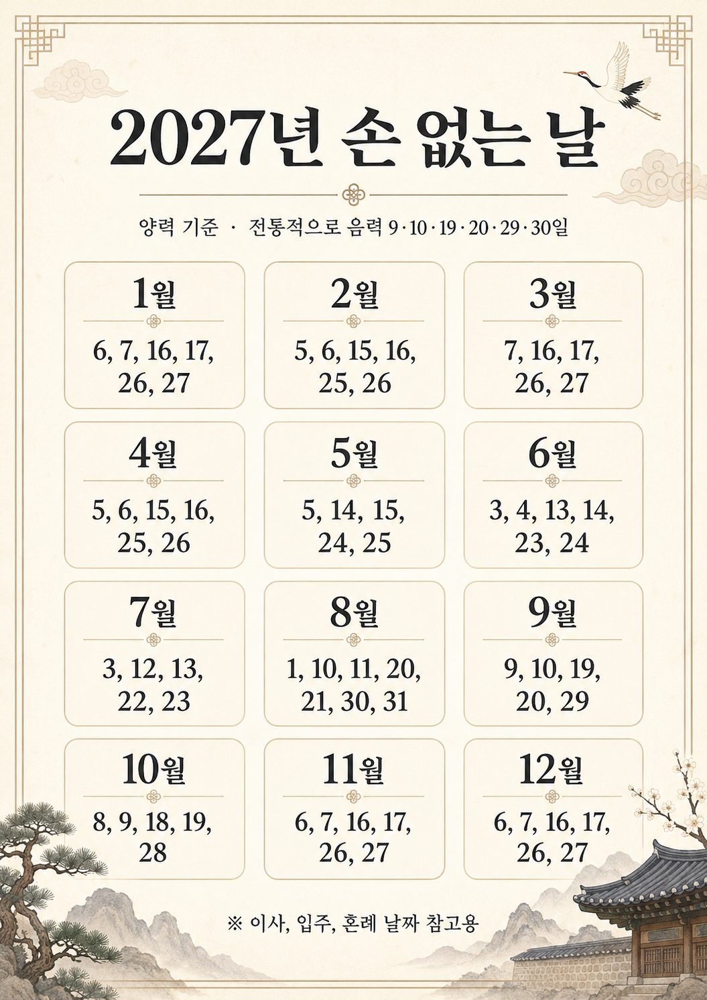
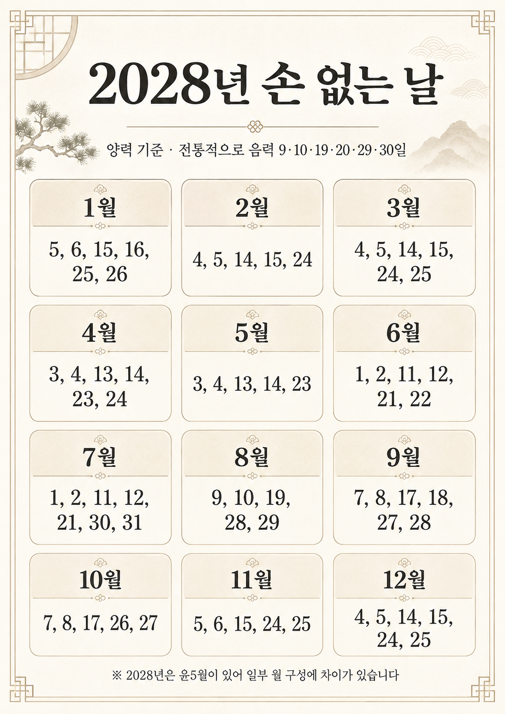
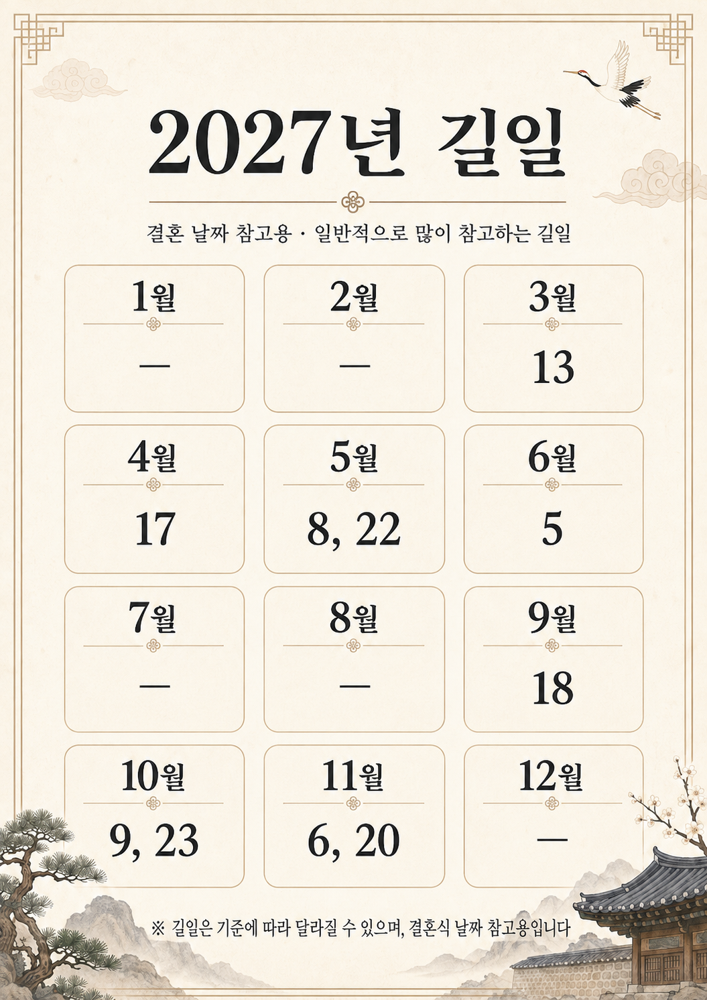
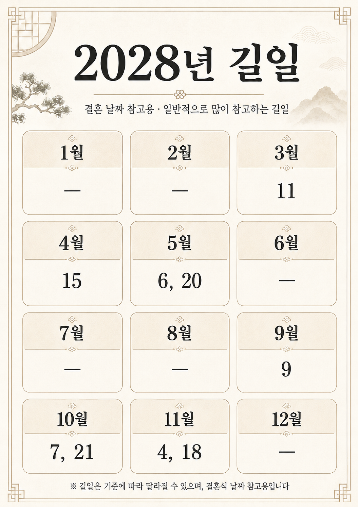

---
categories:
  - useful-tips/general
date: 2026-08-27
description: 해야할 것은 바로 '결혼식 날짜 정하기' 이다.
lang: ko
last_updated: 2026-11-14
naver_date: 2026-08-27
naver_url: https://blog.naver.com/martin-lee/224391813548
tags:
  - 결혼식
  - 웨딩
  - 결혼식날짜
  - 2027길일
  - 2028길일
  - 손없는날
title: "[결혼] 결혼식 날짜 정하기(2027년 손 없는 날, 길일, 성수기/비성수기/연휴)"
translation_key: 2026-08-27-choosing-a-wedding-date
---

결혼을 하기로 마음 먹었다면

결혼식 준비를 시작해야 한다면

해야할 것은 바로 '**결혼식 날짜 정하기**' 이다.

과학적인 근거는 없지만 아직까지 많은 사람들이

손 없는 날을 이사 하는 날을 정하거나

길일과 택일을 통해 결혼식 날짜를 잡고

길일과 손 없는 날을 함께 보고 개업일을 정하는 경우가 있다.

\* 손 없는 날 = '손'이라는 액운이 없다고 보는 날

\* 길일 = 전통적으로 어떤 일을 하기에 좋은 날 전체

\* 흉일 = 중요한 일을 피하는 것이 좋다고 여기는 날

\* 택일 = 여러 조건을 따져 실제로 날짜를 선택하는 것

(손 없는 날 != 길일)

손 없는 날에 비해 길일을 더 적다.

길일에도 종류가 있는데,

<table><tbody><tr><td>
<b>종류</b>
</td><td>
<b>뜻 / 개념</b>
</td><td>
<b>주로 보는 용도</b>
</td><td>
<b>특징</b>
</td></tr><tr><td>
<b>황도길일</b>
</td><td>
천체의 운행과 신살 기준으로 좋은 날
</td><td>
결혼, 이사, 개업 전반
</td><td>
가장 대중적으로 많이 알려진 길일 개념
</td></tr><tr><td>
<b>천덕일(天德日)</b>
</td><td>
하늘의 덕이 깃든 날
</td><td>
결혼, 계약, 시작하는 일
</td><td>
복이 따르고 흉을 덜어준다고 봄
</td></tr><tr><td>
<b>월덕일(月德日)</b>
</td><td>
달(月)의 덕이 있는 날
</td><td>
결혼, 개업, 이사
</td><td>
천덕일과 비슷하게 길한 날로 여김
</td></tr><tr><td>
<b>천은일(天恩日)</b>
</td><td>
하늘의 은혜가 미친다고 보는 날
</td><td>
혼례, 경사, 신고식
</td><td>
경사로운 일에 많이 언급됨
</td></tr><tr><td>
<b>대안길일(大安吉日)</b>
</td><td>
큰 탈 없이 평안하다는 의미의 날
</td><td>
결혼, 이사, 개업
</td><td>
무난하고 안정적인 좋은 날로 많이 봄
</td></tr><tr><td>
<b>음양불장길일 / 음양부장길일</b>
</td><td>
음양이 조화를 이루어 흉이 적은 날
</td><td>
결혼 택일
</td><td>
혼인 날짜에서 자주 보는 기준 중 하나
</td></tr><tr><td>
<b>십전대길일</b>
</td><td>
아주 크게 길한 날
</td><td>
큰 행사, 혼례, 개업
</td><td>
이름 그대로 “매우 좋은 날”로 여김
</td></tr><tr><td>
<b>생기일 / 생갑일</b>
</td><td>
생기와 활력이 돈다고 보는 날
</td><td>
개업, 출발, 사업 시작
</td><td>
새 출발과 관련해 좋다고 봄
</td></tr><tr><td>
<b>통상길일</b>
</td><td>
일반적으로 무난하고 좋은 날
</td><td>
일상적인 중요 일정
</td><td>
아주 특별한 길일은 아니지만 많이 참고함
</td></tr></tbody></table>

2027년

**3월 13일(토): 대안길일**

**4월 17일 (토): 천덕일**

**5월 8일 (토) 천은일**

**5월 22일 (토) 월덕일**

6월 5일 (토) 대안길일

**9월 18일 (토) 천덕일**

**10월 9일 (토) 대안길일**

**10월 23일 (토) 월덕일**

**11월 6일 (토) 천덕일**

11월 20일 (토) 대안길일

2028년

**3월 11일 (토) 대안길일**

**4월 15일 (토) 천덕일**

**5월 6일 (토) 천은일**

**5월 20일 (토) 월덕일**

**9월 9일 (토) 대안길일**

**10월 7일 (토) 천덕일**

**10월 21일 (토) 대안길일**

**11월 4일 (토) 천덕일**

11월 18일 (토) 월덕일

이다.

두번째로 따져봐야할 점은 **결혼식 시즌**이다.

**결혼식 성수기**

봄: 3~5월

가을: 9~11월

특히 4~5월, 9~10월이 가장 인기

**결혼식 비성수기**

겨울: 1~2월, 12월

여름: 7~8월

시즌에 따라 가격이 천차만별이라는 점을 참고해야 한다.

보통 길일 + 손없는 날 + 성수기가 겹치는 날짜라면 인기가 많아 예약이 힘들다.

하나 더 따져봐야할 점은 **연휴 기간** 이다.

연휴에는 다들 놀러가기 때문에 하객들에게 미움을 받을 수 있다. . .

직장인이라면 연휴 기간에 휴가를 붙여쓰는 경우도 많기 때문에 참고해두면 좋다. . .

신혼여행 가는데도 비행기 표 값이 비쌀수도...?

2027년

5월 1일 (토) - 5월 3일(월): 노동절 + 대체공휴일

**9월 14일 (화) - 9월 16일 (목): 추석**

10월 2일 (토) - 10월 4일 (월): 개천절 + 대체공휴일

10월 9일 (토) - 10월 11일 (월): 한글날 + 대체공휴일

2028년

4월 29일 (토) - 5월 2일 (화): 주말 + 노동절 + 부처님 오신 날

5월 5일 (금) - 5월 7일 (일): 어린이날 + 주말

9월 30일 (토) - 10월 5일 (목): 주말 + 추석 + 개천절 대체 공휴일

10월 7일 (토) - 10월 9일 (월): 한글날

다들 결혼식 날짜를 잘 잡고 예식도 무사히 잘 치르고

앞으로 행복한 일들만 가득하기를 바란다.

#결혼식

#웨딩

#결혼식날짜

#2027길일

#2028길일

#손없는날
