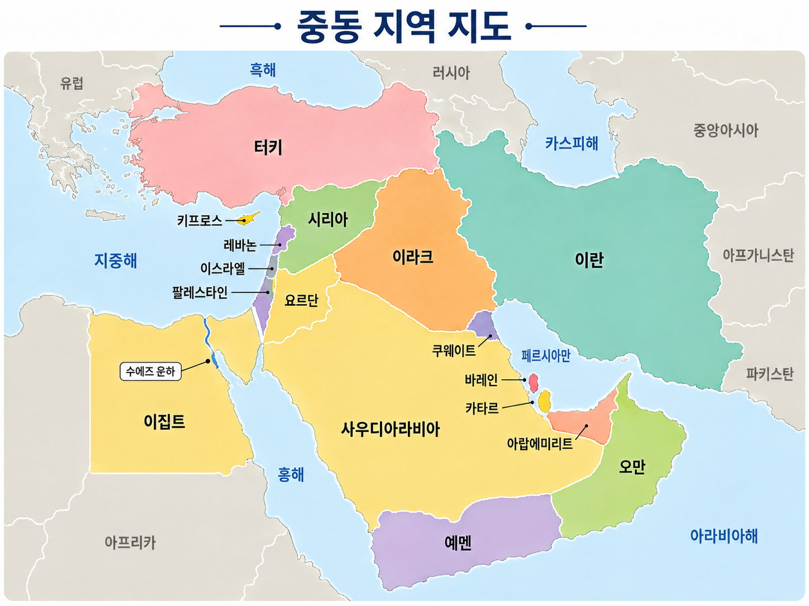

---
categories:
  - useful-tips/general
date: 2026-09-02
description: 중동(Middle East)은 어디인가?
lang: ko
last_updated: 2026-11-14
naver_date: 2026-09-02
naver_url: https://blog.naver.com/martin-lee/224398026298
tags:
  - 공부 기록
title: 중동지역은 어디를 말하는걸까
translation_key: 2026-09-02-defining-the-middle-east
---

중동(Middle East)은 어디인가?

중동 지역이라 하면 석유가 나오는 곳들을 쉽게 떠올린다.

보통 서아시아 + 이집트 일대를 묶어서 중동이라 부르며, 국가로는

사우디아라비아

UAE

카타르

쿠웨이트

바레인

오만

예멘

이라크

이란

이스라엘

요르단

레바논

시리아

팔레스타인 지역

터키

이집트

를 묶어서 중동이라 한다.

조금 더 범위를 넓혀 북아프리카까지 포함하면, 라비아, 튀니지, 알제니, 모로코까지도 중동 지역이라고 보기도 한다.

---

**중동이 중요한 이유**

1\. 자원

2\. 지리적 위치

3\. 운하

4\. 정치⋅종교⋅안보적 문제

유대교/기독교/이슬람 모두 이 지역에서 탄생하거나 핵심 성지가 있다.

이스라엘-팔레스타인,

이란-사우디,

수니파-시아파,

미국⋅러시아⋅중국의 이해관계까지 겹쳐있어 여러가지 복합한 요소가 같이 공존하는 전략적 요충지이기도 하다.
