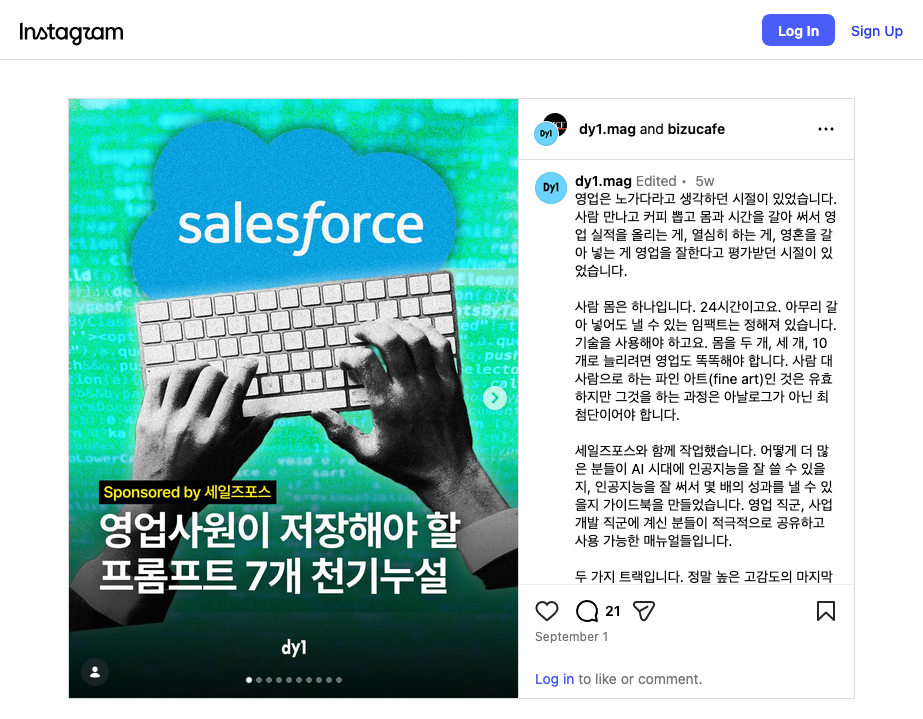

---
categories:
  - useful-tips/general
date: 2026-09-03
description: 2. 거절 맞아보기. 미팅 들어가기 10분 전
lang: ko
last_updated: 2026-11-14
naver_date: 2026-09-03
naver_url: https://blog.naver.com/martin-lee/224399141758
tags:
  - 프롬프트
title: 프롬프트 팁
translation_key: 2026-09-03-prompting-tips
---

[https://www.instagram.com/p/DcxGkfgmUD\_/?utm\_source=ig\_web\_copy\_link&igsi=NTc4MTIwNjQ2YQ==](https://www.instagram.com/p/DcxGkfgmUD_/?utm_source=ig_web_copy_link&igsi=NTc4MTIwNjQ2YQ==)

---

미팅 전날, 리서치

> \[회사명\]과 내일 미팅이 있어, 아래를 조사해서 브리핑해줘.
>
> 이 회사 최근 3개월 뉴스⋅투자⋅채용 소식
>
> 이 회사가 지금 겪고 있을 문제 3가지 추정 (근거 포함)
>
> 미팅에서 아이스브레이킹으로 꺼낼 얘깃거리 2개
>
> 우리 제품 \[제품명\]과 연결할 수 있는 지점
>
> 마지막에 "이 미팅에서 물어봐야 할 질문 3개"로 정리해줘

2\. 거절 맞아보기. 미팅 들어가기 10분 전

> 너는 \[회사명\]의 \[직책\]이야. 우리 제품 도입을 검토 중인데 회의적인 입장이야. 나는 영업사원이고, 지금부터 대화하자.
>
> 너는 "가격이 비싸다", "지금 쓰는 걸로 충분하다", "내부 검토가 필요하다" 순서로 반론을 던져. 대화가 끝나면 내 답변 중 뭐가 약했는지 피드백해줘.

3\. 후속 메일, 미팅 끝난 자리에서

> 아래는 방금 끝난 미팅 요약이야.
>
> \[미팅 요약 붙여넣기\] 이걸로 후속 메일 초안을 써줘.
>
> \- 오늘 논의 핵심 2줄 요약
>
> \- 우리가 다음까지 해갈 것 / 고객이 확인해줄 것 구분
>
> \- 다음 미팅 날짜 제안으로 마무리
>
> \- 5문장 이내, 정중하지만 간결하게

4\. 처음 보내는 콜드메일

> \[회사명\]의 \[직책\]에게 보낼 첫 메일을 써줘.
>
> \- 이 회사 최근 소식 중 하나를 첫 문장에서 언급 (검색해서)
>
> \- 우리 제품 \[제품명\]이 푸는 문제를 한 문장으로
>
> \- 기능 나열 금지, 자랑 금지
>
> \- "30분 통화 가능한지"로만 마무리
>
> \- 전체 6문장 이내

5\. 주간 보고

> 아래는 이번 주 미팅 기록과 메일들이야.
>
> \[붙여넣기\] 주간 보고로 정리해줘.
>
> \- 진행 중인 프로젝트 현황 한 줄씩
>
> \- 이번 주 새로 들어온 문의와 처리 상태
>
> \- 다음 주에 해야 할 일 3개
>
> \- 팀장이 1분 만에 읽을 분량으로

6\. 문의 쌓였을 때, 누구부터 연락할지

> 문의 리스트야.
>
> \[리스트 붙여넣기\] 아래 기준으로 연락 우선순위를 매겨줘.
>
> 돈: 예산이 있어 보이는가
>
> 사람: 결정권자인가
>
> 시기: 언제 도입하려는 건가
>
> 근거와 함께 상위 3명만 뽑아줘.

#프롬프트
