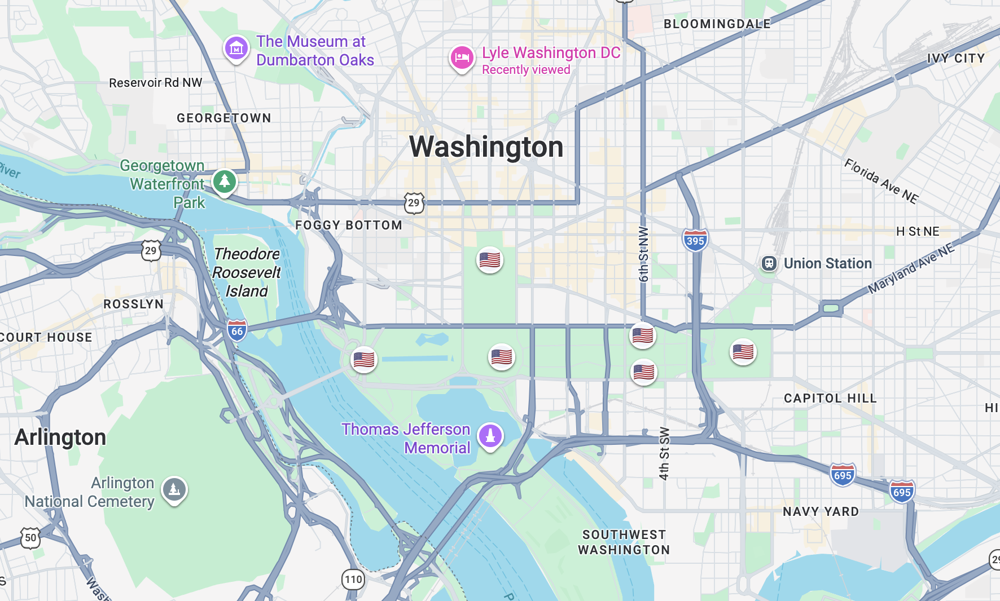

---
categories:
  - useful-tips/general
date: 2026-10-06
description: 여행 계획 세우는데 AI가 정말정말 잘 도와준다.
lang: ko
last_updated: 2026-11-14
naver_date: 2026-10-06
naver_url: https://blog.naver.com/martin-lee/224432997876
tags:
  - 여행 기록
title: "[미국 여행] 워싱턴 DC 1박2일 여행 계획 세우기"
translation_key: 2026-10-06-washington-dc-itinerary
---

세상이 참 좋아졌다.

여행 계획 세우는데 AI가 정말정말 잘 도와준다.

---

워싱턴 DC를 처음 가게되면 꼭 봐야하는 것들은 정해져있다.

관광명소들이 거의 밀집되어있기 때문에 당일치기나 1박 2일 코스로 딱 좋다.

뉴욕 여행겸 워싱턴은 한번 찍는 경우가 많은 것 같았따.

뉴욕 -> 워싱턴으로는 암트랙 Armtrak 기차를 이용하면 된다.

숙소는 Union Station을 기점으로 잡는 것이 가장 좋다고 할 수 있다.

워싱턴은 대중교통이 더 안전하고 잘되어있어 지하철, 버스를 이용할수도 있고, 짧은 거리는 우버를 이용하기에도 좋다

날씨가 좋다면, 자전거 투어도 많이 하는듯했다.

대충 이런 느낌...

위 지도에서 제일 왼쪽에 찍힌 부분이 링컨 기념관 Lincoln Memorial, 제일 오른쪽에 찍은 곳이 미국 국회 의사당 Unite States Capitol 이다. 구글맵 지도로 찍어보면 도보 56분으로 나온다. 이 공원? 같은 곳을 따라 걷다보면 세계 2차대전 기념관 World War II Memorial, 워싱턴 기념비 Washington Monument, 자연사 박물관 Smithsonian National Museum of Natural History, 우주 박물관 Smithsonian's National Air And Space Museum 등이 쭉 있고 위로는 백악관 White House 이 있다.

한국에서 박물관, 전시회 이런거에 관심 없던 사람들도 여기가면 다들 재밌고 눈이 휘둥그레질 정도로 놀라운, 아름다운, 대단한 것들이 많이 있다고 한다. 걸어다닐 일이 많으니 신발은 무조건 편한걸 신고 가야만 한다. 그리고 한가지 중요한 점은 입장료가 무료거나 비싸지 않다는 것이다. **단, 예약이 필수이다.**

1일차(서쪽): 워싱턴 도착 -> 숙소에서 짐 풀고 -> 백악관 -> 점심 먹고 -> 미국인 역사문화 박물관 or 자연사박물관 -> 워싱턴 기념비 -> 2차세계대전 기념비 -> 베트남전/한국전 기념비 -> 링컨 기념관 -> 저녁 먹고 -> 숙소

2일차(동쪽): 조식 먹고 -> 국립 미술관 or 항공우주박물관 -> 의회도서관 -> 국회의사당 -> **Union Station**

0\. 백악관 White House (여행일 D-7~90 전에 신청해야함, 비용 무료)

[https://www.whitehouse.gov/visit/](https://www.whitehouse.gov/visit/)

[Visit The White House](https://www.whitehouse.gov/visit/)

1\. 미국인 역사문화 박물관 (여행일 D-30 부터 예약 가능, 무료)

[https://nmaahc.si.edu/](https://nmaahc.si.edu/)

[A People’s Journey, A Nation’s Story | National Museum of African American History and Culture](https://nmaahc.si.edu/)

2\. 역사 박물관

[https://tickets.si.edu/nmaahc/events](https://tickets.si.edu/nmaahc/events)

3\. 자연사박물관 (사전 예약 필요 없음, 비용 무료)

[https://naturalhistory.si.edu/visit](https://naturalhistory.si.edu/visit)

4\. 워싱턴 기념탑 (여행일 D-1 오후 3시 예약 가능, 비용 $1)

[https://www.recreation.gov/ticket/facility/234635?tab=tours](https://www.recreation.gov/ticket/facility/234635?tab=tours)

[Washington Monument, National Mall and Memorial Parks - Recreation.gov](https://www.recreation.gov/ticket/facility/234635?tab=tours)

4\. 링컨 기념관 지하 전시장 Undercroft (비용 $1)

[https://www.nps.gov/linc/planyourvisit/index.htm](https://www.nps.gov/linc/planyourvisit/index.htm)

[Plan Your Visit - Lincoln Memorial (U.S. National Park Service)](https://www.nps.gov/linc/planyourvisit/index.htm)

5\. 항공우주박물관 (여행 D-30 부터 예약 가능, 비용 무료)

[https://airandspace.si.edu/](https://airandspace.si.edu/)

[Smithsonian’s National Air and Space Museum](https://airandspace.si.edu/)

6\. 의회도서관 (여행 D-30 부터 예약 가능, 비용 무료)

[https://www.loc.gov/visit/](https://www.loc.gov/visit/)

[Visiting the Library | Library of Congress](https://www.loc.gov/visit/)

7\. 국회의사당 U.S. CAPITOL (비용 무료)

[https://www.visitthecapitol.gov/visit/book-a-tour](https://www.visitthecapitol.gov/visit/book-a-tour)

[Book a Tour | U.S. Capitol - Visitor Center](https://www.visitthecapitol.gov/visit/book-a-tour)

---

**워싱턴 맛집 후보**

Old Ebbitt Grill ([https://maps.app.goo.gl/BNkfTrMAW1j1xTM37](https://maps.app.goo.gl/BNkfTrMAW1j1xTM37))

Founding Farmers DC ([https://maps.app.goo.gl/WFrFRDwspF1Jk8D68](https://maps.app.goo.gl/WFrFRDwspF1Jk8D68))

Le Diplomate ([https://maps.app.goo.gl/LayiTLGVwvJNUpso6](https://maps.app.goo.gl/LayiTLGVwvJNUpso6))

Unconventional Diner ([https://maps.app.goo.gl/gNtG5R6ibM4sxKcb9](https://maps.app.goo.gl/gNtG5R6ibM4sxKcb9))

**최종**

**1일차**

**07:35 - 10:30 워싱턴 DC 도착 Union Station**

**10:30 - 11:30 숙소로 이동 Lyle Hotel**

**11:30 - 12:30 짐 맡기고 점심 먹으러 Old Ebbitt Grill - 예약 완료 12:30**

**13:30 - 14:30 밥 먹고 백악관**

**15:00 - 18:00**

**미국인 역사문화 박물관 - 15:00 예약 완료**

**워싱턴 기념비**

**2차세계대전 기념관**

**(18:08 - 18:10 10월 말 일몰시간)**

**18:00 - 19:30 링컨 기념관 - 예약 완료 19:15**

**19:30 - 20:00 저녁먹으러 Le Diplomate · Dining Room - 예약 완료 20:30**

**22:00 - 숙소로 이동**

**2일차**

**08:00 - 11:00 조식 + 체크아웃 + 짐 맡기기**

**12:00 - 15:00 항공우주 - 예약 완료 12:00**

**15:00 - 16:00 국회의사당 - 예약 완료 15:00**

**16:00 - 17:00 도서관 예약 완료 16:00**

**17:00 - 17:30 대법원 앞에서 사진**

**간단한 요기를 하고 버스 탑승하러 Union Staion 예약 완료 - 18:55**

(시간 남으면 2일차에 자연사박물관 한번 방문하기)
