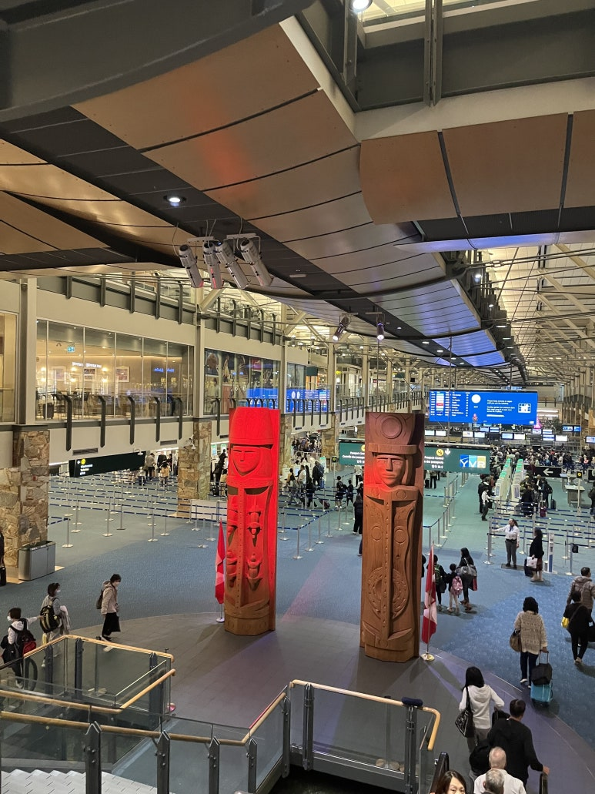
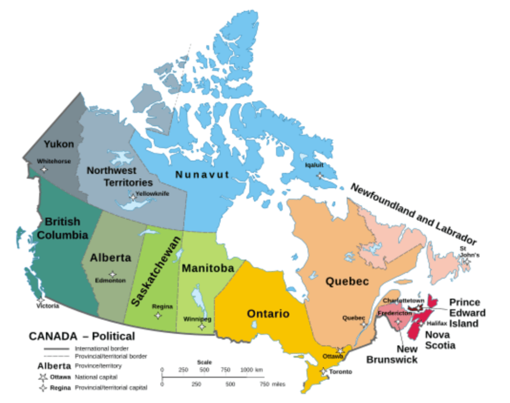
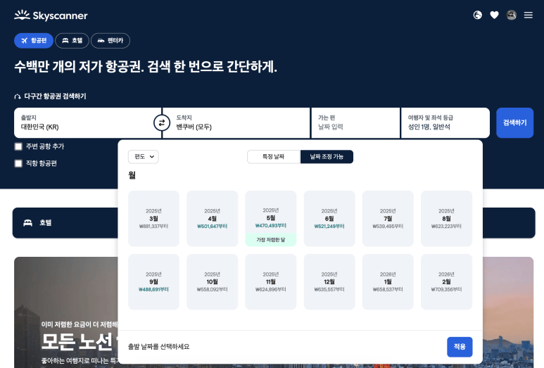
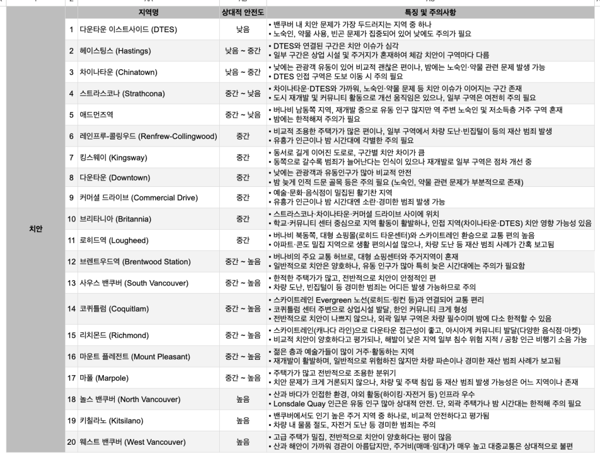
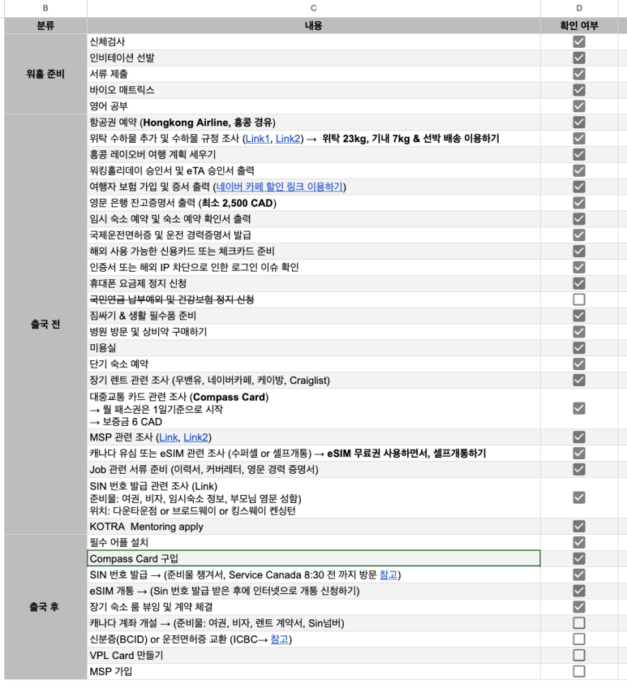

---
categories:
  - useful-tips/in-canada
date: 2025-04-12
description: 현재 나는 워킹홀리데이로 캐나다에 와있다.
lang: ko
last_updated: 2026-11-14
naver_date: 2026-10-10
naver_url: https://blog.naver.com/martin-lee/224436725035
tags:
  - "1"
  - "2"
  - "3"
  - "4"
  - "5"
  - "6"
  - "7"
  - "8"
  - "9"
title: 캐나다 밴쿠버 워킹홀리데이 총 정리 (지역선정/항공권/eSIM/보험/임시숙소/필수서류/준비물)
translation_key: 2025-04-12-vancouver-working-holiday
---

※ 본 글은 블로그 이전으로 인해 기존 글을 옮겨온 것입니다. (작성일: 2025년 4월 12일)

현재 나는 워킹홀리데이로 캐나다에 와있다.

워홀을 결심하게 된 계기는 오래전부터 영어를 잘하고싶단 생각을 가지고 있었기 때문이다. 워홀을 오기전에는 필리핀에서 두달간 영어 어학연수를 마쳤고, 이제는 캐나다에서 실전으로 맞이를 해야한다..

여기까지 오는데 준비한것들이 많은데 블로그로 남겨두면 좋을 것 같아서 글을 쓰고 있다.

---

**#1. 워킹홀리데이 – 캐나다**

워킹홀리데이는 여행비자가 아닌 워크비자를 받게되며 1~2년정도 거주할 수 있게된다. 일을할 수 있고 영어를 배울수도 있고 여행다닐수도있고 목적이 다양하다. 보통 일본, 호주, 캐나다, 뉴질랜드 등등 이렇게 많이들 지원한다. 2024년부터 캐나다는 나이 제한이 만 나이 30살에서 35살까지로 늘었고 2년동안 거주할 수 있도록 변경되었다. 캐나다는 이민자들에게 친숙한 나라이자 영어권 국가로 캐나다 워킹홀리데이로 결정했다. 각 나라마다 신청 조건과 절차는 다르니 꼭 직접 확인해보는 것을 추천한다.

– (a) IRCC를 통해 워킹홀리데이 지원

– (b) 인비테이션 선발까지 기다리기

– (c) 신체검사

– (d) 바이오매트릭스

– (e) 각종 서류 제출

이렇게 프로세스를 나뉠 수 있을것이고 짧으면 1달안에 최종 선발까지 가능한것같다. 비용은 대략 20~30만원정도 들었던걸로 기억한다.

[**https://cafe.naver.com/gocan**](https://cafe.naver.com/gocan)

[2026 캐나다 워킹홀리데이 No.1... : 네이버 카페](https://cafe.naver.com/gocan)

네이버 캐나다 워킹홀리데이 카페에 자세히 정리되어 있어서 가입 후 차근차근 따라하는 것을 추천한다. 영어를 못하는 사람이어도 누구나 쉽게 할 수있을것이다.

---

**#2. 지역선정 – 밴쿠버**

캐나다는 10개의 주(province)와 3개의 준주(territory)로 이뤄진 연방 국가이고, 수도는 온타리오(Ontario)의 오타와(Ottawa) 라는 곳이다. 워홀러들이 많이 선택하는 지역은 주로 \*\*토론토(Toronto), 밴쿠버(Vancouver), 캘거리(Calgary)\*\*인 것 같다. 그리고 사스카툰(Saskatchewan)도 가끔 있다. 퀘백은 불어를 함께 사용하는 지역이라 적응하는데 다른 지역들보다 더 많은 노력이 필요할 것 같다.

각 지역별 특징을 간단히 소개하자면

– 토론토: 도시, 일자리랑 문화생활이 많은편, 집 값과 생활비가 상대적으로 비싼 편

– 밴쿠버: 도시와 자연, 집 값과 생활비가 상대적으로 비싼 편, 비가 많이 내리는 지역

– 캘거리: 자연, 알버타주는 주세금(PST)을 내지 않기때문에 다른 지역들에 비해서 생활비가 저렴한 편

이외에도 각 주마다 더 많은 특징과 장단점들이 있을텐데 본인이 원하는 환경을 선택해서 고르는 것을 추천한다.

---

**#3. 항공권 – 3월, 경유**

항공권은 보통 출국 3개월전이 가장 저렴한 편이다. 홍콩 또는 일본을 경유하는 항공편을 구매하는 것이 가장 저렴할 것이다. 캐나다로 오기 전에 홍콩을 들려서 하루 여행을 즐기고 왔는데 굉장히 만족스러웠다. 홍콩항공을 이용했다. 비행기 결항과 지연이 약간 잦은편이고 수하물 규정에 대해 엄격하다는 후기들이 많았는데 그래도 저렴하고 무사히 잘 이용했다.

---

**#4 통신사(eSIM) – 수퍼셀 eSIM, Fido**

대부분 출국 전에 한국에서 쓰던 핸드폰은 정지를 시키거나 알뜰폰 요금제로 변경해둔다.

가끔 한국으로부터 인증 서비스가 필요할 수 있으니 문자만 받아볼 수 있는 월 3,300원 요금제로 변경했고, eSIM을 개통해서 사용하기로 결심했다.

[https://blog.naver.com/supercell33](https://blog.naver.com/supercell33)

[캐나다 현지 수퍼셀! 캐나다유심과 인터넷 전문점 : 네이버 블로그](https://blog.naver.com/supercell33)

수퍼셀이라는 업체를 통해서 한국에서 미리 eSIM을 개통하고 오는 방법이 가장 편하다. 홍콩 숙소를 예약하다가 무료 eSIM 500MB 쿠폰을 받게되어서 캐나다 도착해서 현지에서 개통하려고 했지만 여기와서보니 프로모션도 다 동일했고, 영어가 익숙하지 않다보니… 현지 도착해서 결국에 수퍼셀 이용해서 이심 개통을 했다.

궁금한거 다 친절하게 답변해주고 밤 늦게까지도 상담해주는 것 같다..

캐나다 통신사는 메이저급은 Rogers > Bell > Telus, 알뜰급은 Fido > Virgin Plus > Koodo 이렇게 있다. 캐나다 인터넷 속도는 한국에 비해 만족스럽지 못한다고 한다. 원래 같았으면 1등 통신사를 고집했겠지만… 가입 당시에 Koodo가 가장 좋은 프로모션으로 나와있어서 Koodo로 가입했다. 프로모션은 자주 바뀌는 것 같으니 가입 전 반드시 상담하는 것을 추천한다.

---

**#5 여행자 보험 – 마이뱅크**

애초에 2년짜리 여행자보험이 있는 보험사가 많이 없었다. 보험도 카페에서 제공하는 링크 통해서 가입하면 할인된다길래 그 중에서 가장 저렴하다는 마이뱅크로 가입했다. 보장금액이 $50,000이 되어야한다, 기간은 반드시 2년이어야한다라는 글들이 종종 보였는데, 입국할 때 문제되기 싫어서 맘편히 든든플랜(?)으로 가입했다.

---

**#6 임시숙소 – 에어비앤비**

어학원을 등록하는 경우가 아니라면, 밴쿠버 한인 카페를 통해서 한인 숙박이나 홈스테이를 예약하거나 에어비앤비를 예약하는 경우가 일반적이다. 개인적으로 에이버앤비를 추천한다. 최근 룸 렌트관련 사기가 많이 일어나기도 하고 에어비앤비를 통해서 예약하면 추후에 임시숙소 증명서를 출력할 수 있기때문이다.. 이 서류가 비자랑 SIN넘버 발급받을때 필요했다.

참고로, 임시숙소가 아닌 장기숙소를 구하는 분들이라면 치안을 중점으로 숙소를 고려해보자.

---

**#7 필수 서류 – 국제 운전면허증, 여행자보험 사본, 워크퍼밋 사본, 임시숙소, 잔고증명서**

밴쿠버에서 운전면허증을 발급받고 싶다면, 국제 운전면허증과 영문 운전면허증(새거 발급받아서 이전꺼 제출하기)을 준비해오자. 공항 입국심사에서는 워크퍼밋이랑 임시숙소 주소만 확인했다.

---

**#8 그 외 준비물..**

해외에서 출금가능한 카드 (트래블 쏠/트래블 월렛 등등)

별도로 수하물 추가 안했고 23kg 위탁수하물, 7kg 기내수하물, 백팩 이렇게 들고왔다.

유튜브나 다른 블로그들보니까 옷, 수건, 특히 양말들을 많이 챙겨오면 좋다고 해서 최대한 다 가져왔다. 엊그제 월마트가서 양말 몇개보니까 정말 질이 구렸다… 전기장판 같은 경우는 필수인지 모르겠으나 방은 정말 건조하다.. 드라이기 같은 경우는 가져온게 전압이 안맞아서 너무 약하다.. 전자제품은 되도록 여기와서 구매하는것이 좋을 것 같고 워홀 카페같은 곳에서 귀국세일을 통해서 구매하는 것을 추천한다.

---

**#9 캐나다 도착후 해야할 일들**

– 캐나다 필수 어플 설치

– SIN 넘버 발급

– 캐나다 계좌 개설 (이것도 은행마다 프로모션이 있으니 잘 확인하고 개설하자) RBC > CIBC > TD 순으로 고객들이 많다고 한다. **반드시 예약하고 갈 것.**

– 교통카드, Compass Card 구매

– 신분증(BCID) 교환

– 도서관, VPL 카드 만들기

– 3달 뒤 MSP 가입

– 잡 구하기

---

워홀 준비하면서 정리한 내용이 많아, 그걸 바탕으로 글을 써봤습니다.. 혹시 빠진 부분이나 궁금한 점 있으면 댓글 남겨주세요. 감사합니다 🙂
