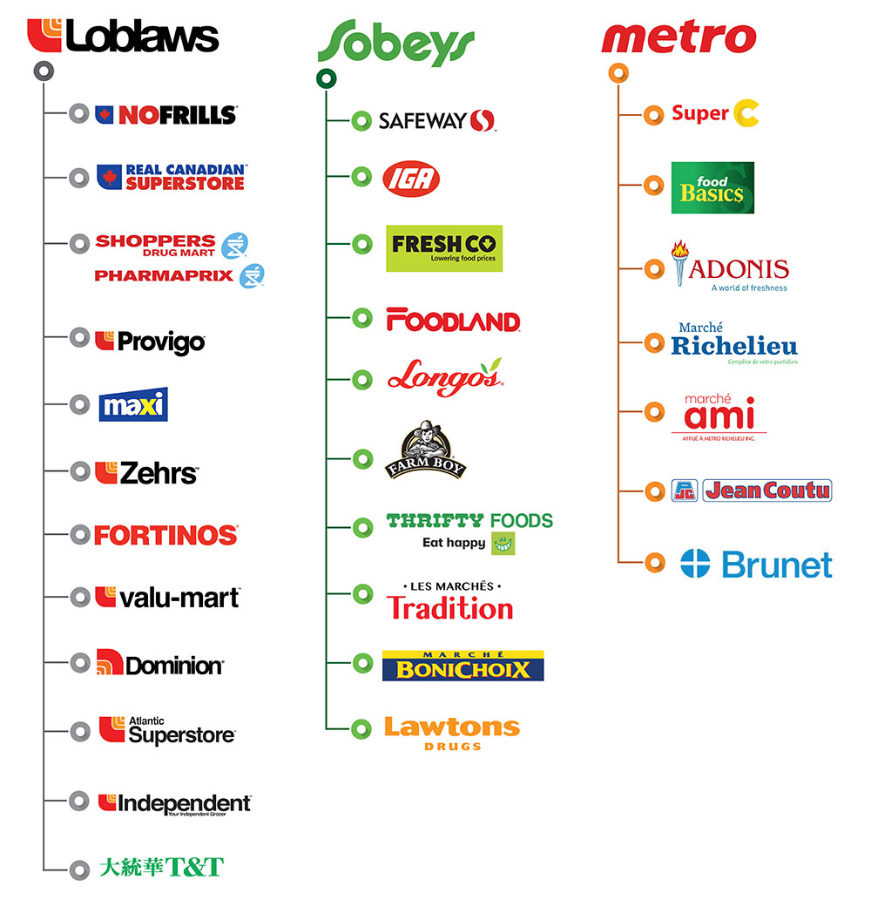

---
categories:
  - useful-tips/in-canada
date: 2026-07-22
description:
  Loblaw의 역사는 1919년 캐나다 온타리오주 토론토에서 시작됐다. Theodore Pringle Loblaw, 줄여서 T.P. Loblaw와 그의 사업 파트너 J. Milton Cork는 토론토에 최초의 Loblaw
  Groceterias 매장을 열었다.…
lang: ko
last_updated: 2026-11-14
naver_date: 2026-07-22
naver_url: https://blog.naver.com/martin-lee/224353897543
tags:
  - 캐나다
  - 식료품점
title: 캐나다 식료품점 - Loblaws, Sobeys, Metro, Pattison Food Group, Dollarama, Walmart, Costco
translation_key: 2026-07-22-canadian-grocers
---

[https://competition-bureau.canada.ca/en/how-we-foster-competition/education-and-outreach/canada-needs-more-grocery-competition](https://competition-bureau.canada.ca/en/how-we-foster-competition/education-and-outreach/canada-needs-more-grocery-competition)

**Loblaws**

Loblaw의 역사는 1919년 캐나다 온타리오주 토론토에서 시작됐다. Theodore Pringle Loblaw, 줄여서 T.P. Loblaw와 그의 사업 파트너 J. Milton Cork는 토론토에 최초의 **Loblaw Groceterias** 매장을 열었다. 이들은 당시 점원이 상품을 꺼내주는 전통적인 식료품점과 달리, 고객이 직접 상품을 고르고 현금으로 계산하는 **셀프서비스·현금판매 방식**을 도입했다. 운영비와 외상 판매 비용을 줄인 만큼 상품을 더 저렴하게 판매할 수 있었고, 이 방식은 소비자들에게 큰 호응을 얻었다.

Loblaw Groceterias는 빠르게 성장해 1924년에는 온타리오를 넘어 미국 뉴욕주에 진출했고, 1928년에는 69개 매장과 당시 최신식으로 평가받던 본사·물류창고를 갖추게 됐다. 1933년 T.P. Loblaw가 60세로 사망했을 당시에는 매장이 150개를 넘어섰으며, 1939년부터 매장 간판에 현재와 같은 **Loblaws**라는 이름이 등장했다.

그러나 오늘날 Loblaw를 지배하는 Weston 가문은 Loblaw의 원래 창업 가문은 아니다. Weston 가문의 기업 역사는 그보다 앞선 1882년으로 거슬러 올라간다. 창업자 George Weston은 토론토에서 제빵사 견습생과 빵 판매원으로 일하다가 고용주로부터 빵 배달 경로를 사들이며 자신의 사업을 시작했다. 이후 Weston’s Bread를 성장시켜 20세기 초에는 캐나다 최대 규모의 제빵업자가 됐다.

1924년에는 그의 장남 Garfield Weston이 George Weston Limited의 사장이 됐다. Garfield는 아버지의 토론토 제빵 사업을 캐나다와 해외 여러 지역에서 활동하는 식품 기업으로 확장했다. 그는 1947년 Loblaw 주식 10만 주를 인수하기 시작했고, George Weston Limited는 1950년대 초 Loblaw의 지배지분을 확보했다. 공식 연차보고서상 1953년 George Weston Limited가 Loblaws Inc.의 경영권을 인수했으며, 1956년에는 현재의 **Loblaw Companies Limited**가 설립됐다.

Loblaw는 이후 지나친 사업 확장과 유통 경쟁으로 어려움을 겪었지만, 1970년대 초 Weston 가문 3세인 **W. Galen Weston**이 경영에 참여하면서 전환점을 맞았다. 그는 1972년 CEO에 취임해 수익성이 낮은 사업을 정리하고, 매장 디자인과 브랜드를 새롭게 바꾸면서 Loblaw를 다시 성장시켰다. 이 과정을 거쳐 Loblaw는 George Weston Limited의 핵심 자산이자 캐나다 최대 식품 유통기업으로 발전했다.

Loblaw의 성장 과정에서는 자체 상품 브랜드도 중요한 역할을 했다. 1978년에는 노란색 포장으로 유명한 저가 상품 브랜드 **no name**을 출시했고, 같은 해 최초의 **No Frills** 할인점을 열었다. 1984년에는 품질과 차별화된 상품을 강조하는 **President’s Choice**를 출시했다. 오늘날 no name은 저가 상품, President’s Choice는 품질과 신상품을 강조하는 브랜드로 서로 다른 역할을 담당한다.

이후 Loblaw는 지역 유통기업을 인수하며 전국적인 사업망을 구축했다. 1998년에는 퀘벡의 Provigo를 인수했고, 2009년에는 캐나다 최대 아시아 식품 체인인 T&T Supermarket을 인수했다. 2014년에는 Shoppers Drug Mart를 인수하면서 단순한 슈퍼마켓 기업에서 식품·약국·건강·미용 사업을 함께 운영하는 종합 유통기업으로 성장했다.

Weston 가문은 현재도 Loblaw를 실질적으로 지배하고 있다. 2026년 초 기준 Galen G. Weston은 자신이 지배하는 회사들을 통해 **George Weston Limited 주식 약 59.5%**를 보유하거나 통제하고 있다. George Weston Limited는 다시 Loblaw Companies Limited 주식 약 52.6%를 보유하고 있다.

현재 **Galen G. Weston**은 Loblaw Companies Limited의 이사회 의장이며, 모회사 George Weston Limited에서는 이사회 의장과 CEO를 동시에 맡고 있다. Loblaw의 일상적인 사업 운영은 전문경영인인 **Per Bank**가 사장 겸 CEO로서 담당한다.

주요 사업 부문은 별도의 책임자가 나누어 관리한다.

Frank Gambioli: 일반 슈퍼마켓 부문 사장

Melanie Singh: No Frills·Maxi 등 할인점 부문 사장

Tina Lee: T&T Supermarkets CEO

Gregers Wedell-Wedellsborg: Shoppers Drug Mart 사장

즉, Loblaws나 No Frills마다 각각 CEO가 있는 것은 아니다. Loblaw의 통합 경영진 아래에서 일반 슈퍼마켓, 할인점, T&T, Shoppers Drug Mart 등의 사업 부문별 책임자가 운영을 담당한다.

Weston 가문

└ George Weston Limited - 식품 유통·부동산 지주회사

├ Loblaw Companies Limited - 식품·약국 유통기업

│　├ Loblaws - 일반 슈퍼마켓

│　├ Loblaw City Market - 도심형 일반 슈퍼마켓

│　├ Real Canadian Superstore - 대형 슈퍼마켓·종합 할인점

│　├ Real Atlantic Superstore - 캐나다 대서양 지역 대형 슈퍼마켓

│　├ Dominion - 뉴펀들랜드 래브라도 지역 슈퍼마켓

│　├ No Frills - 할인형 슈퍼마켓

│　├ Maxi - 퀘벡 지역 할인형 슈퍼마켓

│　├ Provigo - 퀘벡 지역 일반 슈퍼마켓

│　├ Fortinos - 온타리오 지역 풀서비스 슈퍼마켓

│　├ Zehrs - 온타리오 남서부 지역 슈퍼마켓

│　├ Your Independent Grocer - 독립 점주·지역 밀착형 슈퍼마켓

│　├ Valu-mart - 소도시·지역 중심 소형 슈퍼마켓

│　├ T&T Supermarket - 아시아 식품 전문 슈퍼마켓

│　├ Wholesale Club / Club Entrepôt - 창고형 식품 도매점

│　├ Shoppers Drug Mart / Pharmaprix - 드럭스토어·약국

│　├ Joe Fresh - 의류·패션 브랜드

│　├ PC Express - 온라인 주문·픽업·배송 플랫폼

│　├ President’s Choice - 프리미엄 자체 상품 브랜드

│　├ no name - 저가형 자체 상품 브랜드

│　└ PC Optimum - 통합 포인트·로열티 프로그램

│

└ Choice Properties REIT - 슈퍼마켓·산업·주거 부동산 투자회사

**Sobeys**

Sobeys의 창업자는 John William Sobey로, 일반적으로 J.W. Sobey라고 불린다. 그는 1907년 캐나다 노바스코샤주의 스텔라턴에서 말이 끄는 수레를 이용한 육류 배달 사업을 시작했다. 지역 농가로부터 가축을 사들여 운반하고 재판매하는 사업이었다. 이후 그의 아들 Frank H. Sobey가 1924년부터 육류와 일부 채소만 판매하던 사업을 종합 식료품점으로 확장했다. 1947년에는 대서양 연안 지역 최초의 현대식 Sobeys 슈퍼마켓을 열면서 오늘날 슈퍼마켓 체인의 기반을 마련했다.

현재 Sobeys Inc.는 Empire Company Limited가 100% 소유한 식품 유통 자회사이다. 주요 소매 브랜드로는 Sobeys, Safeway, Thrifty Foods, Foodland, IGA, IGA Extra, FreshCo, Chalo! FreshCo, Lawtons Drugs, Needs 등이 있으며, 온라인 장보기 서비스인 Voilà도 운영하고 있다. Empire의 식품 유통 부문에는 이 밖에도 Farm Boy와 Longo’s 등이 포함된다.

현재 Empire Company Limited의 이사회 의장은 James M. Dickson이며, Pierre St-Laurent가 Empire Company Limited와 Sobeys Inc.의 사장 겸 최고경영자, CEO를 동시에 맡고 있다. 그는 2025년 11월 5일 전임자인 Michael Medline의 뒤를 이어 즉시 CEO로 취임했다.

Sobeys, Safeway, Foodland, IGA와 같은 브랜드마다 별도의 CEO가 있는 것은 아니다. 이 브랜드들은 Empire와 Sobeys의 통합 경영진 아래 운영된다. Julia Knox는 최고소매책임자 겸 최고기술·혁신책임자로서 소매점 운영, 공급망과 중앙 조리시설을 총괄하며, 각 지역과 소매 브랜드에는 별도의 운영 및 매장 관리 조직이 배치된다.

Empire의 공식 공시자료에 따르면 2026년 5월 2일 기준 주요 슈퍼마켓 브랜드의 매장 수는 Sobeys 234개, Safeway 132개, IGA Extra 140개, IGA 189개, Farm Boy 52개, Longo’s 43개, Thrifty Foods 26개, Foodland 209개다. Quebec 지역 브랜드인 Bonichoix는 45개, Les Marchés Tradition은 81개이며, 아시아 식품점 Kim Phat은 4개, 고급 식료품점 Pete’s Frootique & Fine Foods는 2개가 운영되고 있다.

할인형 슈퍼마켓인 FreshCo와 Chalo! FreshCo는 합계 160개다. 이 숫자는 두 브랜드를 합산한 것으로, Ontario 108개, Manitoba 6개, Saskatchewan 5개, Alberta 24개, British Columbia 17개로 구성돼 있다.

식료품점 외에도 Sobeys 계열에는 다양한 형태의 소매 사업이 있다. 약국 체인 Lawtons Drugs는 74개, Quebec의 건강·유기농 전문점 Rachelle-Béry는 8개이며, 대서양 연안 지역의 편의점 Needs는 77개다. Quebec의 편의점 브랜드인 Boni-Soir는 282개, Voisin은 80개다. 이 밖에도 현금 도매점인 Cash & Carry 6개, 소매 주유소 359개, 주류 판매점 97개가 집계돼 있다.

Voilà는 일반적인 오프라인 슈퍼마켓 브랜드가 아니라 온라인 주문과 배송을 담당하는 전자상거래 서비스다. 중앙 주문처리센터인 CFC와 지역 배송 거점, 기존 매장 기반의 배송 및 픽업망을 이용해 운영된다.

전체적으로 Sobeys는 1907년 노바스코샤주의 작은 육류 배달 사업에서 출발해, 현재 캐나다 10개 주에서 1,600개가 넘는 식품 소매점을 소유하거나 프랜차이즈 및 제휴 방식으로 운영하는 전국적인 유통기업으로 성장했다.

**현재 규모**

2026년 1월 3일 기준 Loblaw는 캐나다에서 총 2,504개 매장을 운영하거나 관리하고 있다. 이 가운데 회사 직영점은 566개, 프랜차이즈 매장은 562개, 독립 약사가 운영하는 Shoppers Drug Mart·Pharmaprix 계열 약국은 1,376개다.

여기에 약국 진료소와 기타 의료시설을 포함하면 Loblaw가 설명하는 전체 네트워크는 2,800개 이상의 매장·약국·클리닉에 이른다. 직영 직원과 프랜차이즈·약국 운영 인력까지 합하면 약 22만 명이 근무하며, 캐나다인의 약 90%가 Loblaw 계열 매장으로부터 10㎞ 이내에 거주한다.

2025년 Loblaw의 식품·약국 소매 매출은 약 639억 캐나다달러였으며, 매년 식품·약국·금융 서비스에서 10억 건 이상의 고객 거래가 발생한다. PC Optimum의 활성 회원도 1,800만 명을 넘는다.

**Empire Company Limited**

└ **Sobeys Inc.**

Sobeys - 일반 슈퍼마켓

Safeway - 일반 슈퍼마켓

Thrifty Foods - 일반 슈퍼마켓

FreshCo - 할인형 슈퍼마켓

Lawtons Drugs - 드럭스토어⋅약국

Foodland - 지역 밀착형 동네 슈퍼마켓

IGA - 독립 점주⋅지역 맞춤형 슈퍼마켓

Voila - 온라인 주문⋅배송 플랫폼

Needs - 편의점 브랜드 (노바 스코샤 / 뉴 브런즈윅 / PEI / 뉴펀들랜드)

**Metro**

METRO는 Sobeys처럼 특정 창업자 한 명이나 창업 가문을 중심으로 성장한 기업은 아니다. METRO의 역사는 1947년 캐나다 퀘벡에서 여러 독립 식료품점 사업자들이 공동 구매 조직인 Magasins Lasalle Stores를 설립하면서 시작됐다. 당시 소규모 식료품점들은 대형 유통 체인과 가격 경쟁을 벌이기 어려웠기 때문에, 여러 점주가 힘을 합쳐 상품을 공동으로 구매하고 대형 체인과 비슷한 가격에 판매하려 했다. METRO의 출발은 한 개인의 창업이라기보다 독립 상인들의 연합이었다.

1956년에는 ‘groupe des épiciers Metro’라는 조직과 Metro 간판이 만들어졌고, 1972년에는 회사 이름을 Marchés d’Aliments Metro로 변경하면서 현대적인 슈퍼마켓 형태의 매장을 본격적으로 운영하기 시작했다. 이후 METRO는 여러 지역 식료품 유통조직과 합병하며 규모를 키웠다. 1986년에는 몬트리올증권거래소에 상장했고, 같은 해 의약품 유통회사 McMahon Distributeur Pharmaceutique를 인수하며 식품뿐 아니라 약국과 의약품 유통 분야에도 진출했다.

METRO가 현재와 같은 대형 유통기업으로 성장한 과정에서는 여러 차례의 인수가 중요한 역할을 했다. 1987년에는 Super Carnaval 매장을 인수해 할인형 슈퍼마켓 사업을 강화했고, 1992년에는 당시 퀘벡의 대표적인 슈퍼마켓 기업이었던 Steinberg의 매장 임차권과 영업권 48개를 인수했다. 1999년에는 Loeb와 온타리오 지역 슈퍼마켓 41개를 인수하면서 퀘벡 밖으로 사업을 확장했다.

가장 중요한 전환점 가운데 하나는 2005년 A&P Canada를 17억 캐나다달러에 인수한 것이었다. 이를 통해 METRO는 퀘벡뿐 아니라 온타리오에서도 강력한 유통망을 확보했고, 캐나다의 양대 식품 시장에서 주요 슈퍼마켓 기업으로 자리 잡았다. 현재 Ontario에서 볼 수 있는 Metro와 Food Basics 매장 상당수도 이러한 인수와 브랜드 재편 과정을 통해 만들어졌다.

METRO는 일반 슈퍼마켓과 할인점 외에도 전문 식품 브랜드를 계속 편입했다. 2011년에는 지중해·중동 식품 전문 슈퍼마켓인 Adonis의 지분 55%를 인수했고, 2017년 나머지 지분까지 인수해 완전한 소유권을 확보했다. 2014년에는 퀘벡의 베이커리 브랜드 Première Moisson에 투자했고, 2019년 창업 가문이 보유하던 나머지 지분을 인수했다.

2018년에는 약국 체인 Jean Coutu Group을 인수하면서 METRO의 사업 구조가 크게 바뀌었다. 이 인수를 통해 METRO는 슈퍼마켓 기업을 넘어 식품, 약국, 건강·미용용품을 함께 취급하는 종합 유통기업으로 성장했다. 현재 Jean Coutu와 Brunet을 비롯한 약국 브랜드는 METRO의 약국 사업을 구성하는 핵심 브랜드다.

현재 METRO Inc.의 주요 식품 브랜드로는 Metro, Metro Plus, Super C, Food Basics, Marché Richelieu, Marché Ami, Adonis, Première Moisson 등이 있다. Metro와 Metro Plus는 일반 슈퍼마켓, Super C와 Food Basics는 할인형 슈퍼마켓이며, Marché Richelieu와 Marché Ami는 독립 점주와 지역사회를 중심으로 운영되는 동네 식료품점 네트워크에 가깝다.

METRO는 현재 약 1,000개의 식품 매장과 약 640개의 약국을 운영하거나 상품을 공급하고 있다. 연간 매출은 220억 캐나다달러를 넘으며, 퀘벡과 온타리오를 중심으로 9만 7천 명 이상이 근무하고 있다. 식품 매장만 놓고 보면 Metro와 Metro Plus 316개, Super C 119개, Food Basics 153개, Marché Richelieu 53개, Marché Ami 323개 등이 운영되고 있다.

METRO에는 Sobey 가문처럼 회사를 지배하는 특정 창업 가문이 없다. 회사는 토론토증권거래소에 상장돼 있으며, 전문경영인과 이사회를 중심으로 운영된다. 2026년 7월 현재 이사회 의장은 Pierre Boivin이고, Eric La Flèche가 사장 겸 최고경영자를 맡고 있다. Eric La Flèche는 2008년부터 18년 이상 회사를 이끌었으며, 2026년 9월 27일 은퇴할 예정이다. 이후 현재 최고운영책임자인 Marc Giroux가 사장 겸 CEO를 맡고, Eric La Flèche는 이사회 의장으로 이동할 예정이다.

따라서 METRO의 역사는 특정 가문이 대를 이어 기업을 성장시킨 이야기가 아니다. 대형 유통 체인에 대응하기 위해 여러 독립 식료품점 사업자들이 힘을 합쳤고, 이 연합이 합병과 기업공개, 지역 확장, 대규모 인수를 거치면서 캐나다를 대표하는 식품·약국 유통기업으로 발전한 이야기다. Sobeys가 ‘가족기업의 성장’을 보여준다면, METRO는 ‘독립 상인들의 연합이 대기업으로 성장한 과정’을 보여주는 기업이라고 정리할 수 있다.

**METRO Inc.**

Metro / Metro Plus - 일반 슈퍼마켓

Super C - 퀘벡 중심 할인형 슈퍼마켓

Food Basics - 온타리오 중심 할인형 슈퍼마켓

Adonis - 지중해⋅중동 식품 전문 슈퍼마켓

Première Moisson - 베이커리⋅카페 브랜드

Les 5 Saisons - 고급 식료품점

Marché Richelieu - 지역 밀착형 동네 슈퍼마켓

Marché Ami - 독립 점주 중심의 소형 동네 식료품점

Servi Express - 편의점 브랜드

Dépanneurs GEM - 퀘벡 지역 편의점 브랜드

Jean Coutu - 드럭스토어⋅약국

Brunet - 드럭스토어⋅약국

Brunet Plus - 대형 Brunet 약국

Brunet Clinique - 소형⋅건강 상담 중심 약국

**The Jim Pattison Group**

The Jim Pattison Group의 창업자는 James Allen Pattison, 보통 Jim Pattison 또는 Jimmy Pattison이라고 불리는 기업가다. 그는 1928년 Saskatchewan주 Saskatoon에서 태어나 1935년 가족과 함께 Vancouver로 이주했다. UBC에 다니던 시절에는 중고차 매장에서 차를 세척하고 학생들에게 자동차를 판매하며 학비와 생활비를 마련했다. 자동차 판매에서 두각을 나타낸 그는 학위를 마치기 직전 대학을 떠나 자동차 영업에 전념했다.

Jim Pattison은 1961년 32세의 나이에 Vancouver에서 Pontiac과 Buick을 판매하는 General Motors 대리점을 인수했다. 이를 위해 Royal Bank of Canada에서 **4만 캐나다달러를 빌렸으며**, 자신의 집과 생명보험을 담보로 제공했다. 이 자동차 대리점이 오늘날 The Jim Pattison Group의 출발점이다.

사업은 자동차에만 머물지 않았다. 1965년 Vancouver 라디오 방송국 CJOR을 인수하며 미디어 사업에 진출했고, 1967년에는 옥외광고 사업을 인수했다. 1968년에는 식료품 기업 Overwaitea를 인수하면서 식품 유통업에 뛰어들었다. 이후 수산물 기업 Canfisco, Ripley’s Believe It or Not!, Guinness World Records, 포장재 기업, 농기계·트럭 판매업, 부동산과 산림 관련 사업 등을 지속해서 인수하며 사업 영역을 넓혔다.

현재 The Jim Pattison Group은 자동차·농기계, 식품·음료·약국, 미디어·광고·간판, 엔터테인먼트, 포장재, 산림·항만, 유통, 부동산 등 **8개 주요 산업 영역**에서 약 20개의 사업 부문을 운영한다. 대표적인 사업으로는 Jim Pattison Auto Group, Pattison Food Group, Pattison Media, Pattison Outdoor Advertising, Ripley Entertainment, Guinness World Records, Great Wolf Lodge, Genpak, Jim Pattison Developments 등이 있다.

그룹 공식 자료에 따르면 현재 연간 매출은 약 **200억 캐나다달러**, 전체 직원은 약 **5만7천 명**이다. 본사는 Vancouver에 있지만 Canada와 United States를 중심으로 세계 여러 지역에서 사업을 운영한다. 상장회사가 아니라 Jim Pattison이 소유한 대형 비상장 기업집단이라는 점도 특징이다.

Pattison 계열 식료품 사업의 뿌리는 Jim Pattison이 직접 세운 매장이 아니라 **Overwaitea**에 있다. Overwaitea는 R.C. Kidd가 1915년 BC주 New Westminster에서 문을 연 식료품점에서 시작됐다. Jim Pattison Group은 1968년 Overwaitea를 인수하며 식료품 시장에 진출했다.

1982년 일부 매장을 전환하면서 **Save-On-Foods** 브랜드가 출범했고, 1985년 Richmond에는 약국을 갖춘 대형 Save-On-Foods 매장이 문을 열었다. 1993년에는 자체 포인트 프로그램을 도입했으며, 이것이 현재의 **More Rewards**로 발전했다. 2018년에는 Overwaitea Food Group이라는 회사 명칭도 Save-On-Foods로 변경됐다

2021년에는 여러 식료품·약국·도매 사업을 하나의 체계 아래 관리하기 위해 **Pattison Food Group**이 만들어졌다. 따라서 The Jim Pattison Group은 전체 기업집단이고, Pattison Food Group은 그 안에서 식품·약국·도매 사업을 담당하는 부문이다.

Pattison Food Group의 가장 크고 대표적인 브랜드는 Save-On-Foods다. PriceSmart Foods는 일반 할인점이라기보다 동서양 식품을 함께 구성한 아시아 식품 특화 슈퍼마켓이고, Urban Fare와 Meinhardt는 상대적으로 고급 식료품 시장을 담당한다. Buy-Low Foods는 저가형·지역형 시장, Choices Market과 Nature’s Fare는 유기농·건강식품 시장을 겨냥한다.

현재 Pattison Food Group은 **11개 소매 브랜드와 300개 이상의 식품·약국 매장**을 운영하며, 약 3만 명을 고용하고 있다. 직접 운영하는 매장 외에도 Associated Grocers, Van-Whole Produce, Bulkley Valley Wholesale 등의 도매 사업을 통해 캐나다 전역 약 **1,900개 슈퍼마켓·편의점·전문 식품점**에 상품과 유통 서비스를 제공한다.

2026년 현재 Jim Pattison은 97세이며, 여전히 The Jim Pattison Group의 **단독 소유주이자 이사회 의장 겸 CEO**로 공식 등재돼 있다. 그룹의 사장직은 **Ryan Barrington-Foote**가 맡아 각 사업 부문의 실무 경영과 성장을 지원한다.

Pattison Food Group은 **Jamie Nelson**이 사장으로서 Save-On-Foods를 포함한 모든 식품 브랜드의 전반적인 경영과 전략을 책임진다. **Paul Cope**는 소매 운영 담당 수석부사장으로서 Buy-Low Foods, Nesters Market, Quality Foods를 비롯한 식료품 매장 운영을 관리한다. 각 브랜드마다 별도의 CEO가 있는 구조라기보다 Pattison Food Group의 통합 경영진이 여러 브랜드를 나누어 관리하는 방식이다.

Sobey 가문이나 Weston 가문과 달리, 현재 The Jim Pattison Group을 **여러 세대가 공동으로 지배하는 ‘Pattison 가문 기업’이라고 보기는 아직 어렵다.** 회사는 지금도 Jim Pattison 개인이 단독으로 소유하고 있으며, 공개된 핵심 경영진에는 그의 자녀들이 전면에 등장하지 않는다. 비상장기업이기 때문에 향후 지분 승계와 후계 구도도 상세하게 공개돼 있지 않다.

**The Jim Pattison Group**

**└ Pattison Food Group Ltd.**

Save-On-Foods - 서부 캐나다 중심의 일반 슈퍼마켓·그룹 대표 브랜드

PriceSmart Foods - 아시아 식품을 강화한 슈퍼마켓

Buy-Low Foods - 소도시·지역 중심의 저가형 슈퍼마켓

Nesters Market - 관광지·도심 지역의 동네 슈퍼마켓

Quality Foods - 밴쿠버섬 중심의 지역 슈퍼마켓

Urban Fare - 도심형 고급 식료품점

Choices Market - 유기농·자연식품 전문 슈퍼마켓

Nature’s Fare Markets - 건강·유기농 식품 전문점

Meinhardt Fine Foods - 고급 수입식품·간편식 전문점

Everything Wine - 주류 전문점

Pure Integrative Pharmacy - 약국 브랜드

More Rewards - 통합 포인트·로열티 프로그램

Western Family - 자체 상품 브랜드

자산 규모: Loblaw⋅George Weston > Jim Pattison > Empire⋅Sobeys > Metro 순

**Dollarama**

**Walmart / Costco**

#캐나다

#식료품점
